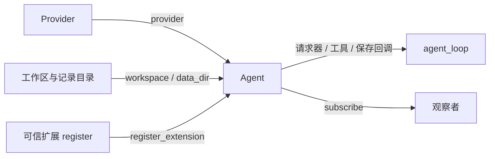

# SDK 与运行结构

外部产品依赖正式包，不导入 `tutorials`。第一版是同步单任务 SDK，不承诺并发输入、统一取消或崩溃后的任意断点续跑。组装过程见 [s16 教程](../tutorials/s16_agent_sdk/README.md)，完整离线调用见 [sdk_basic.py](../examples/sdk_basic.py)。

```python
from pathlib import Path
from pi_code_agent import ModelConfig, RunConfig, create_agent
from pi_code_agent.models import create_model_provider
from pi_code_agent.extensions.todo import register

model_config = ModelConfig(model="your-model", api_key=application_key)
run_config = RunConfig(max_rounds=4, max_tokens=2000)
provider = create_model_provider(config=model_config)
agent = create_agent(
    provider=provider,
    workspace=Path("D:/dev/my-app"),
    data_dir=Path("D:/dev/agent-records"),
    mode="read-only",
    timeout_seconds=model_config.timeout_seconds,
    max_rounds=run_config.max_rounds,
    max_tokens=run_config.max_tokens,
)
agent.register_extension(register)
try:
    messages = agent.run("添加待办：检查入口函数")
finally:
    agent.close()
```

示例中的 `application_key` 由应用提供。SDK 不自动读取 `.env`；`create_model_provider(config=...)` 显式消费模型、认证、地址、超时和重试配置，也可由调用方自建 Provider。`RunConfig` 供入口逐项展开，不是第二套 Agent 工厂接口。配置来源与校验见 [s17](../tutorials/s17_configuration/README.md)。

环境配置可使用 `config` 模块的 `load_environment(明确路径, environ=映射)`、`model_config_from_env()` 和 `run_config_from_env()`，不修改进程环境。旧模型工厂的 `timeout_seconds=... / max_retries=...` 调用方式保留，读取进程环境并经过同样校验，不能与 `config=` 混用。旧 `runtime` 导出保持可用。

`create_agent` 显式列出与 `Agent` 相同的关键字参数，构造时打开会话但不调用模型。传入 `compaction_policy=CompactionPolicy(实际窗口)` 才启用自动压缩；CLI 按必填环境配置启用。SDK 摘要额度默认 4096，CLI 默认预留额度的 80%；本阶段保留现有规则。

`run(prompt)` 返回包含此前有效历史的本次模型上下文，压缩后不等于完整 JSONL 日志；失败向调用方抛出。`subscribe(listener)` 返回 `None`，尚无取消订阅句柄。`close()` 只关闭空闲实例的使用入口，不终止正在运行的任务；外部 Provider 客户端和执行后端由创建者关闭。

`Agent.timeout_seconds` 用于请求事件展示，真实请求超时与 Provider 重试由外部客户端配置。SDK 不修改传入的客户端，不承诺统一任务截止时间。

## 交互命令与扩展效果（s18）

`agent.execute_command("/help")` 返回 `CommandResult(is_error=False, error=None)`。handler 的接口是 `handler(args, ctx) -> None`，通过效果 API 输出。内置 `/help`、`/stats` 和 Todo 扩展 `/todos` 默认只通知用户，审计日志不自动成为模型上下文。

| 接口 | 保存与模型行为 |
|---|---|
| `ctx.ui.notify(text, level="info")` | 发送界面事件，不写模型消息 |
| `api.append_entry(custom_type, data)` | 保存扩展 JSON 状态，不进入模型上下文 |
| `api.send_message(content, custom_type="extension", display=True, details=None, trigger_turn=False)` | 保存模型可见文本；details 不发送模型，display 只控制展示 |
| `api.send_user_message(content)` | 保存真正的用户任务并请求模型回合 |

后三项也可通过 Agent 同名方法在空闲时调用。命令内的触发意图在 handler 和审计结束后兑现，进入同一个核心循环；多个触发意图合并为一次回合。普通 handler 失败不兑现回合，但已保存效果不回滚。消息占用后续 Token，通知和私有状态不占模型上下文。

消息经同一投影、估算和压缩；Todo 恢复仍使用工具 details。存储失败停止入口，只有命令开始时表示完成情况未知，不自动重放。模型回合失败抛出，与已完成的命令处理状态分开。

CLI 根据斜杠选择命令，SDK run 不自动解释命令。命令区分大小写，拒绝重名，args 由 handler 自行解析。扩展访问基础工具仍通过 `api.call_tool()`；命令回调本身是可信宿主代码，不自动经过工具 Hook。

正文目前支持文本；忙时消息队列、完整 TUI 与多模态后续按章节落实。当前拒绝运行期间投递，不暴露无作用的 deliver_as 选项。完整教学、来源及差异见 [s18](../tutorials/s18_commands/README.md)。

## 扩展启动参数与初始化（s19）

扩展通过 `api.register_flag(name, type="boolean" 或 "string", description="说明", default=...)` 声明参数，通过 `api.get_flag(name)` 读取最终值。Agent/create_agent 增加 `extensions=`（预加载的未绑定 ExtensionAPI）和 `flag_values=`（SDK 显式映射）。默认构造仍可先创建 Agent，再 register_extension；首次任务前会校验全部参数。

CLI 先定位模块、加载声明一次、加入 argparse 并完整解析，然后才读取配置和创建 Provider/Session。帮助包含扩展选项；未知、缺失值和名称冲突提前失败。声明阶段禁止读取会话、执行基础工具或发送消息，绑定后的 session_start 才进行状态恢复和读取最终配置。

`agent.initialize_extensions()` 校验并固定参数、发送一次 session_start，不请求模型。CLI 显式调用；SDK 的首次 run、execute_command 或主动模型消息会自动调用。初始化异常或中断关闭实例；初始化回调可恢复状态并选择状态/消息效果；显式请求的回合在全部观察者完成后执行，回调中禁止重入 run。已绑定容器不能交给第二个 Agent。

Todo 实际消费 `todo-heading`（字符串，默认“任务”）与 `todo-progress`（布尔，默认 True）。CLI 使用 `--todo-heading 学习清单 --no-todo-progress`；SDK 在构造时传 `flag_values={"todo-heading": "学习清单", "todo-progress": False}`，再注册 Todo 扩展。修改展示不改变 Todo 状态、模型工具正文或基础权限。

声明期间读到的只是默认值或先前显式值，CLI 覆盖在加载结束后应用，扩展应在运行回调中读取。未知 SDK 名称在初始化前拒绝；注入预加载容器时可在创建会话前验证。参数固定后不支持新增声明或修改值；热重载在后续生命周期章节落实。完整接线和差异见 [s19](../tutorials/s19_extension_flags/README.md)。

## 存储与组件

`data_dir` 省略时使用 `workspace/.pi-code-agent`；CLI 显式传入启动目录下的 `.pi-code-agent`。恢复会话必须使用相同工作区和记录目录，并重新注册扩展及观察者。

| 模块 | 职责与来源 |
|---|---|
| `agent`、`loop` | s16 SDK 组装与明确参数；保留 s15 状态保存及拆分前已有失败状态保护 |
| `config` | s17 显式模型与运行配置、环境快照及校验 |
| `models` | s10 Provider 协议与响应归一化；s17 显式配置及旧调用适配 |
| `session`、`observable_session` | s11/s15 有效历史、用量、扩展状态 |
| `compaction_base`、`requests` | s07/s11 压缩计划、摘要、预算和模型请求 |
| `events` | s11 事件分发、终端、Trace 和统计 |
| `registry`、`hooks`、`result` | s04/s14/s15 能力注册、拦截、正文与 details |
| `commands`、`command_entry`、`extension_entries` | s18 命令上下文、效果接口、审计、扩展状态与模型消息 |
| `flags`、`registry` | s19 扩展参数声明、CLI/SDK 取值与一次运行时绑定 |
| `local_tools`、`sandbox_*` | 工作区实例与 A/B/C 执行后端 |



运行流程：保存用户消息 → 会话投影 → 按需压缩 → 请求模型 → 工具经 Hook/权限执行 → 保存正文与状态 → 发送结果事件 → 继续或结束。

本地默认只读；default 的 shell/写入逐次确认，不是 OS 沙箱。自定义后端必须同时提供 `tools`、`dispatch`、`permission_hook`。可信扩展在宿主执行；注册 API 本身不提供隔离。

外部产品也可使用公开 `runtime` 组件显式组装，再调用公开 `agent_loop`，适合独立修复编排，不需要复制循环。

基础循环可直接使用 `agent_loop(messages, create_message=..., dispatch=..., system=..., tools=...)`；未提供 Hooks 或事件出口时使用空组件。`tools=[]` 明确禁用工具。模型失败停止，未知或截断调用回传工具错误。工作区实例可由 `LocalTools` 提供；基础用法见 s01，后续 SDK 章节不再重复包装已有功能。
