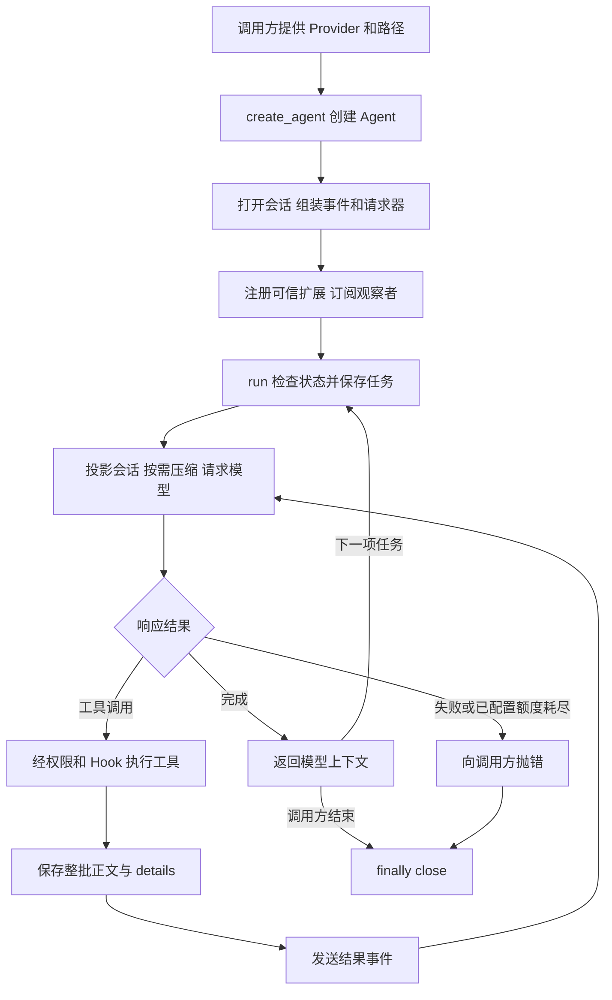
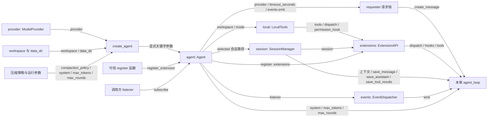

# s16：从教程到同步 Agent SDK

s15 已经能组装模型、工具、会话、事件和 Todo 扩展，但这些步骤主要写在 `main()` 中。另一个 Python 程序要复用它时，需要自己理解并重复这些接线。

s16 只引入一个核心机制：**用一个 Agent 实例管理一份会话的组装与运行**。终端和外部程序分别提供输入，使用同样的运行接口。核心循环、Hook、压缩算法和 Todo 状态格式继续沿用。

本项目的 s16 从 SDK 开始，原 zero2pi 的 s16 仓库检索已拆到业务项目，不属于本章。

## 从 s15 到 s16，代码搬到了哪里

| s15 的职责 | s16 的位置 | 为什么这样安排 |
|---|---|---|
| `main()` 选择基础工具、会话、事件和请求器 | `Agent.__init__()` | 每个实例有自己的工作区、会话和观察链 |
| 追加用户消息、构建上下文、调用循环 | `Agent.run(prompt)` | 程序调用无需依赖终端 `input()` |
| 注册可信扩展 | `Agent.register_extension(register)` | 调用方显式选择能力；注册时能恢复会话中的状态 |
| 终端、Trace、统计观察 | 内置观察者及 `Agent.subscribe(listener)` | 终端展示可由调用方替换，Trace 和统计继续保留 |
| 模型环境、技能目录、提示词及启动参数 | 调用方；本章是 `main()` | SDK 不替应用读取 `.env` 或扫描资源 |
| 完整 `agent_loop()` | 本章 `code.py` 中继续展开 | 组装边界改变，模型与工具的运行顺序仍就地可读 |

新增的工作区绑定使用正式包已有的 `LocalTools`，不再依赖教程早期的模块级 CWD。`data_dir` 下的记录按工作区 ID 隔离；这不构成进程或 OS 隔离。

## Harness、SDK 和 CLI 的关系

- **Harness**：实际运行机制，包括循环、工具分发、权限、会话、请求器和事件。
- **SDK**：Python 程序使用这些机制的入口，本章是 `create_agent()` 和 `Agent` 的四个方法。
- **CLI**：解析启动选项、读取输入并显示输出。本章 `main()` 只是 SDK 的一个调用方。

它们属于同一个产品，不需要再建一个 SDK 项目。源码和教程的对应关系是：

| 教学快照 | 正式实现 |
|---|---|
| `code.py` 中的 `Agent`、`create_agent` | `src/pi_code_agent/agent.py` |
| `code.py` 中的完整 `agent_loop` | `src/pi_code_agent/loop.py` |
| 本章 `main()` | 正式终端入口是 `src/pi_code_agent/cli.py` |
| 复用的工作区工具 | `src/pi_code_agent/local_tools.py` |
| 外部程序示例 | `examples/sdk_basic.py`，只导入正式包 |

教学快照用于观察演进；正式包不导入 `tutorials`。本章与正式 SDK 共用离线契约测试，但正式产品只使用正式包的循环。

建议阅读顺序：先对照 s15 的 `main()`，再读本章 `Agent.__init__()` → `run()` → `create_agent()` → `main()`，最后沿 `run()` 回看完整循环与外部示例。

## SDK 的输入与输出

```python
from pathlib import Path
from pi_code_agent import create_agent

# provider 由调用方提前创建；可以是真实模型适配器，也可以是离线实现。
agent = create_agent(
    provider=provider,
    workspace=Path("D:/dev/my-app"),  # 已有项目目录
    data_dir=Path("D:/dev/agent-records"),
    mode="read-only",
)
try:
    agent.subscribe(listener)  # listener(event) 由应用提供
    messages = agent.run("读取项目入口并解释作用")
finally:
    agent.close()
```

上面是接线片段；无需补齐变量即可运行的完整离线程序见后面的 `examples/sdk_basic.py`。

| 接口 | 输入 | 输出与边界 |
|---|---|---|
| `create_agent(...)` | Provider、已有工作区、可选记录目录和运行参数 | 返回 Agent；会打开或新建会话，尚不请求模型 |
| `register_extension(register)` | 可信的 `register(api)` 函数 | 空闲时注册工具、Hook 和观察者；可恢复 details |
| `subscribe(listener)` | 接收 `AgentEvent` 的函数或可调用对象 | 返回 `None`；观察者失败会停止本次运行 |
| `run(prompt)` | 非空任务文字 | 返回包含此前有效历史的本次模型上下文；失败抛出异常 |
| `close()` | 无 | 关闭空闲实例，之后不能继续 `run()`；运行中调用会报错 |

`run()` 返回值可能已经过上下文压缩，不能当作完整会话日志。`agent.session` 保存原始记录和压缩记录，`agent.session.session_stats()` 从持久化事实重算会话统计。恢复会话时仍需用相同的工作区、记录目录，并重新注册扩展和观察者。

主要构造选项：

| 参数 | 本章规则 |
|---|---|
| `workspace` | 必须是已有目录，不能是磁盘根目录；SDK 不修改进程 CWD |
| `data_dir` | SDK 省略时使用 `workspace/.pi-code-agent`；本章终端显式使用启动目录下 `.pi-code-agent/tutorials/s16` |
| `session_path` | 恢复同一 `data_dir`、同一工作区下的已有会话；省略则新建 |
| `mode` | 本地工具默认 `read-only`；`default` 的宿主写入和 shell 逐次确认 |
| `tools / dispatch / permission_hook` | 自定义后端必须一起提供；显式 `tools=[]` 不会回退默认工具 |
| `system / max_tokens / max_rounds` | 系统说明、单次回答输出额度、回答请求轮数上限；`max_rounds=None` 表示不限轮数 |
| `compaction_policy / summary_max_tokens` | 显式传策略才启用 SDK 自动压缩；摘要额度默认 4096 |
| `timeout_seconds` | Agent 中用于请求事件展示；真实 HTTP 超时由 Provider 客户端配置，SDK 不修改外部客户端 |

与 s15 相比，SDK 会将模型 `error/aborted` 作为运行失败抛给调用方，沿用正式包已有保护。失败回答及已知用量仍保存，失败正文不进入下一次有效上下文；不会执行其中的工具调用。这没有增加自动取消或重试。

## 运行流程



`run()` 的 `finally` 释放同步运行标记；调用方的 `finally` 执行 `close()`。外部 Provider 客户端和执行后端由创建者管理，`close()` 不终止正在执行的模型请求，也不提供取消订阅。

## 组装结构

箭头统一表示左侧向右侧提供依赖或数据，线上的名称对应真实参数或注册方法，不表示执行顺序。只展开本章 Agent 组装边界及其直接关联对象。



未传自定义后端时才创建 `local`；同时传入三项后端依赖时，`chosen_tools / chosen_dispatch / chosen_permission` 来自调用方。所有执行仍进入同一 `ExtensionAPI` 和循环。

## 先运行离线外部程序

在项目根目录，使用已安装本项目及既有依赖的 Python 环境。本章没有新增依赖；环境尚未准备时，按根 README 手动准备。

```powershell
python examples/sdk_basic.py
```

程序在临时目录创建 `note.txt` 和记录目录，直接导入正式 `create_agent`，运行一次 `read_file`，展示真实工具正文、四条上下文消息及事件，再关闭并清理临时文件。固定脚本 Provider 只演示接线，不调用模型 API，也不伪造 Token 用量。

四条消息分别是：用户任务 → assistant 工具调用 → user 工具结果 → assistant 最终回答。

## 再运行本章终端入口

以下入口调用真实模型，需要已有 `.env` 配置和实际 `MODEL_CONTEXT_WINDOW_TOKENS`。模型请求可能产生费用，本章未自动执行这些命令。

```powershell
# 帮助不读取模型配置、不创建会话
python -m tutorials.s16_agent_sdk.code --help
# 默认只读，默认注册正式包内的 Todo 扩展
python -m tutorials.s16_agent_sdk.code --workspace .
# 恢复时使用相同工作区和记录目录，替换为启动时显示的路径
python -m tutorials.s16_agent_sdk.code --workspace . --session "<实际会话路径>"
# 显式模块名替换默认 Todo；只加载你信任的 Python 模块
python -m tutorials.s16_agent_sdk.code --extension pi_code_agent.extensions.read_preview
```

可先输入“添加待办：理解 SDK 的组装过程”，完成后输入 `q`，再恢复同一会话查询清单。只读模式限制基础文件工具，Todo 状态仍随会话保存；可信扩展在宿主运行。

本章 `main()` 依次排列：Provider 与路径 → 显式技能目录、提示词和压缩策略 → Agent 组装与扩展注册 → 终端交互。技能仅扫描 `workspace/skills`，正文仍经已有 `read_file` 读取。SDK 不隐式扫描；多来源资源规则留到后续章节，编号待定。

配置仍沿用 s15 的环境读取方式，终端传入已有压缩策略和轮数限制；正式 CLI 的统一配置与参数接线将在 s17 完成。本章不新建设置管理器，也不添加命令注册或扩展参数协议。

## 离线验证

`tests/test_s16_agent_sdk.py` 对教学工厂和正式工厂运行相同契约，验证重复任务、状态保存先于事件、重建恢复、工作区隔离、失败传播、轮数耗尽、重入保护、自定义后端及显式空工具目录。另测真实 `main()` 接线、帮助早退出、本章独立循环和外部程序。

```powershell
# 必须是本轮全新专用目录；--basetemp 会清空目标，不能填写已有目录
$testTemp = Join-Path ([System.IO.Path]::GetTempPath()) ("p16-" + [guid]::NewGuid().ToString("N").Substring(0, 8))
if (Test-Path -LiteralPath $testTemp) { throw "测试临时目录已存在" }
python -m pytest tests/test_s16_agent_sdk.py tests/test_sdk.py tests/test_package_boundary.py --basetemp $testTemp -p no:cacheprovider
python -m ruff check --no-cache src/pi_code_agent/agent.py tutorials/s16_agent_sdk examples/sdk_basic.py tests/test_s16_agent_sdk.py
```

自动化测试只写临时项目，不修改示例原件或调用真实 API/Docker。离线脚本验证 SDK 运行链，不证明模型任务完成率、服务实际超时或沙箱隔离。

## 参考与差异

- **lcc**：完整可读的循环解决“看不清 Agent 实际如何运行”的学习问题。本章保留完整循环和显式 `main()`，再把会话组装收进实例，解决外部程序复用问题；s16 的独立循环与双工厂测试验证这个边界。
- **本地 Pi 的 `createAgentSession`**：注入模型、会话及运行依赖，解决多入口复用。这里保留显式依赖，先使用同步单会话 `Agent`，不引入其完整资源、设置和交互层；s17 实现配置收口，资源加载与更完整生命周期章节编号待定。
- **Pi 的事件订阅与扩展**：运行事实经观察者交给界面，能力经注册入口接入。本章复用 s08–s15 的事件、Hook 和状态保存，SDK 不依赖终端；s18 增加用户命令注册，s19 增加扩展参数注册，取消订阅与运行取消章节编号待定。

下一章 s17 只处理现有配置的来源、优先级、校验和实际接线；命令、资源、会话树和子 Agent 按教学进度逐章实现。
