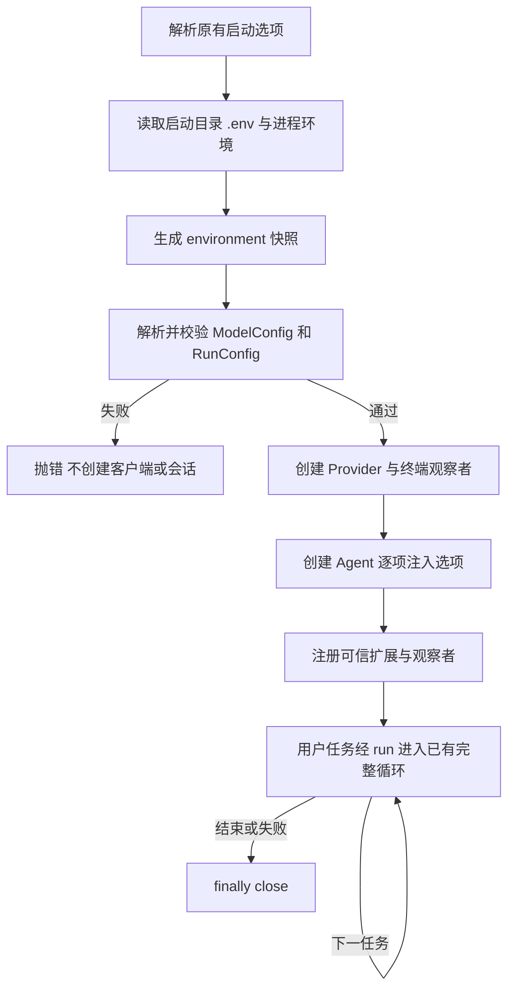
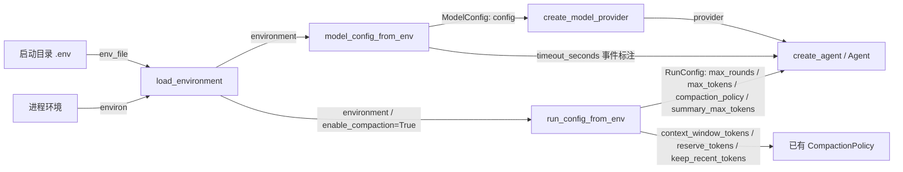

# s17：统一配置与 SDK 参数接线

s16 把运行机制组装成了 `Agent`。这一章解决紧接着的问题：**怎样保证配置有明确来源、经过校验，并真正到达运行组件？**

旧 CLI 在 `.env.example` 中声明了 `AGENT_MAX_ROUNDS`，却没有把它传给 Agent；模型工厂还直接读取进程环境，应用难以分别创建不同配置的实例。s17 引入一个配置边界，完整核心循环继续沿用。

## 本章计划与实现

1. `ModelConfig` 保存模型请求参数，`RunConfig` 保存运行与压缩选项。
2. 读取明确的 `.env` 路径，与进程环境合并成快照，不修改全局环境。
3. 在客户端与会话创建前校验配置，逐项接到现有 Provider 和 Agent。
4. SDK 支持显式模型配置，保留旧环境调用方式和运行组件导出。

新组件位于 `src/pi_code_agent/config.py`，教学与产品共用。本章 `code.py` 保留完整循环和 Agent，正式包不导入教程。建议阅读顺序：配置值对象 → 环境快照 → 两个解析函数 → `main()` → 模型工厂 → Agent 的构造校验。

| s16 | s17 |
|---|---|
| `main()` 中分散的 `getenv` 和转换 | `model_config_from_env()`、`run_config_from_env()` 返回校验后的值 |
| `load_dotenv()` 写入进程环境 | `load_environment()` 返回新的字典 |
| 模型工厂只接受环境配置 | `create_model_provider(config=...)` 显式消费 ModelConfig |
| 部分额度直到进入循环才检查 | Agent 构造时校验，错误时不创建会话 |
| CLI 未传回答轮数上限 | `run_config.max_rounds` 接到 Agent 和已有循环 |
| CLI 固定回答输出额度 | 增加 `MODEL_MAX_TOKENS`，仍默认 8000 |

## 配置从哪里来

CLI 和本章入口只读取**启动目录下的 `.env`**。`--workspace` 指向的项目不会成为宿主模型配置来源，也不会向父目录自动查找文件。

```text
启动目录 .env + 进程环境 → environment 快照 → 两组配置 → 运行组件
                  同名字段：进程环境优先
SDK 的 ModelConfig → create_model_provider：直接使用显式值
```

- 文件可省略；存在却无法读取时直接报错。
- 同一来源内，`MODEL_API_KEY / MODEL_BASE_URL` 优先于 `OPENAI_API_KEY / OPENAI_BASE_URL`；空的主名称可回退同层别名。
- 各来源先归一别名再合并，进程的 `OPENAI_API_KEY` 因而能覆盖文件的 `MODEL_API_KEY`。
- 进程显式空值也覆盖文件。必填字段为空时报错，可选地址为空表示使用默认地址。
- `.env` 使用 UTF-8（可带 BOM），不执行 `${VAR}` 插值，请填写最终值。输入映射和 `os.environ` 都不被修改。

## 参数清单

| 环境字段 | 配置字段 | 默认与校验 |
|---|---|---|
| `MODEL_PROVIDER` | `ModelConfig.provider` | `anthropic` 或 `openai-compatible` |
| `MODEL_ID` | `model` | 必填非空字符串 |
| `ANTHROPIC_API_KEY` | `api_key` | Anthropic 认证；也支持原客户端的 `ANTHROPIC_AUTH_TOKEN` |
| `MODEL_API_KEY`、`OPENAI_API_KEY` | `api_key` | OpenAI 兼容接口必填 |
| `ANTHROPIC_BASE_URL` 或 `MODEL_BASE_URL`、`OPENAI_BASE_URL` | `base_url` | 可选 HTTP(S) 地址，不在地址中放用户凭证 |
| `MODEL_TIMEOUT_SECONDS` | `timeout_seconds` | 60 秒，有限正数 |
| `MODEL_MAX_RETRIES` | `max_retries` | 0，非负整数；属于 Provider 请求重试 |
| `AGENT_MAX_ROUNDS` | `RunConfig.max_rounds` | 0 转为 `None`，正整数限制回答请求 |
| `MODEL_MAX_TOKENS` | `max_tokens` | 8000，正整数，单次回答输出额度 |
| `MODEL_CONTEXT_WINDOW_TOKENS` | `compaction_policy.context_window_tokens` | 启用压缩时必填实际窗口 |
| `SESSION_COMPACTION_RESERVE_TOKENS` | `compaction_policy.reserve_tokens` | 16384 |
| `SESSION_COMPACTION_KEEP_RECENT_TOKENS` | `compaction_policy.keep_recent_tokens` | 20000，须小于压缩触发点 |
| `SESSION_COMPACTION_SUMMARY_MAX_TOKENS` | `summary_max_tokens` | 环境入口启用压缩时默认预留额度的 80% |

两个配置对象不可变，凭证字段不参与 `repr`；校验错误报告字段和约束，不回显原值。Anthropic 环境同时有 API Key 与 Auth Token 时优先使用 API Key，显式 ModelConfig 只允许二选一。

工厂会把所选认证和确定的默认地址传给客户端，避免这些字段再次从环境补值。第三方 SDK 的代理、额外请求头等高级设置仍由第三方管理；高级认证也可由应用自建 Provider。

## SDK 显式接线

下面是接线片段，`application_key` 和已有目标目录由宿主应用提供。构造客户端不请求模型，`run()` 才会请求：

```python
from pathlib import Path
from pi_code_agent import ModelConfig, RunConfig, create_agent
from pi_code_agent.models import create_model_provider

model_config = ModelConfig(
    provider="openai-compatible",
    model="your-model",
    api_key=application_key,
    base_url="https://your-service.example/v1",
    timeout_seconds=60,
    max_retries=0,
)
run_config = RunConfig(max_rounds=4, max_tokens=2000)
provider = create_model_provider(config=model_config)
agent = create_agent(
    provider=provider,
    workspace=Path("D:/dev/my-app"),
    data_dir=Path("D:/dev/agent-records"),
    timeout_seconds=model_config.timeout_seconds,
    max_rounds=run_config.max_rounds,
    max_tokens=run_config.max_tokens,
)
try:
    messages = agent.run("只读解释项目入口")
finally:
    agent.close()
    provider.client.close()  # 本例内置 Provider 的客户端由创建者关闭
```

应用也可把自己加载的字典传给两个 `*_config_from_env()` 函数。`run_config_from_env()` 默认不启用压缩、不要求窗口；`enable_compaction=True` 才解析窗口和摘要选项。直接构造 `RunConfig(compaction_policy=...)` 的摘要额度仍默认 4096，保留 s16 SDK 语义。

注入自定义 Provider 时不必创建 ModelConfig。直接给 Agent 传运行参数也会校验，不要求应用先创建 RunConfig。SDK 不自动读取 `.env`。

旧调用 `create_model_provider(timeout_seconds=60, max_retries=0)` 继续从进程环境生成配置，旧参数覆盖对应环境值；不能与 `config=` 混用。旧 `runtime` 导出继续可用，内置工厂的认证范围以本章表格为准。

## 实际保障边界

- `max_rounds` 只统计回答请求，摘要不计入。超限时保存已完成的工具结果后抛错，不补造最终回答。
- `max_tokens` 是服务请求的单次输出参数，不是任务累计消费预算。
- HTTP 超时由 ModelConfig 创建客户端时设置。Agent 的同名选项仍用于事件标注，外部 Provider 的超时由其创建者负责。
- Provider 重试次数不等于 Harness 分类恢复。本章不重放工具、不增加取消或上下文超限恢复。

## 运行流程



## 组装结构

箭头统一表示左侧向右侧提供依赖或数据，名称对应真实参数；不表示运行先后。



## 运行与验证

使用已安装本项目及既有依赖的 Python 环境，本章不增加依赖。按根目录 `.env.example` 配置启动目录，不改写目标项目的 `.env`。

```powershell
python -m tutorials.s17_configuration.code --help
# 填好模型配置后再运行以下真实模型入口，输入 q 退出
python -m tutorials.s17_configuration.code --workspace .
python -m pi_code_agent --workspace .
# 上一章的离线示例继续可用
python examples/sdk_basic.py
```

可设置 `AGENT_MAX_ROUNDS=1` 执行需要工具的任务，观察首轮工具结果保存后的超限错误。模型是否选择工具由服务决定；离线测试用确定响应验证运行保障。

```powershell
# 必须是全新短路径；--basetemp 会清空目标，不能指向已有目录
$testTemp = Join-Path ([System.IO.Path]::GetTempPath()) ("p17-" + [guid]::NewGuid().ToString("N").Substring(0, 8))
if (Test-Path -LiteralPath $testTemp) { throw "测试目录已存在" }
python -m pytest tests/test_s17_configuration.py tests/test_sdk.py tests/test_s16_agent_sdk.py tests/test_package_boundary.py --basetemp $testTemp -p no:cacheprovider
python -m ruff check --no-cache src tests tutorials examples
```

测试覆盖来源与别名优先级、空值、脱敏、SDK 早校验、旧工厂调用、CLI/教程跨工作区启动、实际限轮和输出额度。认证、地址、超时经过已安装模型 SDK 的真实请求转换验证，HTTP 传输使用内存替身，不访问网络或真实模型。

联调另修复了 s16 技能扫描的 CWD 耦合：`SkillCatalog.scan(..., workspace=workspace)` 接受已选项目，默认调用仍以 CWD 为边界。只修复路径绑定，不引入多来源加载，见 `docs/bug-log.md` 的 B038。

## 参考与差异

- **Pi 的 SettingsManager 与 SDK 注入**解决多个入口共享配置与应用覆盖默认值的问题。本章保留显式值对象，暂不加入设置持久化和热重载；当前机制在 s17 验证，更多配置管理需求编号待定。
- **lcc 的环境入口**让早期例子容易启动。本章保留 `.env` 格式，改为固定来源和无副作用快照以适配 SDK；来源、别名和环境不被修改的测试在 s17 验证。
- **Pi 的运行时保护**区分 Provider 请求选项与 Agent 行为。本章接好已有额度；任务取消、总预算、分类恢复分别留到后续教学，编号待定，不把请求重试写成整个 Harness 已具备可靠恢复。

下一章 s18 实现最小命令注册表，先接 `/help`、`/stats` 与扩展命令；s19 再处理扩展启动参数。本章不提前加入这些注册接口。
