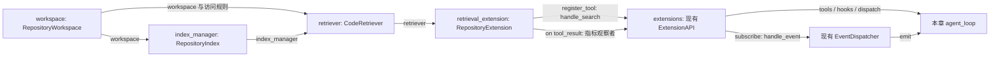
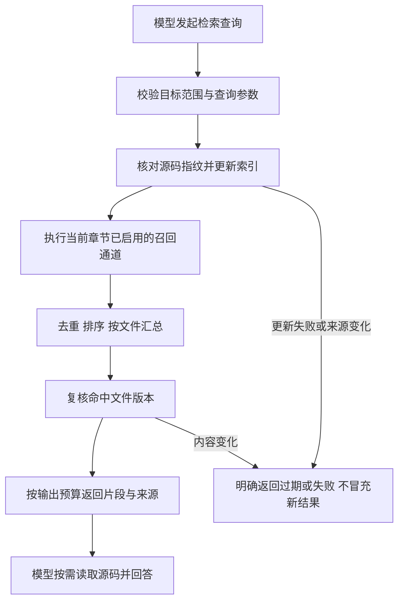

# 代码仓库理解与检索：第二阶段总体设计

版本：v0.2；更新：2026-10-14；状态：s16 已实现 Python 编排与离线回归，真实 Zoekt 验证待手动准备镜像；s17–s19 尚未开发。

本阶段围绕一个问题：收到代码维护任务后，如何用更少的无效浏览，找到有源码证据的相关文件和函数。先确定数据、检索、更新和评测边界，再开发 s16–s19；s16 组件已落地，其余能力仍为规划，不提前添加空类、未使用方法或新依赖。

## 目标与范围

第一版面向单个本地仓库，支持 UTF-8 文本定位；结构分析先支持 Python。Agent 只读定位，不自动修改代码、执行仓库脚本或安装项目依赖。

验收场景：根据错误信息定位实现与测试；根据自然语言需求召回候选代码；从已知函数补充定义及可靠解析的关联代码。每个结果必须包含路径、行号、源码版本与命中依据。

多仓库服务、完整多语言调用图、自动修复、外部 Issue/Comment 接入和多 Agent 协作不在本阶段实现。Git 任务上下文、修改/测试闭环分别保留为 s20、s21 的规划；正式定位评测汇总保留为 s22，但样本和基线从 s16 就建立。

成功标准不是“加了向量库”，而是定位质量、模型工具调用和上下文成本相对基线的变化；没有实测前，不写性能提升结论。

## 参考来源与取舍

| 参考 | 本次核对的入口 | 借鉴与取舍 | 验证章节 |
| --- | --- | --- | --- |
| Sourcebot / Zoekt | [zoektSearcher.ts](https://github.com/sourcebot-dev/sourcebot/blob/main/packages/web/src/features/search/zoektSearcher.ts)、[Zoekt 算法](https://github.com/sourcegraph/zoekt/blob/27517a30ae6df16c6e768623847fdab8f6a3bbcf/doc/design.md) | 复用位置 trigram 索引和搜索，保留范围、位置与完整性；Python 编排改用短容器，不引入整个 Web 平台 | s16 |
| Potpie 当前 Context Graph | [查询架构](https://github.com/potpie-ai/potpie/blob/main/docs/context-graph/querying.md)、[组件架构](https://github.com/potpie-ai/potpie/blob/main/docs/context-graph/architecture.md) | 返回带来源、可解释的排序证据，Agent 负责推理；保留检索与存储边界，不复制其完整知识和部署体系 | s18、s19 |
| Potpie 历史代码解析路径 | [官方发布记录](https://github.com/potpie-ai/potpie/releases)中的 1.0.2 | 作为结构解析与混合检索的专项走读对象，不把历史实现当成当前主线；具体源码与参数尚需在 s17/s18 开发前核对 | s17、s18 |
| Pi | 同级 `../pi/packages/coding-agent/examples/extensions/todo.ts` | 通过注册 API 接入工具和观察者，正文与结构化 details 分工；索引不作为 Todo 那样的会话状态恢复 | s16 起 |
| lcc | 同级 `../learn-claude-code/s02_tool_use/code.py` | 稳定循环、显式工具分发和渐进章节；不直接复制其代码，也不把多路检索塞进循环 | s16 起 |

Sourcebot 的上述搜索路径通过 Zoekt 提供索引搜索，不能将其直接描述为向量 RAG。Potpie 当前查询文档强调排序证据，其 Context Graph 范围也不等同于早期代码关系图；两条来源分开使用。

参考版本记录：Pi 本地 HEAD 为 `e4c75a73222ae2c72abb5f5314fa35ee8effc508`；lcc 本地 HEAD 为 `0dcafa2ae053a1ddd6a72f265431104b08a5aa13`。s16 固定 Zoekt 提交 `27517a30ae6df16c6e768623847fdab8f6a3bbcf`，走读目录索引器、查询类型、SearchOptions 和索引构建选项；镜像标签与实际镜像 ID 参与版本检查。Sourcebot/Potpie 的在线材料仍需在对应章节补充固定版本，不能把主线变化或文档中的未实现能力当成已验证实现。研究设计，不复制上游大段源码；镜像保留 Zoekt LICENSE，其他依赖在采用时核对。

## 数据与证据

源码是事实，索引是可重建缓存，LLM 生成的解释只是辅助信息。按章节逐步增加实际使用的数据：

| 数据 | 最少信息 | 首次使用 |
| --- | --- | --- |
| 文件记录 | 仓库身份、相对路径、内容指纹、字节数、索引代次 | s16 |
| 代码片段 | 文件、起止行、该文件内容指纹、片段 ID | s16；s17 改为优先按符号边界组织 |
| 符号 | 模块、限定名称、种类、定义位置、内容版本 | s17 |
| 语义向量 | 片段 ID、模型/版本、维度、输入表示版本 | s18 |
| 关系 | 起点、终点、关系类型、证据位置、源码版本、解析状态 | s19 |

片段 ID 包含源码版本，不能用旧 ID 读取新行号。符号可用“模块路径＋限定名称”定位，但必须附版本；重命名先按删除与新增处理，不提前加入复杂身份追踪。

同一段代码被不同通道命中时合并证据，保留各通道的排名与命中依据，不重复占用模型上下文。跨文件不能只靠同名函数判定为同一符号。

检索正文示例仅说明形状，不是实际运行结果或已经实现的接口：

```json
{
  "status": "ok",
  "mode": "text",
  "index_generation": 3,
  "files": [
    {
      "path": "s15_stateful_extensions/session.py",
      "rank": 1,
      "hits": [
        {
          "start_line": 159,
          "end_line": 175,
          "content_hash": "示例指纹",
          "reason": "命中 latest_tool_details",
          "snippet": "示例：从完整日志反向查找工具快照"
        }
      ]
    }
  ],
  "truncated": false
}
```

实际行号和片段由当前文件生成，不能照抄此示例。`ok` 表示本次查询成功，不表示一定找到了正确修复位置。空结果、输出截断、文件跳过、索引过期和更新失败必须能区分，不能统一返回“没有匹配”。

## 组件职责与组装

只保留四个上层职责。s16 已使用以下组件；另外用 `ZoektBackend` 封装外部进程，不增加一套 Provider 注册体系：

| 组件 | 职责 | 不负责 |
| --- | --- | --- |
| `RepositoryWorkspace` | 目标根目录、源码访问规则、仓库身份和缓存位置 | 模型请求、排名、导入目标项目 Python |
| `RepositoryIndex` | 接收扫描快照，管理索引版本、复用和成功发布 | Agent 决策、权限确认、编写最终答案 |
| `CodeRetriever` | 查询、调用已实现通道、去重排序、按预算组织证据 | 修改源码、改变会话压缩算法 |
| `RepositoryExtension` | 将检索 handler 和指标观察者注册到现有 API | 另建核心循环、保存整份索引到会话 |

结构图的箭头统一表示左侧向右侧提供依赖或数据，标签标明参数或注册方式，不表示调用顺序。



main 按“workspace 与索引 → retriever → extension → 现有运行时 → 交互入口”显式组装。建议让已注入 retriever 的扩展组件执行 `register(api)`，内部调用现有 `api.register_tool()`；不修改模块加载器为隐式依赖注入器，也不通过全局变量传目标仓库。

s16 中，`workspace.scan()` 返回内存源码 `SourceSnapshot`，`index_manager.prepare()` 返回不含源码的索引信息 `PreparedIndex`。扩展入口叫 `handle_search()`，完整检索流程叫 `CodeRetriever.search()`，引擎查询叫 `ZoektBackend.search_index()`；三者职责不同，不共用一个含糊的 `search` 名称。

每章继续完整展开 agent_loop。s16 的真实组装见 [章节 README](../s16_repository_search/README.md#组装结构)，上图是阶段职责概览。到 s17/s18/s19 时，只增加该章真正使用的索引内容、检索能力与参数；不用在 s16 先写空的 SemanticRetriever、关系查询接口或 Provider 注册表。

## 检索流程与算法



不同通道的职责：

- 文本：标识符、路径与字面内容。精确名称优先用于确定性定位；s16 不承诺理解任意中文需求，由模型提取代码关键词。
- 符号：函数/类定义、所属模块和方法边界。优先使用 Python 标准库 AST；无法解析的文件仍可做文本检索，并明确缺少结构结果。
- 语义：把自然语言需求与代码片段匹配。先嵌入源码、路径、签名和已有文档字符串，不默认给所有代码调用 LLM 生成描述。
- 关系：从已知符号或文件有限扩展。先支持 import、继承和明确可解析的调用；动态分派、反射及无法绑定的调用标为 unresolved，不能作为已确认的依赖边。

初版只注册一个 `search_code` 工具，s16 参数是 `query` 字面文本、`scope` 相对目录、`limit` 文件上限；以后有实际能力时才添加语义模式、符号或关系查询。适配器构造 Zoekt Substring，不把模型参数当查询表达式、正则或 shell 执行。

s18 多路融合先采用按排名合并的 RRF 作为基线，避免直接相加 BM25 与向量相似度；保留原排名和通道来源。参数、路径/符号优先规则在开发集确定，不根据测试集调权重。RRF 是实验起点，不保证一定优于文本检索。[原始论文](https://cormack.uwaterloo.ca/cormacksigir09-rrf.pdf)

s19 关系扩展先限制一跳，设置邻居数量和总输出上限；返回起点、关系证据和关联代码，不能递归展开整个仓库。必要时是否增加第二跳，由消融结果决定。

文件排名与片段排名分别保留。同一文件占满所有前排片段时，要限制其配额；File Recall@10 按最终去重后的十个文件计算，不按十个片段计算。

## 存储、更新与访问边界

### 初始选型

s16 改为直接复用 Zoekt，SQLite FTS5 不再是主文本搜索方案。Zoekt 保存三字符出现位置，先筛选候选再验证文本；本项目的 Go 薄适配器只构造查询和返回排序位置，索引/匹配由上游执行。Python 使用同版快照核验位置、组织有界片段。短容器只挂载过滤源码与缓存，禁止联网和自动拉取镜像；固定镜像需由用户手动构建。

s16 使用 JSON manifest 与 Zoekt 分片，不增加数据库依赖。s17 按实际符号数据需要再决定存储，SQLite 可作为元数据/关系表选择，不等同于检索算法。s18 的 embedding 模型、调用方式和向量后端暂不锁定；参考 Potpie 的结构化切分和混合召回，先建立普通 embedding 基线，再决定是否比较 ColBERT。s19 可先用关系表表达有限图遍历，不要求部署 Neo4j。

聊天模型与 embedding 模型分别配置。远程 embedding 会额外发送代码，必须明确授权和记录成本；没有配置时语义能力不启用。模型下载、数据库服务和 API 调用不自动执行，选型与准备命令在对应章节给出。

### 源码版本与更新

初版采用同步更新，优先正确和可读，不引入后台队列、文件监控和分布式锁：

1. 启动绑定唯一目标目录，生成允许读取的文件清单及内容指纹。
2. 每次查询前核对允许文件的内容指纹，识别新增、修改、删除；时间戳只作辅助信息。
3. s16 首次或允许源码变化时整代重建 Zoekt 分片；未变化复用缓存。后续符号/向量章节再按实际能力缓存变化文件，不将 s16 描述为逐文件增量索引。
4. 一批更新成功才激活新索引代次。中途失败不把一半旧数据、一半新数据称为更新成功。
5. 返回片段前复核命中文件指纹；来源变化则有界重试或明确失败，不无限刷新。

缓存复用不代表不扫描源码：s16 查询前、返回前各核对一次允许文件内容，磁盘成本单列。后续逐文件更新、扫描优化或使用监控前，要保留同等正确性测试。文件系统不是原子快照，不承诺并发修改时整个仓库强一致；稳定评测使用冻结工作树。

文件删除时清除对应片段及关系；语义缓存按“片段内容＋embedding 模型/版本＋输入表示版本”区分。向量更新尚未完成时，不能将语义通道标为 ready；不混用不同维度或旧模型结果。

### 目录隔离与读取安全

索引保存于 Harness 的 `.indexes/s16/<workspace_id>/<generation>/`，不放进外部目标仓库或 Session。代次包含源码哈希、目标身份、适配器格式与实际镜像 ID；每代次有过滤源码副本、Zoekt 分片和 manifest，旧代次保留为可重建缓存。后续增加不同源码视图或解析/embedding 配置时再定义对应缓存身份。

复用 s13 的“路径规范化＋仓库身份”思路，不直接修改它限定 A/B/C 的 WorkspaceLayout。目标仓库、Harness、执行视图分别明确；新章的会话和 Trace 也必须按目标隔离，不能恢复另一个仓库的授权。

现有 s03 文件工具依赖全局 WORKDIR。s16 已将基础读取、路径权限与检索绑定到同一个 RepositoryWorkspace，不修改旧章全局变量。读取继续遵循行/字节预算，增加行号、内容哈希和 expected_hash 校验，避免沿用检索旧行号读取新源码。

索引服务自身强制检查工作区边界和排除规则，不因为“是只读扩展”就自动安全：拒绝路径越界、链接/硬链接别名；排除凭证、Git 内部数据、依赖、运行记录、索引和评测答案。Git ignore 与大小、数量和读取时限共同限定扫描范围；返回跳过数量与原因，但不泄露秘密正文。只解析文本/AST，不 import 或执行目标项目代码。

### 沙箱视图

第二阶段先交付本地只读定位，不自动把宿主扩展接进 s13 的沙箱。后续沙箱检索接入编号待定，作为 s21 自动修改闭环前的验收门槛：

- A：操作的是容器副本，索引必须来自同一副本/快照版本；不能使用宿主原仓库的旧索引假装对应副本修改。
- B/C：修改直接影响真实目录，索引要识别变更；扫描和源码读取也必须遵循同一执行后端的保护规则，不能用宿主扩展绕过 Worker。
- 现有 Extension 是可信宿主 Python，不具备 OS 隔离。未完成同源与访问边界验证前，不在沙箱入口暴露检索扩展；不宣称本地测试证明了容器或原生隔离。

## 与已有 Harness 的衔接

| 已有能力 | 本阶段如何使用 | 需要注意的真实边界 |
| --- | --- | --- |
| s14/s15 ExtensionAPI | 注册检索 handler，调用统一 dispatch | 新扩展可以持有显式注入的检索组件，不给循环增加业务分支 |
| s15 ToolResult | content 给模型证据；details 放少量检索统计 | details 会随会话落盘，不放完整索引、全部候选或 embedding 向量 |
| s03 权限与文件工具 | 复用权限职责、底层行窗口和路径检查思路 | 新章必须显式绑定目标；新增工具不在旧只读名称集合里，不能只追加名称就绕过服务检查 |
| s04 Hooks | 保留调用拦截入口 | 不用 Hook 做排名；写入后标记 dirty 只能是提示，不能替代查询前指纹核对 |
| s11 EventDispatcher | 复用 tool_result 观察检索统计 | 当前 Trace 投影会省略 details，不能假设检索指标自动存在于 Trace |
| s11 用量与会话 | 正常回答、摘要和失败仍走原统计与有效历史规则 | embedding 请求/索引成本另外记录，不能混成 assistant 的一次请求 |
| s07 压缩 | 复用既有上下文预算 | 巨型工具正文进入摘要区会裁剪，重要证据放在有界结果中，完整源码仍按需读取 |

检索观察者读取 tool_result 中的紧凑 details，写独立的实验指标记录；不用新增一套事件总线。保存 query_id、索引代次、模式、命中/返回数量、截断状态及耗时，不重复存整份源码或秘密查询。指标观察者失败沿用 B019 停止策略，不静默丢失评测数据。

先使用实际会调用的输出预算：按文件和片段限制数量，再限制总字节，并标明省略位置。具体默认值在 s16 小样本试验后固定；不能修改基础 read_file 预算来掩盖检索结果组织问题。

## 运行案例与章节安排

示例任务：“重新加载会话时，Todo 清单从哪里恢复？”这是教学案例，不是性能评测结论。

s16 用 `todo`、`latest_tool_details` 等关键词召回带行号的文件；s17 进一步定位 `register`、`restore_state` 和同名方法的所属类；s18 验证仅用自然语言是否更容易召回；s19 验证能否补充有证据的委托关系。Agent 根据返回位置补读源码，解释清单恢复路径，而不是遍历全部目录。

| 章节 | 一个主要机制 | 当章必须闭合的验证 |
| --- | --- | --- |
| s16：仓库系统 · 文本检索 | 同一目标范围内的索引文本定位 | 外部目标读取一致、指纹更新/删除、候选排序与预算、只读访问、无 LLM 组件测试与基础工具基线 |
| s17：仓库系统 · 符号索引 | Python AST 定义和符号边界 | 嵌套/同名/异步函数、行号、解析失败反馈、变化文件重建、文本＋符号消融 |
| s18：仓库系统 · 语义与混合检索 | 语义候选与多路排名融合 | 独立 embedding 配置、版本/维度与缓存、已知/未知成本、排名去重、语义故障与文本模式区别 |
| s19：仓库系统 · 关系扩展 | 有限、可核验的关联代码导航 | import/继承/可解析调用、unresolved、不跨版本、循环关系和邻居预算、关系消融 |

以上是功能拆分，不要求一次写完全部实现。若 s18 无法保持单章可读，先评审再拆子章，不把未来接口塞进 s16。每章 README 使用真实代码中的组件名、组装参数、流程图和结构图，说明参考解决的问题及本项目取舍。

## 评测与简历证据

### 两层评测

组件层直接调用检索器，不经过 LLM，验证召回、排名、索引更新和耗时；Agent 层比较同一 Harness 在同一任务上的定位表现，检索效果与模型行为分开解释。

对照组仅使用 glob、grep、read_file；实验组在相同只读基础上加入检索扩展。模型版本、提示词中非工具部分、任务文本、源码版本、过滤范围、上下文与输出预算、停止规则保持一致；工具定义变化作为实验因素记录。真实模型测试先约定调用次数与费用上限，不自动执行。

逐步比较：基础工具、文本、文本＋符号、加入语义、加入关系。每项都保留失败、超时和限轮任务，不能只统计完成样本；各阶段输出统一有序候选文件清单，评测器不从自由文本猜排名。

### 样本与标签

s16 先建立少量人工核验案例用于回归，逐章扩充；正式数据可从 SWE-bench Verified 的维护任务中抽取，但样本范围、许可、获取和固定版本在执行前确认。

固定每个任务的 base commit 与允许输入；gold 文件/函数和修复补丁只交给评测器，不能进入待索引仓库、模型工具范围、向量输入或案例提示词。补丁修改文件仅作为候选标签来源，需要人工核验，不冒充完整定位真值。开发集调参数，测试集保持冻结；按任务或仓库划分，避免同一问题的变体落在两边。

Recall 的 gold 必须是 base commit 中实际存在、可以检索的文件或符号。新建文件和标签未确定的任务单列，不能把不存在的文件当作漏召回，也不能把空 gold 当作满分任务。样本筛选规则在测量前固定并公开，不能按某种算法是否命中再挑样本。

### 指标定义

- File Recall@10：每个任务计算“前十个去重文件中命中的 gold 文件数 / gold 文件总数”，再对任务平均。它不是“找到任意一个文件的任务比例”；后者另记 Hit@10，全部目标文件命中率也另列。
- Symbol Recall@K、首个相关结果排名：有人工核验符号标签时才报告，不凭文件命中推算。
- 定位工具调用：从任务开始到输出候选清单的全部模型工具调用；辅助组件内部扫描量另计，不包装成一次工具就声称系统工作量下降。
- 定位 Token：已知正常回答与摘要用量；报告未知用量次数，不用字符估算假装真实 Token。
- 检索耗时与容量：冷启动建索引、增量更新、温查询分别测量；记录索引体积、扫描文件/字节和返回字节，必要时列 P50/P95。
- embedding 成本：初建、增量和查询分别记请求、已知 Token/费用及耗时，单列或明确摊销，不能隐藏在“降低 LLM Token”后面。

模型运行存在波动，按事先约定的重复次数报告均值、分布与配对差异；在测试前固定预算和统计口径。简历里“72%→88%、工具调用下降 30%、Token 下降 20%–25%”仅保留为目标，实测结果出来后再决定能否写入以及如何注明数据集和条件。

## 开发前验收门槛

- 确认本方案的单仓库/Python/只读范围，并补齐相关上游固定版本与走读记录。
- s16 首先验证“检索与 read_file 是同一个目标”，不能依赖修改旧章 WORKDIR。
- 固定首批任务、gold 隔离方式、Recall 定义和对照条件，然后才测试召回算法。
- s16 不加入语义、关系的空实现；s18 前确认 embedding 隐私、费用与版本策略。
- 无结果、能力未启用、索引过期、更新失败、输出截断分别可观察；不能用提示词承诺运行时保证。
- 索引可删除重建，恢复会话不恢复授权或强行复用旧索引；保护规则和源码版本每次重新校验。
- 沙箱检索同源验证与正式性能提升结论均未完成，不提前写进已实现能力。

下一步由用户手动准备镜像，执行 s16 的真实 Zoekt 小样本测试和运行案例，再评审 s17。普通离线回归使用后端/模型替身，不证明真实引擎或 Agent 的性能提升；正式数据和费用预算仍需单独确认。
