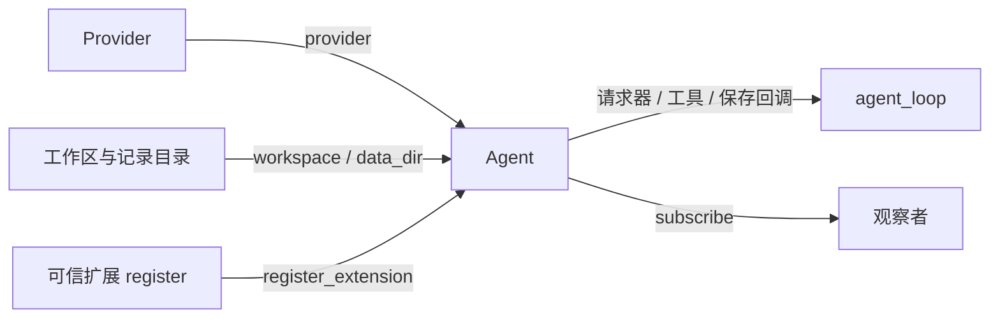

# SDK 与运行结构

外部产品依赖正式包，不导入 `tutorials`。第一版是同步单任务 SDK，不承诺并发输入、统一取消或崩溃后的任意断点续跑。组装过程见 [s16 教程](../tutorials/s16_agent_sdk/README.md)，完整离线调用见 [sdk_basic.py](../examples/sdk_basic.py)。

```python
from pathlib import Path
from pi_code_agent import ModelConfig, RunConfig, create_agent
from pi_code_agent.models import create_model_provider
from pi_code_agent.extensions.todo import register

model_config = ModelConfig(model="your-model", api_key=application_key)
run_config = RunConfig(max_rounds=4, max_tokens=2000)
provider = create_model_provider(config=model_config)
agent = create_agent(
    provider=provider,
    workspace=Path("D:/dev/my-app"),
    data_dir=Path("D:/dev/agent-records"),
    mode="read-only",
    timeout_seconds=model_config.timeout_seconds,
    max_rounds=run_config.max_rounds,
    max_tokens=run_config.max_tokens,
)
agent.register_extension(register)
try:
    messages = agent.run("添加待办：检查入口函数")
finally:
    agent.close()
```

示例中的 `application_key` 由应用提供。SDK 不自动读取 `.env`；`create_model_provider(config=...)` 显式消费模型、认证、地址、超时和重试配置，也可由调用方自建 Provider。`RunConfig` 供入口逐项展开，不是第二套 Agent 工厂接口。配置来源与校验见 [s17](../tutorials/s17_configuration/README.md)。

环境配置可使用 `config` 模块的 `load_environment(明确路径, environ=映射)`、`model_config_from_env()` 和 `run_config_from_env()`，不修改进程环境。旧模型工厂的 `timeout_seconds=... / max_retries=...` 调用方式保留，读取进程环境并经过同样校验，不能与 `config=` 混用。旧 `runtime` 导出保持可用。

`create_agent` 显式列出与 `Agent` 相同的关键字参数，构造时打开会话但不调用模型。传入 `compaction_policy=CompactionPolicy(实际窗口)` 才启用自动压缩；CLI 按必填环境配置启用。SDK 摘要额度默认 4096，CLI 默认预留额度的 80%；本阶段保留现有规则。

`run(prompt)` 返回包含此前有效历史的本次模型上下文，压缩后不等于完整 JSONL 日志；失败向调用方抛出。`subscribe(listener)` 返回 `None`，尚无取消订阅句柄。`close()` 只关闭空闲实例的使用入口，不终止正在运行的任务；外部 Provider 客户端和执行后端由创建者关闭。

`Agent.timeout_seconds` 用于请求事件展示，真实请求超时与 Provider 重试由外部客户端配置。SDK 不修改传入的客户端，不承诺统一任务截止时间。

`data_dir` 省略时使用 `workspace/.pi-code-agent`；CLI 显式传入启动目录下的 `.pi-code-agent`。恢复会话必须使用相同工作区和记录目录，并重新注册扩展及观察者。

| 模块 | 职责与来源 |
|---|---|
| `agent`、`loop` | s16 SDK 组装与明确参数；保留 s15 状态保存及拆分前已有失败状态保护 |
| `config` | s17 显式模型与运行配置、环境快照及校验 |
| `models` | s10 Provider 协议与响应归一化；s17 显式配置及旧调用适配 |
| `session`、`observable_session` | s11/s15 有效历史、用量、扩展状态 |
| `compaction_base`、`requests` | s07/s11 压缩计划、摘要、预算和模型请求 |
| `events` | s11 事件分发、终端、Trace 和统计 |
| `registry`、`hooks`、`result` | s04/s14/s15 能力注册、拦截、正文与 details |
| `local_tools`、`sandbox_*` | 工作区实例与 A/B/C 执行后端 |



运行流程：保存用户消息 → 会话投影 → 按需压缩 → 请求模型 → 工具经 Hook/权限执行 → 保存正文与状态 → 发送结果事件 → 继续或结束。

本地默认只读；default 的 shell/写入逐次确认，不是 OS 沙箱。自定义后端必须同时提供 `tools`、`dispatch`、`permission_hook`。可信扩展在宿主执行；注册 API 本身不提供隔离。

外部产品也可使用公开 `runtime` 组件显式组装，再调用公开 `agent_loop`，适合独立修复编排，不需要复制循环。
