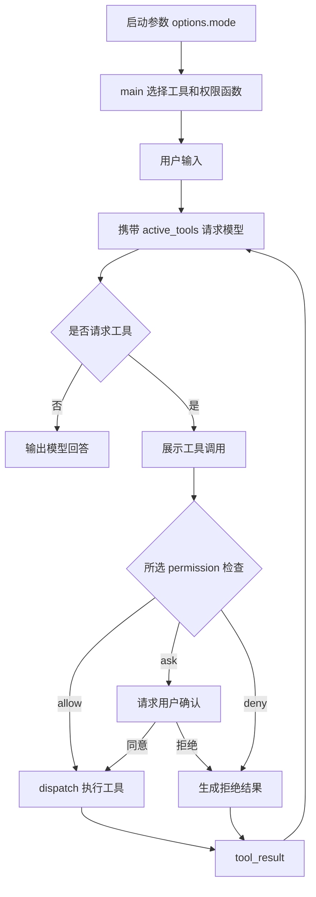
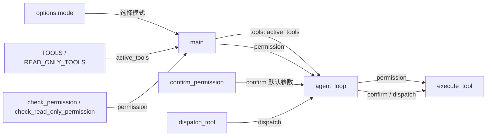

# s03：工具权限

这一章在 s02 的工具分发前增加权限门禁，区分自动允许、需要用户确认和直接拒绝三种结果；启动时可选择普通模式或只读模式。

## 架构流程



```text
tool_call → permission → confirm（仅 ask） → dispatch → tool_result
```

## 组装结构

箭头表示左侧组件向右侧提供对应能力；它描述权限入口的组成，不表示执行顺序。



`main()` 选择 `active_tools` 和 `permission`，分别传给 `agent_loop(tools=..., permission=...)`。循环只转交权限函数，不判断当前模式；`execute_tool()` 是唯一权限门禁，负责允许、询问或拒绝后再调用分发器。

## 组件关系与调用链

本章新增的核心组件如下：

| 组件 | 作用 |
| --- | --- |
| `PermissionStatus` | 表示 `allow`、`ask`、`deny` 三种决定 |
| `PermissionDecision` | 携带权限状态和原因的不可变结果对象 |
| `check_permission()` | 根据工具名称、路径和命令规则生成权限决定 |
| `READ_ONLY_TOOLS` | 从原有定义中筛选 glob、grep、read_file，不创建新工具 |
| `check_read_only_permission()` | 拒绝非只读工具、越界路径及常见敏感路径，不返回 ask |
| `confirm_permission()` | 对 `ask` 状态发起终端确认 |
| `execute_tool()` | 组织权限检查、用户确认和实际执行 |
| `dispatch_tool()` | 只负责查找并执行具体 handler，沿用 s02 |

核心调用关系是：

```text
agent_loop()
    ↓
execute_tool()
    ├─ permission（启动时选择）
    │      ├─ default: check_permission()
    │      └─ read-only: check_read_only_permission()
    │                       └─ check_permission()（复用原有路径检查）
    ├─ confirm_permission()  （仅 ask）
    └─ dispatch_tool()
           ↓
       具体工具 handler
```

`check_permission()` 只做策略判断，`confirm_permission()` 只负责交互，`dispatch_tool()` 只负责执行。`execute_tool()` 是本章的组合入口，因此后续 s04 可以只替换这个入口的生命周期，而不用把权限代码散落到每个工具中。

默认模式沿用已有规则：只读工具自动允许，写入、编辑和匹配风险规则的命令需要确认，明显高危命令直接拒绝。没有匹配风险正则不等于已经证明命令安全；这是教学式应用策略，不是完整 shell 安全检查。权限拒绝会作为工具结果返回模型，核心循环不会因此崩溃。

`grep` 在 s02 定义，本章只增加权限归属：与 `read_file` 一样先校验工作区路径，再自动允许。`cd ... && findstr ...` 仍是 shell 命令，`&&` 会触发确认；不为了方便搜索放宽复合命令规则。读取和搜索的底层预算复用 s02，本章的 handler 将已校验路径交给它们；核心循环不增加 grep 分支。

## 只读模式怎么工作

只读模式用于解释和审查代码，采用两层控制：

1. **模型所见**：`READ_ONLY_TOOLS` 仅包含 `glob`、`grep`、`read_file`，不会发送 bash、写入和编辑工具的定义。
2. **实际执行**：`check_read_only_permission()` 注入已有 `execute_tool()`，即使模型仍返回 bash 或写入请求，也直接拒绝，不询问是否放行。

例如分析 `run_read`：`grep` 找行号 → `read_file(start_line=..., limit=...)` 读取目标 → 必要时补读相关代码 → 回答。不能运行测试或取得 Git 命令结果时，应说明缺少的证据，不能升级权限。

读取仍受工作区边界约束；只读模式额外阻止读取 `.env`、`.env.*`（允许公开的 `.env.example`）及 `.ssh`、`.aws`、`.git` 路径中的内容。路径先解析，避免通过 `notes/../.env` 绕过。`glob` 可以返回文件名，但不能据此读取这些敏感内容。普通文件里也可能有秘密，这不是通用脱敏或操作系统沙箱。

两种模式共用同一个核心循环和工具分发器；只读策略只返回 allow/deny，不请求批准。它保证受限工具不会执行，不保证模型一定不再尝试或一定能完成任务。显式 `tools=[]` 也不再回退为默认全部工具；执行限制仍由传入的 `permission` 负责。

## 运行

```powershell
# 普通模式，保留原有审批规则
python -m s03_permission.code

# 只读分析，不开放 bash、写入和编辑
python -m s03_permission.code --mode read-only

# 离线验证只读门禁和普通模式审批
python -m pytest tests/test_s03_permission.py
```

可以尝试：`读取 README.md`、`创建一个测试文件`、`执行 dir`。写入文件时终端会显示原因并等待输入 `y` 或 `n`。

只读模式建议输入：`解释 s03_permission/code.py 中 check_read_only_permission 的输入、输出和执行流程`。启动应显示 `工具模式：read-only`，可用工具只有 `grep, read_file, glob`。

s03 仍使用原有 Anthropic 接口配置（`MODEL_ID`、`ANTHROPIC_API_KEY`、可选 `ANTHROPIC_BASE_URL`），不读取 s10 的 Provider 配置。不要为了这次权限功能把 Provider 实现移入 s03。当前只在 s03 开放 `--mode`，s04–s12 尚未同步此启动选项。

## 参考与差异

- `lcc` 用黑名单、风险规则和用户确认在工具执行前建立教学式安全边界，目的是让权限判断集中在 Harness，而不是交给模型自行决定。
- 本章保留这个三段式思路，但用 `PermissionDecision` 和独立的 `execute_tool` 表达，避免把权限分支散落到各个 handler；路径边界仍由代码检查，bash 规则只是一层应用策略，不等于系统沙箱。
- Pi 的 `createReadOnlyTools` 通过工具组合减少模型可选动作，包含 read、grep、find、ls；本章复用已有 glob、grep、read_file，并额外在执行前拒绝非只读请求，避免只靠工具定义或提示词。s03 离线测试验证两层边界；s04 已有的权限 Hook 接口可注入此函数，但本次未修改后续章节入口。
- `pi` 默认不提供文件、进程和网络权限隔离，但提供工具调用前后的拦截点。本章先实现权限策略，s04 已把 `execute_tool` 前后的处理抽象为 `before_tool_call` / `after_tool_call` Hooks。
- 本章暂不实现容器或操作系统级沙箱；如果后续需要真正隔离，会在运行时章节（编号待定）单独讨论。
