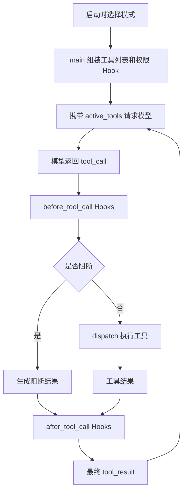
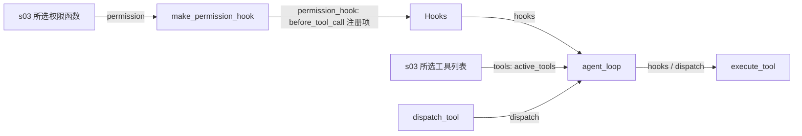

# s04：工具调用 Hooks

这一章复用 s03 的工具和权限策略，把工具执行前后的扩展逻辑抽成可注入的 Hooks。普通与只读模式都通过同一个权限 Hook 接入，不在核心循环中新增模式分支。

## 架构流程



```text
tool_call → before_tool_call → dispatch → after_tool_call → tool_result
```

## 组装结构

箭头统一表示左侧向右侧提供依赖或数据，线上标明代码中的参数或注册方式；运行先后见上方流程图。只画本章 Hook 组件及直接关联对象。



`main()` 先选择 `active_tools` 和 `permission`，再执行 `permission_hook = make_permission_hook(permission=permission)`，把它注册进 `Hooks(before_tool_call=[permission_hook])`。工具列表与 Hooks 都传给循环；循环通过 `execute_tool()` 运行生命周期，不判断当前模式。

## 组件关系与调用链

本章新增的核心组件如下：

| 组件 | 作用 |
| --- | --- |
| `Hooks` | 保存前置 Hook 和后置 Hook 列表，作为运行时依赖容器 |
| `run_before_hooks()` | 按顺序运行前置 Hook，返回第一个阻断原因 |
| `run_after_hooks()` | 按顺序传递和转换工具结果 |
| `make_permission_hook()` | 把 s03 的权限函数适配成前置 Hook |
| `execute_tool()` | 组织前置 Hook、工具分发和后置 Hook |
| `agent_loop()` | 只负责消息循环，并把工具生命周期交给 `Hooks` |

核心调用关系是：

```text
agent_loop()
    ↓
execute_tool()
    ├─ run_before_hooks()
    │      └─ permission_hook()（make_permission_hook 组装时返回的函数）
    │             └─ s03 所选权限函数
    ├─ dispatch()
    └─ run_after_hooks()
```

`Hooks` 只保存函数，不负责执行；两个 `run_*_hooks()` 负责生命周期调度；`execute_tool()` 负责组合流程；`agent_loop()` 不再知道权限、日志或结果处理的具体实现。这样新增行为时可以注册 Hook，而不必继续修改核心循环。

前置 Hook 可以阻止工具调用，后置 Hook 可以观察或转换工具结果；多个 Hook 按注册顺序执行，前置 Hook 首次阻断后不再执行工具。

`BeforeToolHook` 返回 `None` 表示放行，返回字符串表示阻断原因；`AfterToolHook` 接收当前结果并返回处理后的结果。

## 只读模式的接入

权限机制仍属于 s03，本章只是改变它的接入位置：

| 启动模式 | 发给模型的工具 | 注入权限 Hook 的函数 |
| --- | --- | --- |
| `default`（默认） | `previous.TOOLS` | `previous.check_permission` |
| `read-only` | `previous.READ_ONLY_TOOLS` | `previous.check_read_only_permission` |

例如模型仍返回 `bash(command="dir")`：权限 Hook 调用 s03 的只读检查 → 返回拒绝字符串 → 跳过 dispatch 和后续前置 Hook → 后置 Hook 接收拒绝结果 → 作为 tool_result 回传模型。不会请求批准，也不会执行该命令。

`glob`、`grep`、`read_file` 正常通过权限 Hook 后执行，后置 Hook 仍可观察结果。工作区、敏感路径和只读工具范围都由 s03 判断，本章不复制这些规则；显式 `tools=[]` 也沿用 s03 的行为，不回退到全部工具。注意工具列表只决定模型所见，实际阻断依赖注册的权限 Hook，不能省略它。

只读模式不保证模型一定停止尝试，也不是系统沙箱。s05–s12 均沿用该组装，并验证会话恢复不改变当前权限；后续章节不复制权限判断规则。

## 运行

```powershell
# 普通模式，保留原有审批规则
python -m s04_hooks.code

# 只读模式，权限由 s03 提供并经前置 Hook 检查
python -m s04_hooks.code --mode read-only

# 离线验证只读 Hook、结果回传与入口组装
python -m pytest tests/test_s04_hooks.py
```

本章默认把 s03 的权限策略注册为 `before_tool_call`，因此写入文件和高风险命令仍会请求确认。

只读模式可以输入：`解释 s04_hooks/code.py 中 execute_tool 的流程，说明前置 Hook 拒绝后，后置 Hook 收到的结果是什么`。启动应显示 `工具模式：read-only`，可用工具只有 `grep, read_file, glob`。

s04 仍使用既有 `MODEL_ID`、`ANTHROPIC_API_KEY` 和可选 `ANTHROPIC_BASE_URL` 配置，不读取 s10 的 Provider 配置；没有安装或配置新依赖。

## 参考与差异

- `lcc` 将扩展逻辑直接放在核心循环中，目的是保持教学代码短小；本章把工具生命周期拆成前置和后置阶段，解决新增日志、权限和结果处理时反复修改循环的问题。
- `pi` 通过工具调用前后的回调提供运行时扩展点。本章采用函数注入和 `Hooks` 数据类实现同类结构，但保持同步、顺序执行，便于观察调用流程；权限策略仍复用 s03，不复制 lcc 代码。
- Pi 的工具调用拦截点让权限策略可以独立接入；本章将 s03 的普通或只读权限函数适配成同一个前置 Hook，不复制策略，也不增加 agent_loop 模式分支。本章离线测试验证允许、阻断、后置观察和真实入口组装。
- s03 的权限检查在本章落地为 `make_permission_hook()`，s08 已实现独立事件边界；本章只处理同步工具生命周期，不把事件监听与权限阻断混为一谈。
