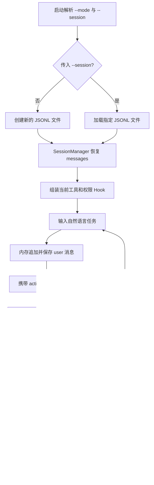
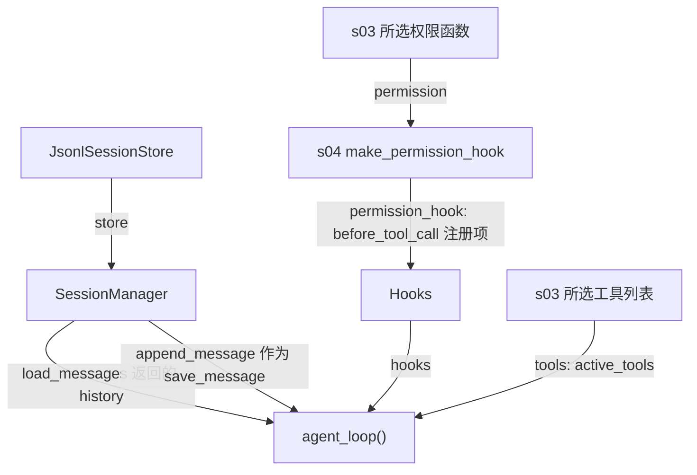

# s05：会话系统 · 持久化

本章在 s04 的 Agent loop 上增加线性 JSONL 会话：每次默认创建新对话；只有在启动时传入 `--session`，才加载指定历史记录。沿用 s03/s04 的只读模式，消息恢复与当前授权相互独立。

## 架构流程



```text
Message → SessionMessage → JsonlSessionStore → SessionManager → agent_loop
```

## 组装结构

箭头表示左侧向右侧提供构造参数、初始数据或保存函数；运行中的写入顺序见架构流程。



本章只画持久化及直接关联依赖：管理器向循环提供初始历史和保存函数；工具、权限和 Hook 复用 s03/s04。图中 `permission_hook` 是组装时得到的函数，不是循环中新建的权限实现。

## 组件关系与调用链

| 层次 | 组件 | 作用 |
| --- | --- | --- |
| 消息模型 | `SessionMessage` | 在 Agent 消息与 JSONL 记录间转换 |
| 存储层 | `JsonlSessionStore` | 只负责按行追加和顺序读取文件 |
| 管理层 | `SessionManager` | 对外提供打开、加载和追加消息的接口 |
| 启动选择 | `session_path_from_cli()` | 默认创建新文件；只在 `--session` 存在时选择历史文件 |

`main()` 先通过 `session_path_from_cli()` 选择文件，再用 `SessionManager.open()` 创建管理器、`load_messages()` 加载历史，并将 `session.append_message` 作为 `save_message` 传入 `agent_loop()`。

启动选项在 `main()` 一起解析，随后只把 `session_arguments` 交给 `session_path_from_cli()`；这个共享函数仍只接受 `--session`，创建与加载规则不变。s06–s12 尚未同步模式时，不会因为调用这个函数而接受一个实际上没有生效的 `--mode`。

每条新消息的处理直接写在产生消息的位置：先用 `messages.append(message)` 更新模型使用的内存历史，再用 `save_message(message)` 写入 JSONL。`save_message` 是保存函数；实际运行时指向 `session.append_message`，传入 `None` 时只更新内存。用户输入在 `main()` 中同样先追加到 `history`，再调用 `session.append_message` 保存。

## 只读模式与会话是什么关系

两个选项各管一件事：`--session` 决定读写哪份历史，`--mode` 决定这次运行的模型可以操作什么。权限规则来自 s03，执行前检查来自 s04 的权限 Hook，本章没有增加权限判断类或循环分支。

例如以前对话里允许过写文件，现在用 `--mode read-only --session <历史路径>` 启动：历史消息仍被加载，但不重放旧工具，也不恢复旧授权。模型新发起的 bash、写入和编辑请求直接被 Hook 拒绝，不请求批准；普通模式仍保留原有确认流程。

**只读不等于会话文件不再写入。** 模型不能修改项目，但 Harness 仍将用户输入、assistant、拒绝或成功的 tool_result、最终回答追加到 JSONL。这样退出后仍能继续对话。会话记录格式未改变，也不会新增授权记录。

只读模型仍可使用 glob、grep、read_file；越界及常见敏感路径由 s03 拒绝。显式空工具列表也不再回退到全部工具。只读不保证模型一定收敛，不是沙箱，也不会自动清洗已有历史中的敏感信息。

## 运行

```powershell
# 创建新的独立会话；实际文件路径会在启动后打印
python -m s05_session_persistence.code

# 加载一个已有的历史会话
python -m s05_session_persistence.code --session .sessions\s05\session-20260919-120000.jsonl

# 新建只读会话；项目工具受限，但对话记录仍会保存
python -m s05_session_persistence.code --mode read-only

# 以只读权限继续历史；替换为启动时显示的真实会话路径
python -m s05_session_persistence.code --mode read-only --session .sessions\s05\session-20260919-120000.jsonl

# 离线验证新建、恢复、只读门禁和消息保存
python -m pytest tests/test_s05_session_persistence.py
```

从项目根目录使用 `-m` 运行，以保证章节之间的兄弟模块可以正常导入。默认会话保存在 `.sessions/s05/`；`--session` 指向的文件必须已经存在。

只读模式可以输入：`解释 s05_session_persistence/code.py 中 append_message 怎样保存消息`。启动应显示 `工具模式：read-only`；退出后使用终端显示的路径加载，仍能看到历史，但不会自动执行历史中的工具调用。

s05 仍使用 `MODEL_ID`、`ANTHROPIC_API_KEY` 和可选 `ANTHROPIC_BASE_URL`，不读取 s10 的 Provider 配置。当前模式入口已同步到 s05，s06–s12 尚未同步。

## 参考与差异

- `lcc` 的 memory 同时处理长期存储、召回、提取与整理，解决跨会话知识复用；本章只保存和恢复原始对话记录，避免把不同职责混在同一层。
- `pi` 的 session 采用追加式记录，并从持久化状态重建上下文，解决运行中断后的连续对话；本章保留这一方向，但使用“默认新建、显式路径恢复”的线性文件模型。s06 在此基础上将完整日志与模型上下文拆为投影关系。
- s04 的 Hooks 只管理工具生命周期；s05 通过保存回调写入消息，使会话持久化保持在 Harness 内部，而不进入系统提示词。
- Pi 从会话记录重建对话状态，不应将旧模型文本当作当前工具授权；本章把 `--session` 与 `--mode` 分开，直接复用 s03 权限和 s04 Hook。s05 离线测试验证旧对话不重放工具、不扩大只读权限，且拒绝结果仍能保存；存储格式及消息顺序不变。
