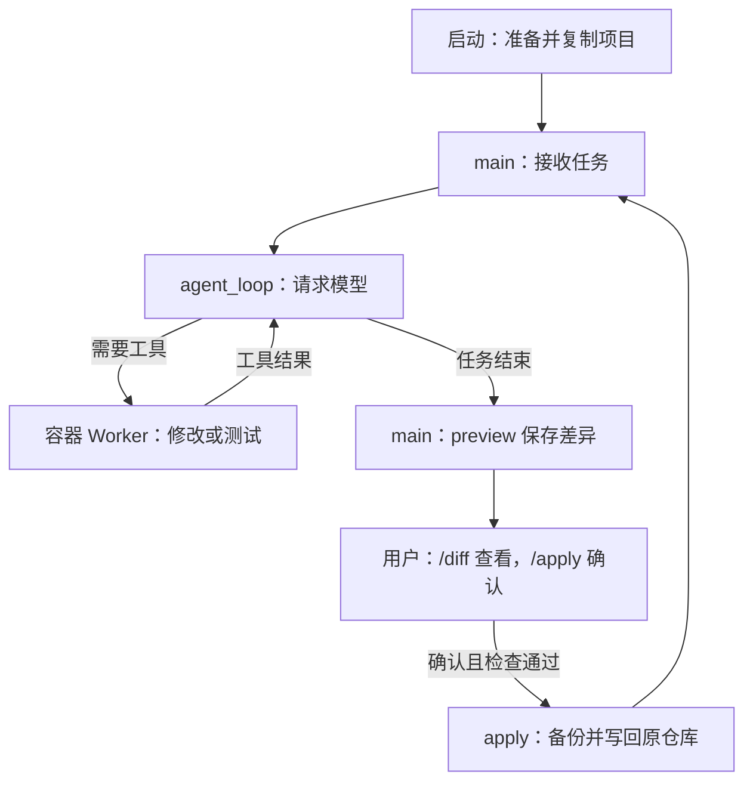
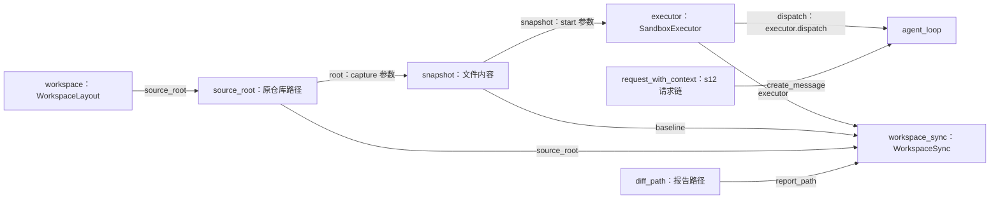

# s13-A：执行沙箱 · 隔离副本

## 实现原理

宿主（你的电脑）上的 Python 负责对话和模型请求；模型返回工具调用后，程序把请求交给 Docker 容器中的 Worker 执行。启动时，允许复制的项目文件被复制到容器 `/work`，不挂载原仓库，因此工具修改的是独立副本。

容器通过禁网、非 root 和资源配额限制工具执行。任务结束后，程序比较副本与文件基线生成 Diff；只有你通过 `/apply` 确认且检查通过，才把修改写回原仓库。**工具无需逐条审批，但写回需要确认；退出不会自动写回。**

观察者故障也会停止入口并清理容器；重新加载会话不重放历史工具，恢复规则复用 [s11](../s11_runtime_observability/README.md#有效历史与故障边界)。未应用的容器修改仍只保存为报告，不自动写回。

## 运行与验证

本例在 `example_project` 中创建加法函数和三个测试，在容器里测试通过后确认写回。以下是操作步骤与预期结果，不是已运行的模型日志。

### 环境准备

在 zero2pi 根目录、已有虚拟环境中操作。先在 Harness 的 `.env` 中配置模型及实际 `MODEL_CONTEXT_WINDOW_TOKENS`，手动启动 Docker Desktop 的 Linux 引擎，再执行：

```powershell
# 检查宿主 Git 和 Docker 服务
git --version
docker version

# 首次准备或镜像内容变化时构建；首次可能下载基础镜像和依赖
docker build -f s13_a_sandbox_copy/Dockerfile -t zero2pi-sandbox:s13-a .
```

<details>
<summary>镜像重建条件</summary>

**镜像首次构建一次即可，不必每次启动都构建。** 项目副本在每次启动时重新复制，容器也由程序自动创建。

- **需要重建：** 镜像被删除，或修改了 Dockerfile、其 ignore 清单、`pyproject.toml`、`src/zero2pi/*.py`、`s02_tool_use/code.py`，以及 s13-A 的 `__init__.py`、`snapshot.py`、`tool_worker.py`；需要增加镜像内测试依赖时也要重建。
- **无需重建：** 新对话、修改 `.env`、README、普通项目文件或测试代码，以及宿主入口 `code.py`、交付组件 `workspace_sync.py`；上述镜像内文件除外。
- **重建后重新启动 Agent：** 已运行的容器不会自动更新。旧 `zero2pi-sandbox:s13` 镜像不能替代 A 镜像。

构建可联网，任务容器禁网，不会临时补装项目依赖。

</details>

### 启动示例项目

在 PowerShell 执行；已有目录请先检查同名文件，不要清空或覆盖：

```powershell
# 目录不存在时创建；已有目录保持不变
if (-not (Test-Path -LiteralPath ".\example_project")) {
    New-Item -ItemType Directory -Path ".\example_project"
}

# 默认就是 sandbox，容器由程序创建
python -m s13_a_sandbox_copy.code --workspace ".\example_project"
```

启动时检查“目标项目”指向 `zero2pi\example_project`，随后出现 `s13-A >>`。若已有 `sandbox_demo.py` 或 `test_sandbox_demo.py`，请另选示例目录，并修改 `--workspace`。

### 开发与测试

在 **Agent 输入框**输入任务，不是在 PowerShell 执行：

```text
只用 Python 标准库，在当前项目副本创建 sandbox_demo.py，定义 add(a, b)；创建 test_sandbox_demo.py，用 unittest 测试 2+3=5、-2+1=-1、0+0=0。执行 python -m unittest，修复到三个测试通过。不安装依赖，不创建其他源码文件，完成后简要说明改动和测试结果。
```

预期测试结果包含 `Ran 3 tests` 和 `OK`，具体工具调用顺序由模型决定。此时文件只在容器 `/work` 中，电脑上的示例目录还没有收到它们；没有测试成功的证据时，不急着写回。

### 差异预览与确认写回

等 Agent 回答结束，在 `s13-A >>` 输入 `/diff`，检查新增的两个文件；确认内容符合任务后输入 `/apply`。程序询问 `是否应用到原仓库？[y/N]` 时，输入 `y` 才写回，回车或 `n` 都取消。

检查通过后的预期提示：

```text
修改  已应用 2 个文件；容器继续保留。
```

**文件立即进入原项目，不需要退出对话。** 可以在另一个 PowerShell 中检查：

```powershell
# 查看已写回的文件
Get-ChildItem -LiteralPath ".\example_project" -Force
```

### 继续修改与退出

在同一对话中继续输入：

```text
只给 sandbox_demo.py 的 add 增加 int 参数和返回值注解，不改测试文件；再次执行 python -m unittest，确认三个测试通过后说明结果。
```

测试通过后，再用 `/diff` 审查、`/apply` 确认。预期只有类型注解变化，不重复显示第一次创建的全部内容。完成后输入 `q`，预期提示：

```text
修改  没有未应用修改。
沙箱  容器已清理。
```

已写回的两个文件保留在电脑上。没有确认写回就退出，则只保存未应用 Diff，不把副本修改送回原项目。

### 运行选项

- `--workspace <目录>`：替换示例目录即可操作其他项目。不传时使用当前目录；目标必须已存在且不是磁盘根目录，可以不是 Git 仓库，相对路径按启动目录解析。
- `--smoke`：只验证容器工具，不请求模型或写回。可以先运行 `python -m s13_a_sandbox_copy.code --workspace ".\example_project" --smoke`。
- 配置始终来自 zero2pi 的 `.env`，不加载目标项目配置；本次运行不能切换目标。技能仅从目标快照的 `s12_skill_loading/skills/<名称>/SKILL.md` 发现，正文通过 `read_file` 按需读取。

### 使用要点

- **记录位置：** 会话、Trace、Diff 与写回备份分别留在 zero2pi 的 `.sessions/s13-a/`、`.traces/s13-a/`、`.sandboxes/s13-a/`，按目标项目路径生成的 ID 分组，不写入外部项目。
- **恢复对话：** 使用相同 `--workspace` 并追加 `--session <启动时打印的会话路径>`，保留会话旁的 `.workspace.json`。恢复的是消息和用量；程序新建容器，不恢复旧副本或未应用文件。
- **依赖与敏感信息：** 任务容器禁网，项目依赖需提前放入镜像。复制时排除常见配置、凭证和运行目录，但不会识别源码中的所有秘密，交给模型前仍需检查。
- **写回限制：** 仅支持普通非空 UTF-8 文件的新增、修改和删除；二进制或空文件变化会阻止整批应用。不交付链接或文件权限，应用期间不要同时编辑目标文件；写入失败保留备份，但不保证自动回滚。

## 核心组件与方法

### 副本准备：`snapshot` 与 `executor.start()`

`main()` 先用 `WorkspaceLayout.for_path(options.workspace, HARNESS_ROOT)` 得到 `workspace`：`source_root` 是要修改的项目，另外三个目录是这个项目在 Harness 中的记录位置。它只选路径，不创建容器或复制文件。

然后调用 `WorkspaceSnapshot.capture(source_root)`，得到变量 `snapshot`。它保存允许复制的文件路径和内容，不是容器，也不是对话历史。

接着，`main()` 调用 `executor.start(snapshot, run_root)`：执行器创建容器，把快照保存为 `source.tar` 并送入容器，由 Worker 解压到 `/work`。

“基线”就是**计算差异时用来对照的那份文件内容**。刚启动时，交付组件以 `snapshot` 为基线；应用成功后，它会更新为刚交付的版本。

对应文件：[workspace.py](workspace.py)、[sandbox.py](sandbox.py)、[snapshot.py](snapshot.py)。

### 工具执行：`agent_loop()` → `executor.dispatch()` → Worker

`main()` 把 `executor.dispatch` 传给 `agent_loop()`。模型返回工具名称和参数时，循环通过已有 `execute_tool()` 调用它。

例如模型返回：

```text
工具：write_file
参数：{"path": "sandbox_demo.py", "content": "..."}
```

`executor.dispatch()` 将参数编码为 JSON，通过固定的 `docker exec` 交给容器中的 `tool_worker.py`。Worker 找到处理函数，执行后把结果返回循环，循环再请求模型。读取、搜索、写入、编辑、文件查找和 shell 都走这条路。

`hooks = Hooks()` 不注册逐条审批 Hook，因此不反复询问是否允许工具；保护来自容器执行边界，不是提示词。Docker 或 Worker 致命失败时停止，不回退到宿主执行。

对应文件：[code.py](code.py) 中的 `agent_loop()`、[tool_worker.py](tool_worker.py)。

### 差异预览与确认写回：`main()` 与 `workspace_sync`

`WorkspaceSync` 不在 Agent Loop 里面，也不是模型工具。它由宿主 `main()` 持有：

- 任务结束后，`main()` 调用 `workspace_sync.preview()`；输入 `/diff` 也会调用它。它通过 `executor.capture_workspace()` 取得容器当前文件，与基线比较，保存 Diff，并记住这次预览的版本。原仓库不变。
- 输入 `/apply` 后，`main()` 先展示文件列表并获取确认；只有输入 `y` 才调用 `workspace_sync.apply()`。回车或其他回答都取消。

`apply()` 的检查可以理解为三个问题：

1. 容器现在还是你预览过的那个版本吗？
2. 原仓库中要写入的目标有没有被你另外修改，路径和文件类型是否允许？
3. 补丁能否应用？

检查通过后，先备份，再用 Git 应用补丁，核对结果，最后更新 `workspace_sync.baseline`，所以下一轮 Diff 只包含新的变化，启动归档 `source.tar` 不变。宿主编辑不会自动同步到容器。这里不自动暂存或提交；实际写入失败会禁用后续回写，需要人工检查备份和文件。

对应文件：[workspace_sync.py](workspace_sync.py)。`/diff` 和 `/apply` 由入口识别，不发送给模型，模型不能替你确认。

## 运行流程

流程图展示任务执行、差异预览和确认写回的先后顺序。图中为正常完成并确认交付的路径；取消确认或检查失败时，原仓库不应用这批修改，回到输入入口；`q` 随时走退出收尾。



工具结果返回模型的循环，和用户确认写回的流程，是两件事。测试命令成功也不会绕过用户确认。

## 组装结构

`main()` 组装模型请求接口、工具执行器和交付组件。这里说明组件之间的依赖及参数传递，不表示执行顺序。

下面是 `main()` 中关键连线的摘录，省略路径检查、s12 请求链组装、交互与收尾，不能单独运行：

```python
workspace = WorkspaceLayout.for_path(options.workspace, HARNESS_ROOT)
source_root = workspace.source_root
snapshot = WorkspaceSnapshot.capture(source_root)
executor = SandboxExecutor(image=options.image)
run_root = workspace.sandbox_root / executor.name
diff_path = run_root / "changes.diff"

workspace_sync = WorkspaceSync(
    source_root=source_root,  # 写回的原仓库
    executor=executor,  # 从这个容器取得文件
    baseline=snapshot,  # 刚启动时的比较基线
    report_path=diff_path,  # Diff 保存位置
)
executor.start(snapshot, run_root)

# 中间沿用 s12，组装模型、会话、事件及 request_with_context。

# 普通任务进入循环；/diff、/apply 由 main 单独处理。
agent_loop(
    active_context,
    create_message=request_with_context,  # 请求模型仍走 s12 请求链
    dispatch=executor.dispatch,  # 工具执行改走容器
    # 其他参数省略……
)
```

结构图的箭头统一表示**左侧向右侧提供依赖或数据**，线上标出真实参数名；不表示调用先后。



**传给循环的是执行工具的方法，不是把整套交付组件塞进循环。** `main()` 另行调用 `workspace_sync.preview()/apply()`，因此核心循环不用理解 Git 补丁和确认交付。

`workspace` 还向入口提供 `session_root`、`trace_root`、`sandbox_root`；入口分别用它们选择会话、创建 Trace 路径和拼接 `run_root/diff_path`。这只是存储位置的组装，不是新的模型调用链。

## 回归测试

这是**开发者检查程序实现**的命令，不是上面加法案例的必做步骤。它们在 zero2pi 根目录的 PowerShell 执行，不输入到 Agent 对话中。

```powershell
# 离线测试：使用 Docker 替身和临时目录中的真实 Git，无模型调用
python -m pytest tests/test_s13_a_sandbox_copy.py tests/test_s13_a_workspace.py tests/test_s13_a_workspace_sync.py

# 仅在 Docker 和本地镜像准备好后，验证真实隔离与两轮交付
$env:SANDBOX_INTEGRATION = "1"
python -m pytest tests/test_s13_a_sandbox_copy.py -k real_docker
Remove-Item Env:SANDBOX_INTEGRATION
```

第一条命令用假的 Docker/模型出口和临时文件，检查取消确认、写回、冲突、会话归属等程序逻辑，不启动真实容器或调用模型。第二组命令显式开启真实 Docker 测试，检查容器限制及两轮写回；它要求你已准备好服务和镜像，不会替你下载安装。

## 参考与差异

- **Pi：注入执行后端。** 保留“循环不关心工具执行位置”的思路，但本章把六种工具统一放入容器副本，并在隔离失败时停止；不是只包装 bash，也不采用本地示例的普通 bash 回退。本章离线与 Docker 测试分别验证接入和隔离。
- **Pi：按工作目录归档会话，并记录 cwd。** 本章保留项目分组和归属检查，但用路径哈希及会话旁路绑定，不给既有 JSONL 增加新 Entry。本章恢复与跨项目测试验证绑定；s13-B、s13-C 已复用同一布局，按版本再分组，跨版本会话拒绝测试验证不混用。
- **Pi：直接操作实际工作区。** 本章为保护原仓库，改为先预览、后确认交付。[s13-B](../s13_b_sandbox_workspace/README.md) 用共享容器、[s13-C](../s13_c_sandbox_native/README.md) 用原生进程比较直接写入：启动时授权，文件立即生效，没有 `/apply`；实际限制须显式集成测试验证。
- **lcc：worktree 隔离任务改动。** 本章不引入任务板或 worktree，而用容器限制执行环境、用文件基线检查交付冲突；任务改动分离不等于 OS 安全隔离。本章冲突测试验证用户已有内容不会被强行覆盖。
