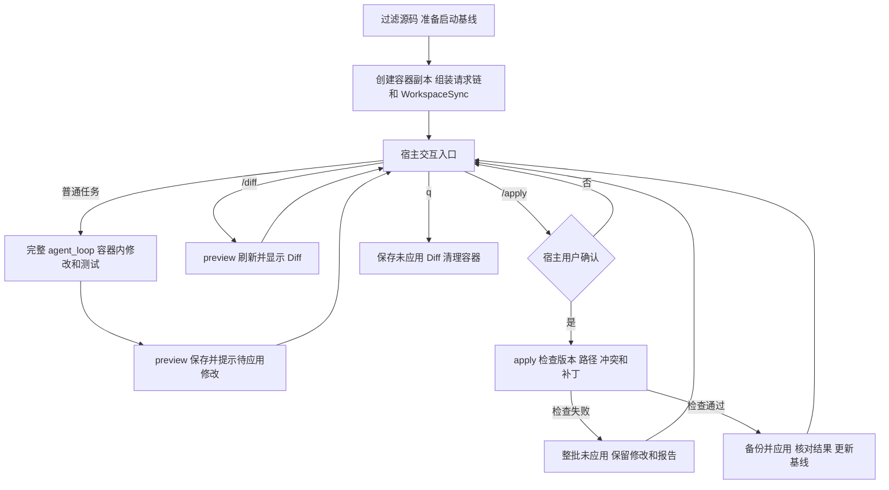
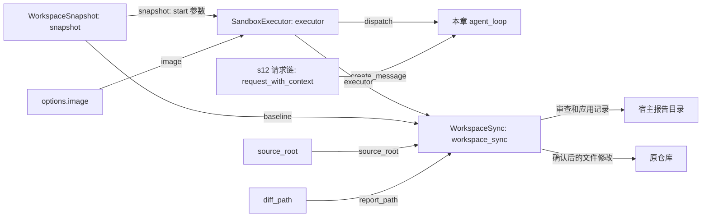

# s13-A：执行沙箱 · 隔离副本

s13-A 在 s12 的完整 Agent 循环之外增加两层边界：工具只操作 Docker 项目副本；宿主用户确认后才把预览过的修改应用到原仓库。任务结束即可查看和应用，不需要退出对话。

## 工作边界

- 六种工具统一在容器 `/work` 执行，不逐条审批；不挂载宿主目录、不暴露 Docker API。
- 本地可信 Linux 镜像固定到 image ID，`--pull never`；启动失败不下载、不回退宿主。
- 非 root（UID/GID 65534）、只读根文件系统、删除 capabilities、禁止提权、禁用网络。
- CPU 1 核、内存/交换总额度 1 GiB、最多 64 个进程；`/work` 和 `/tmp` 分别限制为 512/128 MiB，shell 命令超时 120 秒。
- 复制时排除 `.env`、`.env.*`（保留 `.env.example`）、`.git`、依赖、运行目录和常见凭证；不复制符号链接、junction、硬链接或特殊文件。快照最多 4000 文件 / 12 MiB。
- 模型密钥、会话和 Trace 留在宿主；模型没有回写工具，不能替用户批准 `/apply`。

容器不是绝对安全，文件名排除也不是通用脱敏；仍应只选择可以交给模型的源码。[Docker 安全说明](https://docs.docker.com/engine/security/)、[容器运行参数](https://docs.docker.com/reference/cli/docker/container/run/)。

## 组件和方法的关系

| 组件 | 职责与调用关系 |
| --- | --- |
| `WorkspaceSnapshot` | `capture()` 获取启动文件基线；`write_tar()` 准备输入和回写前内容备份；`diff()` 比较普通文件内容 |
| `SandboxExecutor` | `start()` 创建容器和副本；`dispatch()` 执行六种工具；`capture_workspace()` 返回校验过的容器快照；`close()` 清理本次容器 |
| `tool_worker.py` | 启动时接收 tar，运行时接收 JSON；从只读镜像加载 s02 文件工具，并将 bash 替换为 Linux `/bin/sh` |
| `WorkspaceSync` | `preview()` 固定待确认版本并保存 Diff；`apply()` 检查并交付该版本，成功后更新比较基线 |
| 本章 `agent_loop()` | 保留 s12 的完整模型/工具流程；只增加隔离失败时补齐工具结果并停止，不处理回写 |
| `main()` | 组装组件、处理宿主 `/diff` 和 `/apply`、获取用户确认；普通任务才进入会话和模型 |

`WorkspaceSync` 是宿主交付组件，不是工具 handler、Hook 或模型请求器。其底层辅助函数只负责固定 Git argv、宿主路径检查和读取；上层 `apply()` 就地展开交付顺序。

### preview 与 apply

`preview()`：读取容器当前快照 → 与当前基线比较 → 保存 `changes.diff` → 缓存这份版本和补丁。只预览，不修改原仓库；不支持的文件变化也不会被悄悄藏起来。

`apply()`：确认容器仍是已预览版本 → 检查路径和文本类型 → 检查宿主目标与基线一致 → `git apply --check` → 保存补丁和内容备份 → 再检查宿主目标 → 应用 → 核对结果 → 更新基线。

补丁通过 stdin 传给固定 Git argv，不执行宿主 shell，不从可被手动编辑的 `changes.diff` 读取应用指令。不使用 `--index`、`--cached`、`--reject`、`--unsafe-paths`，也不自动创建提交。`--check` 不写文件；补丁片段不能应用时，Git 默认拒绝整份补丁。[Git apply 官方说明](https://git-scm.com/docs/git-apply)

## 运行流程



Docker/Worker 致命失败直接终止入口，不再继续工具调用或回写；最后一次成功预览仍在宿主。实际写入阶段失败或结果不一致时，禁用本次运行的后续回写，保留备份供人工检查；不会伪装成成功或自动强制恢复。

## 组装结构

箭头统一表示“左侧向右侧提供依赖或数据”，不是调用顺序；只展示本章新增组件及直接关联对象。



`main()` 先声明 `snapshot`、`executor`、`run_root`、`diff_path`、`workspace_sync`，再组装既有模型和上下文组件。`/diff`、`/apply` 在保存用户消息之前处理，不进入模型上下文、不计模型请求；系统提示词无需解释这套宿主机制。

## 两轮修改：为什么需要更新基线

```text
启动：原仓库与容器都没有 sandbox_demo.py；基线也没有。

第一轮：容器新增 add(a, b)，原仓库仍无该文件。
preview：显示“新增 sandbox_demo.py”。
/apply + y：原仓库获得该文件，基线更新为这个已交付版本。

第二轮：继续让模型给 add 增加类型注解，容器仍然存活。
preview：只显示相对刚交付版本新增的类型注解。
/apply + y：原仓库获得注解，基线再次更新。

再次 /diff：无待应用修改；q 退出也不会重复导出已应用的内容。
```

更新的是 `workspace_sync.baseline`，启动时的 `source.tar` 保持不变。只检查本批目标文件：已有文件的宿主内容必须与基线完全一致；新增文件必须尚不存在。任何一个目标冲突都整批拒绝，无关宿主修改不会被覆盖。

这一版不把宿主外部编辑反向同步到容器。如果外部编辑影响后续任务，应先处理改动，再重新启动获取新的副本。

## 准备与运行

在项目根目录、已有 Python 虚拟环境中执行。以下步骤由你手动执行，程序不会安装依赖、构建镜像或启动 Docker 服务。

```powershell
# 确认宿主 Git 可用，以及 Docker Desktop 的 Linux 服务已启动
git --version
docker version

# 构建 A 版本镜像：会按需下载基础镜像和项目依赖
docker build -f s13_a_sandbox_copy/Dockerfile -t zero2pi-sandbox:s13-a .

# 无模型冒烟：只验证副本工具，退出时保存报告，不回写原仓库
python -m s13_a_sandbox_copy.code --smoke

# 模型交互：容器内自动执行；回写需要 /apply 单独确认
python -m s13_a_sandbox_copy.code --mode sandbox
```

包和 Worker 路径已改名，旧 `zero2pi-sandbox:s13` 镜像不能替代 A 镜像，需要按上面的命令构建一次。Dockerfile 专属 ignore 清单不包含 `.env` 或宿主交付组件；固定工具从只读镜像加载，不受 `/work` 的 `PYTHONPATH` 替换。项目复制只走 tar stdin，由非 root Worker 解压，避免 root 属主造成副本不可写。

模型仍使用宿主 `.env`，需配置 s07 的实际窗口预算。其他项目的依赖需要你准备对应可信镜像，容器运行时不联网补装。

### 不退出即可交付的测试

```text
在副本中新建 sandbox_demo.py，定义 add(a, b)，再用 Python 断言 add(2, 3) == 5。完成后说明改了什么。
/diff
/apply
y
给 sandbox_demo.py 中的 add 增加 int 类型注解，再运行原断言。
/diff
/apply
y
q
```

第一次确认前，宿主没有 `sandbox_demo.py`；确认后立即出现。第二次 Diff 只含新增注解。工具不逐条审批，回写每批确认一次，默认回车或输入非 `y` 都取消。

## 验证、产物和限制

```powershell
# 离线回归：真实 Git 只修改临时测试目录，无模型、无 Docker
python -m pytest tests/test_s13_a_sandbox_copy.py tests/test_s13_a_workspace_sync.py

# 镜像和 Docker 准备好后，显式验证真实隔离与两轮交付
$env:SANDBOX_INTEGRATION = "1"
python -m pytest tests/test_s13_a_sandbox_copy.py -k real_docker
Remove-Item Env:SANDBOX_INTEGRATION
```

离线测试覆盖固定 Docker 参数、stdin、冲突整批拒绝、两轮应用、取消确认、命令不进模型、换行保留、危险路径拒绝和失败收尾；它不证明 OS 隔离。真实 Docker 测试检查非 root、只读根、禁网、无宿主挂载，以及不关闭容器的两轮应用。

运行目录分别是 `.sessions/s13-a/`、`.traces/s13-a/`、`.sandboxes/s13-a/<名称>/`，全部忽略 Git。报告目录包含：

- `source.tar`：不可变启动副本。
- `changes.diff`：最近预览或退出时的未应用修改；全部应用后为空。
- `apply-001.diff`、`before-001.tar`：每次实际回写尝试的补丁与原文件内容备份；失败尝试也保留，不能仅凭文件名认定已成功。

当前交付仅支持普通非空 UTF-8 文本文件的新增、修改、删除。二进制（含 NUL）、空文件变化、文件/目录互换、大小写重命名和不适用于 Windows 的文件名整批拒绝；不交付链接或权限元数据。备份只保存文件内容，不是 ACL/权限或整个文件系统的事务备份。

回写前后复核能检测常见冲突，但不会锁住编辑器或后台进程，也不承诺磁盘故障下的自动回滚；应用期间不要并发编辑目标。`--session` 只恢复消息和用量，不恢复旧容器内容。超长 shell 全文只在容器存活时可补读。强制关闭终端或 Docker 失联可能残留容器，按具体名称手动清理，不批量删除其他容器。

沙箱不保证模型收敛；需保护消费时显式配置 s11 的 `AGENT_MAX_ROUNDS`。

## 参考与差异

- Pi 通过执行后端注入限制命令，本章保留这条放权思路，但把全部六种工具放进同一个容器副本；本章离线和 Docker 测试分别验证接入与真实隔离。隔离失败必须停止，不采用本地 Pi 示例的普通 bash 回退。
- Pi 的本地示例在实际工作区包装 bash，而本章保护原仓库不被模型工具直接写入，因此增加宿主确认交付；s13-B 的共享工作区、s13-C 的原生隔离将比较另一种边界，当前不提前创建代码。
- lcc 的 worktree 隔离用于避免任务改动互相污染，不提供 OS 安全边界；本章不引入任务板或 worktree，通过内容基线保护用户同期修改，本章冲突测试验证这一取舍。
