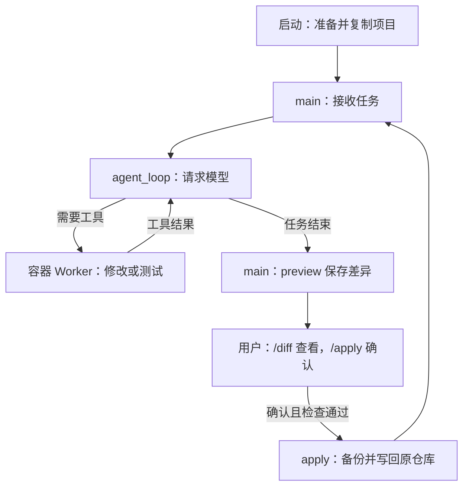
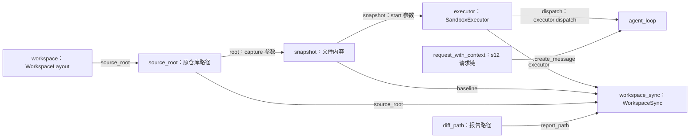

# s13-A：执行沙箱 · 隔离副本

这一章只抓住一个区别：**模型修改容器里的项目副本；你确认后，程序才把修改写回原仓库。** 宿主指你的电脑，容器的项目目录是 `/work`，两边不是同一份文件。

建议先读下面的例子，再找对应方法，最后看组装。模型请求、会话、压缩和事件沿用 s12，不在这一章重新展开。

## 1. 用“创建文件并测试”走一遍

假设原仓库还没有 `sandbox_demo.py`。如果已经有这个文件，请在下面的任务中换一个未使用的名字，不要覆盖已有内容。

启动后输入：

```text
在副本中新建 sandbox_demo.py，定义 add(a, b)，再用 Python 断言 add(2, 3) == 5。完成后说明改了什么。
```

一次正常完成的过程是：

1. **准备副本。** 程序读取 `--workspace` 指定项目中允许复制的文件（默认当前目录），记住这些文件的内容，再创建容器并复制到 `/work`。你不需要手动创建容器。
2. **模型决定怎么做。** 宿主 Python 把任务发送给模型。模型可能选择 `write_file` 创建文件，再选择 `bash` 执行 Python 断言；具体工具次序由模型决定。
3. **工具修改副本。** 六种工具都在容器执行；创建的是 `/work/sandbox_demo.py`。工具结果返回宿主，再交给模型决定是否继续。
4. **完成后预览。** 模型结束工具调用后，程序比较副本和记住的文件内容，保存 `changes.diff`。这时原仓库仍没有新文件。
5. **你确认写回。** 输入 `/diff` 查看差异，再输入 `/apply`，确认时输入 `y`。检查通过后，原仓库立即获得新文件，容器仍然保留。
6. **退出。** 输入 `q`，程序保存剩余未应用的差异并清理容器，不会偷偷应用修改。没有剩余变化时提示“没有未应用修改”。

先记住：**副本里测试通过，不代表修改已经进入原仓库；看到“已应用”才表示写回完成。**

## 2. 在代码里，这几步分别找谁？

### 准备副本：`snapshot` 和 `executor.start()`

`main()` 先用 `WorkspaceLayout.for_path(options.workspace, HARNESS_ROOT)` 得到 `workspace`：`source_root` 是要修改的项目，另外三个目录是这个项目在 Harness 中的记录位置。它只选路径，不创建容器或复制文件。

然后调用 `WorkspaceSnapshot.capture(source_root)`，得到变量 `snapshot`。它保存允许复制的文件路径和内容，不是容器，也不是对话历史。

接着，`main()` 调用 `executor.start(snapshot, run_root)`：执行器创建容器，把快照保存为 `source.tar` 并送入容器，由 Worker 解压到 `/work`。

“基线”就是**计算差异时用来对照的那份文件内容**。刚启动时，交付组件以 `snapshot` 为基线；应用成功后，它会更新为刚交付的版本。

对应文件：[workspace.py](workspace.py)、[sandbox.py](sandbox.py)、[snapshot.py](snapshot.py)。

### 修改和测试：`agent_loop()` → `executor.dispatch()` → Worker

`main()` 把 `executor.dispatch` 传给 `agent_loop()`。模型返回工具名称和参数时，循环通过已有 `execute_tool()` 调用它。

例如模型返回：

```text
工具：write_file
参数：{"path": "sandbox_demo.py", "content": "..."}
```

`executor.dispatch()` 将参数编码为 JSON，通过固定的 `docker exec` 交给容器中的 `tool_worker.py`。Worker 找到处理函数，执行后把结果返回循环，循环再请求模型。读取、搜索、写入、编辑、文件查找和 shell 都走这条路。

`hooks = Hooks()` 不注册逐条审批 Hook，因此不反复询问是否允许工具；保护来自容器执行边界，不是提示词。Docker 或 Worker 致命失败时停止，不回退到宿主执行。

对应文件：[code.py](code.py) 中的 `agent_loop()`、[tool_worker.py](tool_worker.py)。

### 查看和写回：`main()` → `workspace_sync`

`WorkspaceSync` 不在 Agent Loop 里面，也不是模型工具。它由宿主 `main()` 持有：

- 任务结束后，`main()` 调用 `workspace_sync.preview()`；输入 `/diff` 也会调用它。它通过 `executor.capture_workspace()` 取得容器当前文件，与基线比较，保存 Diff，并记住这次预览的版本。原仓库不变。
- 输入 `/apply` 后，`main()` 先展示文件列表并获取确认；只有输入 `y` 才调用 `workspace_sync.apply()`。回车或其他回答都取消。

`apply()` 的检查可以理解为三个问题：

1. 容器现在还是你预览过的那个版本吗？
2. 原仓库中要写入的目标有没有被你另外修改，路径和文件类型是否允许？
3. 补丁能否应用？

检查通过后，先备份，再用 Git 应用补丁，核对结果，最后更新基线。这里不自动暂存或提交；实际写入阶段失败会禁用本次运行的后续回写，需要人工检查备份和文件。

对应文件：[workspace_sync.py](workspace_sync.py)。`/diff` 和 `/apply` 由入口识别，不发送给模型，模型不能替你确认。

## 3. 运行流程图：只看先后顺序

这张图只画“任务正常完成后，用户确认交付”的路线。取消确认或检查失败时，原仓库不应用这批修改，回到输入入口；`q` 随时走退出收尾。



工具结果返回模型的循环，和用户确认写回的流程，是两件事。测试命令成功也不会绕过用户确认。

## 4. 组装结构：只看“谁提供给谁”

组装不是运行步骤。它是 `main()` 提前告诉组件：**请求模型找谁、执行工具找谁、比较文件用哪份基线。**

下面是 `main()` 中关键连线的摘录，省略路径检查、s12 请求链组装、交互与收尾，不能单独运行：

```python
workspace = WorkspaceLayout.for_path(options.workspace, HARNESS_ROOT)
source_root = workspace.source_root
snapshot = WorkspaceSnapshot.capture(source_root)
executor = SandboxExecutor(image=options.image)
run_root = workspace.sandbox_root / executor.name
diff_path = run_root / "changes.diff"

workspace_sync = WorkspaceSync(
    source_root=source_root,  # 写回的原仓库
    executor=executor,  # 从这个容器取得文件
    baseline=snapshot,  # 刚启动时的比较基线
    report_path=diff_path,  # Diff 保存位置
)
executor.start(snapshot, run_root)

# 中间沿用 s12，组装模型、会话、事件及 request_with_context。

# 普通任务进入循环；/diff、/apply 由 main 单独处理。
agent_loop(
    active_context,
    create_message=request_with_context,  # 请求模型仍走 s12 请求链
    dispatch=executor.dispatch,  # 工具执行改走容器
    # 其他参数省略……
)
```

结构图的箭头统一表示**左侧向右侧提供依赖或数据**，线上标出真实参数名；不表示调用先后。



**传给循环的是执行工具的方法，不是把整套交付组件塞进循环。** `main()` 另行调用 `workspace_sync.preview()/apply()`，因此核心循环不用理解 Git 补丁和确认交付。

`workspace` 还向入口提供 `session_root`、`trace_root`、`sandbox_root`；入口分别用它们选择会话、创建 Trace 路径和拼接 `run_root/diff_path`。这只是存储位置的组装，不是新的模型调用链。

## 5. 再做一轮，为什么不会重复写回？

第一轮创建文件并应用成功后，让模型继续：

```text
给 sandbox_demo.py 中的 add 增加 int 类型注解，再运行原断言。
```

同一个容器仍然存活，所以模型可以直接修改那个文件。此时比较的是：

```text
第一轮：启动时的文件 → 创建 add 后的文件
应用成功：基线更新为“创建 add 后的文件”

第二轮：创建 add 后的文件 → 加上类型注解后的文件
应用成功：基线再次更新
```

所以第二次 Diff 只展示新增注解，不会重复交付第一轮内容。更新的是 `workspace_sync.baseline`，启动归档 `source.tar` 不会被改写。

如果你在编辑器里同时改了本批目标文件，程序会拒绝整批应用，不强行覆盖；无关文件的修改不会被覆盖。**宿主的外部编辑也不会自动反向同步到容器。**

## 6. 怎么运行和观察？

在 zero2pi 根目录、已有虚拟环境中执行。不传 `--workspace` 时，目标仍是当前目录；传入后只改变操作对象，不改变 Harness 的配置位置。

先手动启动 Docker Desktop 的 Linux 引擎，再准备镜像：

```powershell
# 检查宿主 Git 和 Docker 服务
git --version
docker version

# 首次使用或需要更新镜像时执行，不必每次启动都执行；首次可能下载镜像和依赖
docker build -f s13_a_sandbox_copy/Dockerfile -t zero2pi-sandbox:s13-a .

# 无模型冒烟：验证容器工具，不加载模型配置、不回写原仓库
python -m s13_a_sandbox_copy.code --smoke

# 正式交互：默认就是 sandbox，不用手动创建容器
python -m s13_a_sandbox_copy.code
```

**镜像首次构建一次即可，不必每次启动都构建。** 项目副本在每次启动时重新复制，容器也由程序自动创建。

- **需要重建：** 镜像被删除，或修改了 Dockerfile、其 ignore 清单、`pyproject.toml`、`src/zero2pi/*.py`、`s02_tool_use/code.py`，以及 s13-A 的 `__init__.py`、`snapshot.py`、`tool_worker.py`；需要增加镜像内测试依赖时也要重建。
- **无需重建：** 新对话、修改 `.env`、README、普通项目文件或测试代码，以及宿主入口 `code.py`、交付组件 `workspace_sync.py`；上述镜像内文件除外。
- **重建后重新启动 Agent：** 已运行的容器不会自动更新。旧 `zero2pi-sandbox:s13` 镜像不能替代 A 镜像。

构建可联网，任务容器禁网，不会临时补装项目依赖。

### 指定另一个项目

```powershell
# 从 zero2pi 启动，复制 my-app；/apply 确认后写回 my-app，而不是 zero2pi
python -m s13_a_sandbox_copy.code --workspace "D:\dev\my-app"

# 只验证该项目的容器副本，不调用模型或写回
python -m s13_a_sandbox_copy.code --workspace "D:\dev\my-app" --smoke
```

目标必须是已存在的目录，可以不是 Git 仓库；相对路径按启动目录解析。不存在、文件路径或磁盘根目录会报错，不自动创建项目。整次运行绑定这个目标，不提供对话内切换；它只收到源码副本，不挂载宿主目录。

模型配置只加载 **zero2pi 根目录的 `.env`**，不加载目标项目 `.env`；需填写 `MODEL_CONTEXT_WINDOW_TOKENS`。技能也只从目标快照的 `s12_skill_loading/skills/<名称>/SKILL.md` 发现，路径改为 `/work/...`；没有这个目录就没有技能，不偷偷复制 Harness 的技能。`load_container_skills(snapshot)` 读取头部，正文仍交给已有 `read_file` 按需加载。

### 完整运行案例：在 example_project 中开发并测试

**案例目标：** 让 Agent 写一个加法函数和三个测试，在容器里测试通过，再由你确认把两个文件写进 `example_project`。只用 Python 标准库，不需要安装额外依赖。

下面是操作教程与预期结果，不是已经替你运行过的模型日志。假设虚拟环境、宿主 `.env`、Docker 和 A 镜像已经按前面的说明准备好；已有镜像时不要重复构建。

#### 第一步：指定示例目录，启动 Agent

在 **zero2pi 根目录的 PowerShell** 执行：

```powershell
# 当前已创建这个空目录；若刚克隆项目、目录不存在，先执行下面这一行
# New-Item -ItemType Directory -Path ".\example_project"

# 指定示例项目；默认就是沙箱模式，不需要再传 --mode sandbox
python -m s13_a_sandbox_copy.code --workspace ".\example_project"
```

启动时检查“目标项目”指向 `zero2pi\example_project`，随后出现 `s13-A >>`。容器由程序创建，你不用手动 `docker run`。

如果示例目录已有文件，先检查是否存在下面同名文件；不要为了重跑案例删除已有内容，可以另建示例目录并修改 `--workspace`。

#### 第二步：输入开发任务，等待工具执行结束

在 **`s13-A >>` 后面**输入下面整行，不是在 PowerShell 执行：

```text
只用 Python 标准库，在当前项目副本创建 sandbox_demo.py，定义 add(a, b)；创建 test_sandbox_demo.py，用 unittest 测试 2+3=5、-2+1=-1、0+0=0。执行 python -m unittest，修复到三个测试通过。不安装依赖，不创建其他源码文件，完成后简要说明改动和测试结果。
```

你应看到写入工具及测试命令的执行结果。正常情况下测试结果包含 `Ran 3 tests` 和 `OK`；工具调用顺序、次数和模型回答可能不同。没有测试成功的证据时，先让 Agent 检查，不急着确认写回。

此时文件在 **容器 `/work`** 中，电脑上的 `example_project` 仍未收到它们。需要检查时，在另一个位于 zero2pi 根目录的 PowerShell 中执行：

```powershell
# 只查看宿主目录，不进入 Agent；若开始时为空，现在仍应为空
Get-ChildItem -LiteralPath ".\example_project" -Force
```

#### 第三步：查看修改，再确认写回

等 Agent 回答结束、重新出现 `s13-A >>` 后，先输入：

```text
/diff
```

检查 Diff 应包含 `sandbox_demo.py` 和 `test_sandbox_demo.py` 的新增内容。确认实现和测试符合任务，再输入：

```text
/apply
```

程序会列出待应用文件并问 `是否应用到原仓库？[y/N]`。确认时输入 `y`；回车或输入 `n` 都取消，不会写回。检查通过后的预期提示是：

```text
修改  已应用 2 个文件；容器继续保留。
```

**到这一步，电脑上的 `example_project` 才获得两个文件，不需要退出对话。** 可以在编辑器中打开，也可以在另一个 PowerShell 中再次查看目录。

#### 第四步：不退出，再做一次小修改

回到 Agent，输入：

```text
只给 sandbox_demo.py 的 add 增加 int 参数和返回值注解，不改测试文件；再次执行 python -m unittest，确认三个测试通过后说明结果。
```

等待结束后，再用 `/diff` 审查。预期只有类型注解的变化，不应重复显示第一次创建文件的整个内容；这是应用成功后更新基线的效果。再 `/apply`，确认时输入 `y`。

#### 第五步：退出，确认最终文件保留

没有新修改时输入：

```text
q
```

正常退出的预期提示：

```text
修改  没有未应用修改。
沙箱  容器已清理。
```

电脑上保留的结果应是：

```text
example_project/
├─ sandbox_demo.py        # add 函数，第二轮增加了类型注解
└─ test_sandbox_demo.py   # 三个 unittest 测试
```

如果没有 `/apply` 就退出，只会保存未应用 Diff，不会把副本里的文件写回。**这个案例要观察的就是：工具无需逐条批准，但文件写回需要每批确认一次。**

## 7. 记录保存在哪里？退出会失去什么？

所有记录留在 **zero2pi 的运行目录**，不复制到容器，也不写进外部目标项目。程序把目标的规范化绝对路径转换为稳定 ID，例如 `my-app-<路径哈希>`；同名但位置不同的项目会分到不同目录：

- `.sessions/s13-a/<项目ID>/*.jsonl`：对话、工具调用及实际返回结果、压缩记录和已知模型用量，供继续对话。
- 同一会话旁的 `session-....workspace.json`：保存目标路径和会话文件名，只有工作区归属匹配才允许恢复；它不进入模型上下文，不改变 s11 的 JSONL 格式。
- `.traces/s13-a/<项目ID>/*.jsonl`：请求、工具、错误和耗时等事件的精简记录，不重复保存完整大型正文或逐段流式文本。
- `.sandboxes/s13-a/<项目ID>/<容器名称>/`：`source.tar` 是启动副本；`changes.diff` 是最近预览的未应用修改，全部应用后为空；`apply-001.diff` 和 `before-001.tar` 保存回写尝试的补丁及原文件内容，失败尝试也可能留下，不能仅凭文件名认定成功。

`/diff`、`/apply` 不进入对话或 Agent 事件 Trace；交付凭据在报告目录。

新建会话和继续会话都调用 `workspace.select_session_path()`。恢复时先核对记录目录和旁路绑定；跨项目、缺少绑定或篡改绑定的记录会在创建容器前被拒绝。原来没有绑定的旧记录保留，但不自动兼容、迁移或删除；绑定是防误用检查，不是防恶意伪造的认证。

继续对话时，指定**同一个目标目录**，并把启动时打印的真实会话路径传给 `--session`：

```powershell
# 用实际路径替换占位内容；绑定文件需保留在同一目录
python -m s13_a_sandbox_copy.code --workspace "D:\dev\my-app" --session ".sessions\s13-a\<项目ID>\<会话文件>.jsonl"
```

正常退出会删除容器：已应用的文件仍在原仓库，未应用内容保留为 Diff，不自动回写。`--session` 只能恢复消息和累计用量；每次启动仍从当前目标创建新副本，另建 Trace 和报告，不恢复旧容器或未应用文件。项目移动或重命名会形成新分组，不能直接加载原路径的历史。强制关闭终端或 Docker 失联可能残留容器，需按具体名称处理。

## 8. 使用时要注意什么？

这一节不是运行步骤，只说明当前能做什么、不能做什么；跑上面的案例时重点记住前两条即可。

- **模型只能改容器副本，不能替你确认写回。** 宿主模型配置和运行记录不送进容器；项目中其他普通源码也可能含秘密，所以仍要先检查哪些内容可以交给模型。
- **容器不能联网安装依赖。** 上面的案例只用标准库，可以直接测试。其他项目需要的库要预先放入可信镜像；电脑上的 `.venv` 不会复制进去。
- **目前写回主要用于普通文本代码。** 支持普通非空 UTF-8 文件的新增、修改、删除；二进制或空文件变化会阻止整批应用，空目录也不会单独保存。链接、文件权限、大小写重命名等不是本例支持的交付对象。
- **应用期间不要同时修改目标文件。** 发现你已改过目标时会拒绝应用；写入发生异常时保留补丁和内容备份供人工检查，但不保证自动恢复。
- **隔离不等于任务一定成功。** 模型仍可能反复调用工具、消耗额度；需要限制请求轮数时，在 Harness 的 `.env` 配置正整数 `AGENT_MAX_ROUNDS`。

<details>
<summary>实现参数：需要排查容器或大项目问题时再看</summary>

六种工具都在同一容器执行，不挂载宿主目录、不提供 Docker API；以非 root 运行，禁网、只读根文件系统，`/work` 和 `/tmp` 可写。

资源限制：CPU 1 核、内存/交换总额度 1 GiB、64 个进程、`/work` 512 MiB、`/tmp` 128 MiB，shell 超时 120 秒。源码快照最多 4000 文件 / 12 MiB。

复制时排除 `.env`、`.env.*`（保留 `.env.example`）、`.git`、依赖、运行目录、常见凭证和链接；文件名过滤不是通用脱敏，容器也不是绝对安全。回写拒绝文件目录互换及不适用于 Windows 的文件名；备份只保存内容，不保存 ACL/权限。

</details>

## 9. 修改 Harness 后怎么跑回归测试？

这是**开发者检查程序实现**的命令，不是上面加法案例的必做步骤。它们在 zero2pi 根目录的 PowerShell 执行，不输入到 Agent 对话中。

```powershell
# 离线测试：使用 Docker 替身和临时目录中的真实 Git，无模型调用
python -m pytest tests/test_s13_a_sandbox_copy.py tests/test_s13_a_workspace.py tests/test_s13_a_workspace_sync.py

# 仅在 Docker 和本地镜像准备好后，验证真实隔离与两轮交付
$env:SANDBOX_INTEGRATION = "1"
python -m pytest tests/test_s13_a_sandbox_copy.py -k real_docker
Remove-Item Env:SANDBOX_INTEGRATION
```

第一条命令用假的 Docker/模型出口和临时文件，检查取消确认、写回、冲突、会话归属等程序逻辑，不启动真实容器或调用模型。第二组命令显式开启真实 Docker 测试，检查容器限制及两轮写回；它要求你已准备好服务和镜像，不会替你下载安装。

## 参考与差异

- **Pi：注入执行后端。** 保留“循环不关心工具执行位置”的思路，但本章把六种工具统一放入容器副本，并在隔离失败时停止；不是只包装 bash，也不采用本地示例的普通 bash 回退。本章离线与 Docker 测试分别验证接入和隔离。
- **Pi：按工作目录归档会话，并记录 cwd。** 本章保留项目分组和归属检查，但用路径哈希及会话旁路绑定，不给既有 JSONL 增加新 Entry。本章恢复与跨项目测试验证绑定；s13-B、s13-C 实现时沿用同一工作区选择，不提前抽象执行后端。
- **Pi：直接操作实际工作区。** 本章为保护原仓库，改为先预览、后确认交付。s13-B 的共享工作区、s13-C 的原生隔离将比较直接写入的边界，目前没有实现代码。
- **lcc：worktree 隔离任务改动。** 本章不引入任务板或 worktree，而用容器限制执行环境、用文件基线检查交付冲突；任务改动分离不等于 OS 安全隔离。本章冲突测试验证用户已有内容不会被强行覆盖。
