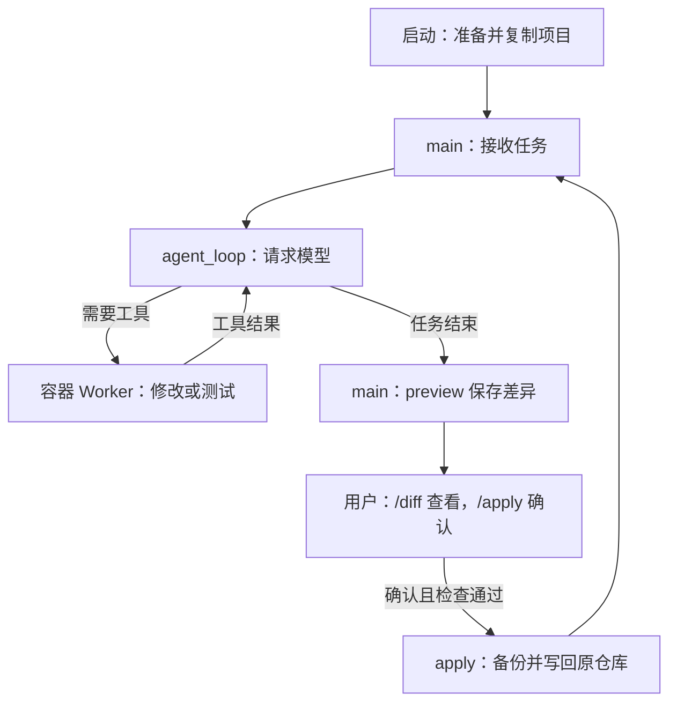
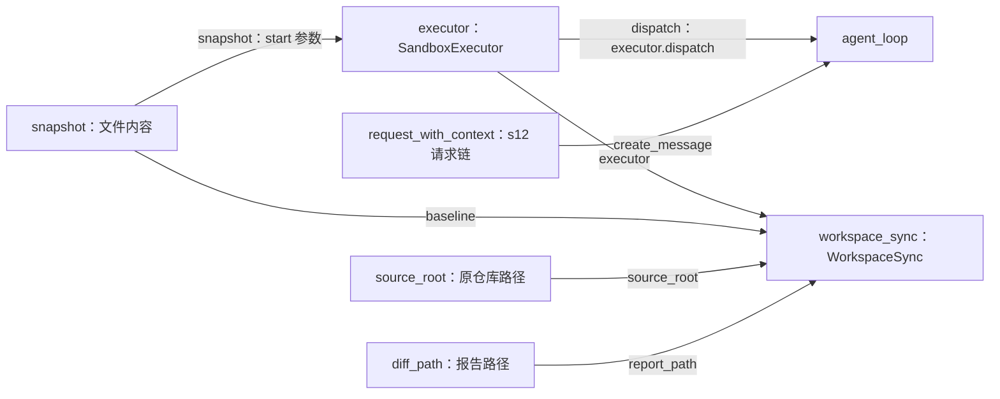

# s13-A：执行沙箱 · 隔离副本

这一章只抓住一个区别：**模型修改容器里的项目副本；你确认后，程序才把修改写回原仓库。** 宿主指你的电脑，容器的项目目录是 `/work`，两边不是同一份文件。

建议先读下面的例子，再找对应方法，最后看组装。模型请求、会话、压缩和事件沿用 s12，不在这一章重新展开。

## 1. 用“创建文件并测试”走一遍

假设原仓库还没有 `sandbox_demo.py`。如果已经有这个文件，请在下面的任务中换一个未使用的名字，不要覆盖已有内容。

启动后输入：

```text
在副本中新建 sandbox_demo.py，定义 add(a, b)，再用 Python 断言 add(2, 3) == 5。完成后说明改了什么。
```

一次正常完成的过程是：

1. **准备副本。** 程序读取当前项目中允许复制的文件，记住这些文件的内容，再创建容器并复制到 `/work`。你不需要手动创建容器。
2. **模型决定怎么做。** 宿主 Python 把任务发送给模型。模型可能选择 `write_file` 创建文件，再选择 `bash` 执行 Python 断言；具体工具次序由模型决定。
3. **工具修改副本。** 六种工具都在容器执行；创建的是 `/work/sandbox_demo.py`。工具结果返回宿主，再交给模型决定是否继续。
4. **完成后预览。** 模型结束工具调用后，程序比较副本和记住的文件内容，保存 `changes.diff`。这时原仓库仍没有新文件。
5. **你确认写回。** 输入 `/diff` 查看差异，再输入 `/apply`，确认时输入 `y`。检查通过后，原仓库立即获得新文件，容器仍然保留。
6. **退出。** 输入 `q`，程序保存剩余未应用的差异并清理容器，不会偷偷应用修改。没有剩余变化时提示“没有未应用修改”。

先记住：**副本里测试通过，不代表修改已经进入原仓库；看到“已应用”才表示写回完成。**

## 2. 在代码里，这几步分别找谁？

### 准备副本：`snapshot` 和 `executor.start()`

`main()` 先调用 `WorkspaceSnapshot.capture(source_root)`，得到变量 `snapshot`。它保存允许复制的文件路径和内容，不是容器，也不是对话历史。

接着，`main()` 调用 `executor.start(snapshot, run_root)`：执行器创建容器，把快照保存为 `source.tar` 并送入容器，由 Worker 解压到 `/work`。

“基线”就是**计算差异时用来对照的那份文件内容**。刚启动时，交付组件以 `snapshot` 为基线；应用成功后，它会更新为刚交付的版本。

对应文件：[sandbox.py](sandbox.py)、[snapshot.py](snapshot.py)。

### 修改和测试：`agent_loop()` → `executor.dispatch()` → Worker

`main()` 把 `executor.dispatch` 传给 `agent_loop()`。模型返回工具名称和参数时，循环通过已有 `execute_tool()` 调用它。

例如模型返回：

```text
工具：write_file
参数：{"path": "sandbox_demo.py", "content": "..."}
```

`executor.dispatch()` 将参数编码为 JSON，通过固定的 `docker exec` 交给容器中的 `tool_worker.py`。Worker 找到处理函数，执行后把结果返回循环，循环再请求模型。读取、搜索、写入、编辑、文件查找和 shell 都走这条路。

`hooks = Hooks()` 不注册逐条审批 Hook，因此不反复询问是否允许工具；保护来自容器执行边界，不是提示词。Docker 或 Worker 致命失败时停止，不回退到宿主执行。

对应文件：[code.py](code.py) 中的 `agent_loop()`、[tool_worker.py](tool_worker.py)。

### 查看和写回：`main()` → `workspace_sync`

`WorkspaceSync` 不在 Agent Loop 里面，也不是模型工具。它由宿主 `main()` 持有：

- 任务结束后，`main()` 调用 `workspace_sync.preview()`；输入 `/diff` 也会调用它。它通过 `executor.capture_workspace()` 取得容器当前文件，与基线比较，保存 Diff，并记住这次预览的版本。原仓库不变。
- 输入 `/apply` 后，`main()` 先展示文件列表并获取确认；只有输入 `y` 才调用 `workspace_sync.apply()`。回车或其他回答都取消。

`apply()` 的检查可以理解为三个问题：

1. 容器现在还是你预览过的那个版本吗？
2. 原仓库中要写入的目标有没有被你另外修改，路径和文件类型是否允许？
3. 补丁能否应用？

检查通过后，先备份，再用 Git 应用补丁，核对结果，最后更新基线。这里不自动暂存或提交；实际写入阶段失败会禁用本次运行的后续回写，需要人工检查备份和文件。

对应文件：[workspace_sync.py](workspace_sync.py)。`/diff` 和 `/apply` 由入口识别，不发送给模型，模型不能替你确认。

## 3. 运行流程图：只看先后顺序

这张图只画“任务正常完成后，用户确认交付”的路线。取消确认或检查失败时，原仓库不应用这批修改，回到输入入口；`q` 随时走退出收尾。



工具结果返回模型的循环，和用户确认写回的流程，是两件事。测试命令成功也不会绕过用户确认。

## 4. 组装结构：只看“谁提供给谁”

组装不是运行步骤。它是 `main()` 提前告诉组件：**请求模型找谁、执行工具找谁、比较文件用哪份基线。**

下面是 `main()` 中关键连线的摘录，省略路径检查、s12 请求链组装、交互与收尾，不能单独运行：

```python
source_root = Path.cwd().resolve()
snapshot = WorkspaceSnapshot.capture(source_root)
executor = SandboxExecutor(image=options.image)
run_root = SANDBOX_ROOT / executor.name
diff_path = run_root / "changes.diff"

workspace_sync = WorkspaceSync(
    source_root=source_root,    # 写回的原仓库
    executor=executor,          # 从这个容器取得文件
    baseline=snapshot,          # 刚启动时的比较基线
    report_path=diff_path,      # Diff 保存位置
)
executor.start(snapshot, run_root)

# 中间沿用 s12，组装模型、会话、事件及 request_with_context。

# 普通任务进入循环；/diff、/apply 由 main 单独处理。
agent_loop(
    active_context,
    create_message=request_with_context,  # 请求模型仍走 s12 请求链
    dispatch=executor.dispatch,            # 工具执行改走容器
    # 其他参数省略……
)
```

结构图的箭头统一表示**左侧向右侧提供依赖或数据**，线上标出真实参数名；不表示调用先后。



**传给循环的是执行工具的方法，不是把整套交付组件塞进循环。** `main()` 另行调用 `workspace_sync.preview()/apply()`，因此核心循环不用理解 Git 补丁和确认交付。

## 5. 再做一轮，为什么不会重复写回？

第一轮创建文件并应用成功后，让模型继续：

```text
给 sandbox_demo.py 中的 add 增加 int 类型注解，再运行原断言。
```

同一个容器仍然存活，所以模型可以直接修改那个文件。此时比较的是：

```text
第一轮：启动时的文件 → 创建 add 后的文件
应用成功：基线更新为“创建 add 后的文件”

第二轮：创建 add 后的文件 → 加上类型注解后的文件
应用成功：基线再次更新
```

所以第二次 Diff 只展示新增注解，不会重复交付第一轮内容。更新的是 `workspace_sync.baseline`，启动归档 `source.tar` 不会被改写。

如果你在编辑器里同时改了本批目标文件，程序会拒绝整批应用，不强行覆盖；无关文件的修改不会被覆盖。**宿主的外部编辑也不会自动反向同步到容器。**

## 6. 怎么运行和观察？

在项目根目录、已有虚拟环境中执行。当前目标是启动目录，没有 `--workspace` 参数。

先手动启动 Docker Desktop 的 Linux 引擎，再准备镜像：

```powershell
# 检查宿主 Git 和 Docker 服务
git --version
docker version

# 按 Dockerfile 制作运行环境；首次可能下载基础镜像和项目依赖
docker build -f s13_a_sandbox_copy/Dockerfile -t zero2pi-sandbox:s13-a .

# 无模型冒烟：验证容器工具，不加载模型配置、不回写原仓库
python -m s13_a_sandbox_copy.code --smoke

# 正式交互：默认就是 sandbox，不用手动创建容器
python -m s13_a_sandbox_copy.code
```

镜像是可以重复使用的环境模板；每次启动程序才创建本次容器。配方或镜像内工具变化时需要重建；旧 `zero2pi-sandbox:s13` 镜像不能替代 A 镜像。构建可联网，任务容器禁网，不会临时补装项目依赖。

模型配置仍来自宿主 `.env`，需填写 `MODEL_CONTEXT_WINDOW_TOKENS`。下面各行是在 Agent 交互入口输入，不是 PowerShell 命令：

```text
在副本中新建 sandbox_demo.py，定义 add(a, b)，再用 Python 断言 add(2, 3) == 5。完成后说明改了什么。
/diff
/apply
y
给 sandbox_demo.py 中的 add 增加 int 类型注解，再运行原断言。
/diff
/apply
y
q
```

观察：第一次确认前，原仓库没有新文件；确认后立即出现。第二次只交付注解。全部应用后退出，应提示“没有未应用修改”和“容器已清理”；仍有变化时才提示未应用 Diff 保存路径。导出或清理失败仍报错。

## 7. 记录保存在哪里？退出会失去什么？

所有记录留在宿主，不复制到容器：

- `.sessions/s13-a/*.jsonl`：对话、工具调用及实际返回结果、压缩记录和已知模型用量，供继续对话。
- `.traces/s13-a/*.jsonl`：请求、工具、错误和耗时等事件的精简记录，不重复保存完整大型正文或逐段流式文本。
- `.sandboxes/s13-a/<容器名称>/`：`source.tar` 是启动副本；`changes.diff` 是最近预览的未应用修改，全部应用后为空；`apply-001.diff` 和 `before-001.tar` 保存回写尝试的补丁及原文件内容，失败尝试也可能留下，不能仅凭文件名认定成功。

`/diff`、`/apply` 不进入对话或 Agent 事件 Trace；交付凭据在报告目录。

正常退出会删除容器：已应用的文件仍在原仓库，未应用内容保留为 Diff，不自动回写。用 `--session <历史会话路径>` 只能恢复消息和累计用量；它仍从当前原仓库创建新副本，不恢复旧容器或未应用文件。强制关闭终端或 Docker 失联可能残留容器，需按具体名称处理。

## 8. 边界与验证

- 全部六种工具在同一容器执行；无宿主挂载、无 Docker API、非 root、禁网、只读根文件系统，`/work` 和 `/tmp` 可写。资源限制为 CPU 1 核、内存/交换总额度 1 GiB、64 个进程、`/work` 512 MiB、`/tmp` 128 MiB，shell 超时 120 秒。
- 复制排除 `.env`、`.env.*`（保留 `.env.example`）、`.git`、依赖、运行目录和常见凭证；不复制链接或特殊文件。快照最多 4000 文件 / 12 MiB。文件名过滤不是通用脱敏，容器也不是绝对安全。
- 回写只支持普通非空 UTF-8 文本的新增、修改、删除；二进制/空文件变化、文件目录互换、大小写重命名和不适用于 Windows 的文件名整批拒绝，不交付链接或权限。
- 备份只保存内容，不承诺并发编辑或磁盘故障下的自动回滚。应用时不要同时编辑目标文件。
- 沙箱不保证模型收敛；需要限制消费时，显式配置 s11 的 `AGENT_MAX_ROUNDS`。

```powershell
# 离线测试：使用 Docker 替身和临时目录中的真实 Git，无模型调用
python -m pytest tests/test_s13_a_sandbox_copy.py tests/test_s13_a_workspace_sync.py

# 仅在 Docker 和本地镜像准备好后，验证真实隔离与两轮交付
$env:SANDBOX_INTEGRATION = "1"
python -m pytest tests/test_s13_a_sandbox_copy.py -k real_docker
Remove-Item Env:SANDBOX_INTEGRATION
```

离线测试验证接线、取消确认、冲突与失败收尾，不证明 OS 隔离；Docker 集成测试才检查实际非 root、禁网、只读根、无挂载及两轮交付。程序不会替你安装依赖、构建镜像或启动服务。

## 参考与差异

- **Pi：注入执行后端。** 保留“循环不关心工具执行位置”的思路，但本章把六种工具统一放入容器副本，并在隔离失败时停止；不是只包装 bash，也不采用本地示例的普通 bash 回退。本章离线与 Docker 测试分别验证接入和隔离。
- **Pi：直接操作实际工作区。** 本章为保护原仓库，改为先预览、后确认交付。s13-B 的共享工作区、s13-C 的原生隔离将比较直接写入的边界，目前没有实现代码。
- **lcc：worktree 隔离任务改动。** 本章不引入任务板或 worktree，而用容器限制执行环境、用文件基线检查交付冲突；任务改动分离不等于 OS 安全隔离。本章冲突测试验证用户已有内容不会被强行覆盖。
