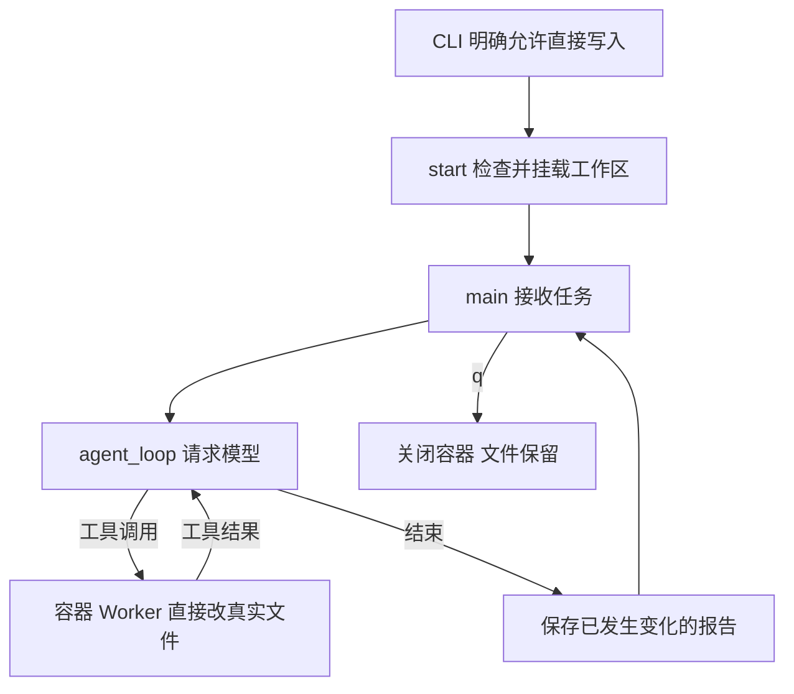
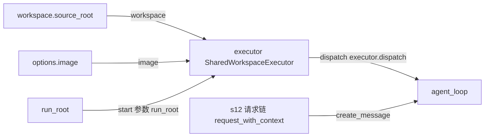

# s13-B：执行沙箱 · Docker 共享工作区

## 实现原理

宿主 Python 负责对话和模型请求，六种工具交给 Docker 容器中的 Worker 执行。与 A 复制项目不同，B 用共享挂载把真实项目接到容器 `/work`：电脑和容器访问的是同一份文件，工具修改后立即生效，不需要 `/apply`，退出也不会撤销。

容器通过禁网、非 root 和资源配额限制执行，并用只读空挂载遮蔽工作区内已识别的凭证和元数据。**启动时用 `--allow-write` 授权，不再逐条审批；授权范围内的误修改仍会直接发生。** `/diff` 只报告已经发生的变化，不是写回确认。

先用示例项目验证，不要直接拿未备份的重要仓库试验。

## 环境准备与运行示例

在 zero2pi 根目录、已有虚拟环境中操作。先手动启动 Docker Desktop 的本机 Linux 引擎。

```powershell
# 首次准备 B 镜像；已有镜像且镜像内代码未变时不用重复构建
docker build -f s13_b_sandbox_workspace/Dockerfile -t zero2pi-sandbox:s13-b .

# 仅在目录不存在时创建，已有目录请先检查内容，不要清空
New-Item -ItemType Directory -Path ".\example_project\b_demo"

# 本次授权只针对 b_demo；这不是 A 镜像，也不是副本模式
python -m s13_b_sandbox_workspace.code --workspace ".\example_project\b_demo" --allow-write
```

在 `s13-B >>` 输入整行：

```text
只用 Python 标准库，创建 sandbox_demo.py 定义 add(a, b)，创建 test_sandbox_demo.py，用 unittest 测试 2+3=5、-2+1=-1、0+0=0。执行 python -m unittest，修复到三个测试通过。不安装依赖，完成后说明文件和测试结果。
```

等工具执行结束，在另一个 PowerShell 查看：

```powershell
# 文件已经在电脑上，不用等 /apply 或退出
Get-ChildItem -LiteralPath ".\example_project\b_demo" -Force
```

预期出现两个源码文件，测试结果包含 `Ran 3 tests` 和 `OK`。这是预期，不是已经替你运行过的模型日志；具体工具次序由模型决定。

回到 Agent 输入 `/diff` 查看本次启动后已发生的变化，再输入 `q` 退出。输入 `/apply` 只会提醒无需应用，不请求模型、不执行补丁。

**不要把 `/diff` 当成审批：你看到它时，修改已经发生。** 如果希望确认前原仓库不变，请用 [s13-A](../s13_a_sandbox_copy/README.md)。

## 工作区挂载与文件位置

```text
电脑 example_project/b_demo  ← 同一份文件 →  容器 /work
```

`--mount type=bind` 把真实目录接给容器，不再打包 `source.tar` 或解压源码。测试仍使用镜像里的 Linux Python 和依赖，不能使用电脑的 Windows `.venv`。[Docker 共享挂载说明](https://docs.docker.com/engine/storage/bind-mounts/)

镜像只装固定工具，放在只读 `/opt/zero2pi`；项目放在可写 `/work`。修改项目不能替换固定 Worker。没有 Docker socket 挂载，没有网络，也不提供逐条审批 Hook。

## 核心组件与方法

- `main()`：核对 `--allow-write`，选定项目，组装请求链，处理输入及变化报告。授权不从历史会话恢复。
- `SharedWorkspaceExecutor.start(run_root)`：确认本机 Docker 和可信镜像，检查链接、硬链接和保护路径，创建挂载并探测 Worker。
- `dispatch(name, arguments)`：重核工作区，通过固定 `docker exec` 的 stdin JSON 把请求交给容器；模型不能提供挂载参数。
- `tool_worker.handle_request()`：在 `/work` 调用六种工具；bash 使用 Linux shell。凭证和元数据的文件参数提前拒绝，bash 则依赖 OS 挂载保护。
- `close()`：移除本次容器，项目文件不删除、不回滚。

`WorkspaceSnapshot` 在这里仅用于启动内容备份和 Diff，不是用于初始化容器。没有 `WorkspaceSync`，循环不负责补丁交付。

对应文件：[code.py](code.py)、[sandbox.py](sandbox.py)、[workspace_access.py](workspace_access.py)、[tool_worker.py](tool_worker.py)。

## 运行流程

流程图展示启动授权、工作区挂载、工具执行及退出的先后顺序。工具直接修改真实文件，任务结束后保存的是已发生变化的报告。



## 组装结构

箭头只表示左侧向右侧提供依赖或数据，不表示调用先后；参数名对应 `main()`。



关键连线是 `executor = SharedWorkspaceExecutor(workspace=source_root, image=options.image)`，然后把 `executor.dispatch` 传给本章完整 `agent_loop()`。模型、会话、压缩、事件按 A 的层次显式组装，不用一个包装函数藏住主流程。

## 隔离机制与使用限制

B 不能使用 A 的“复制时排除”来保护共享文件。它对工作区内**现有**的 `.env`、凭证、`.git`、运行记录和依赖目录，在容器里加只读空文件/空目录挂载，遮住原内容；不修改宿主这些对象，不 chmod 原项目。

源码范围内的错误修改和删除仍然可能发生。启动和每次工具调用会检查链接、硬链接、特殊文件及保护清单变化，但不会锁住编辑器；运行期间不要添加凭证、路径别名或同时修改目标文件。未知文件中的秘密不自动识别，保护不是通用脱敏。

禁止跨远程 Docker 使用同名路径；只支持本机 `unix://` 或 `npipe://` 引擎。Linux 容器使用当前普通用户 UID/GID，Windows 使用 65534，宿主不能以 root 启动 B；项目必须可由对应用户写入。镜像运行禁网、只读根、删除 capabilities、禁止提权，CPU 1 核、内存/交换总额 1 GiB、64 个进程、`/tmp` 128 MiB，shell 超时 120 秒。

新增保护对象时停止并要求重新启动，不自动放宽；基础设施失败同样停止，不回退宿主。容器不是绝对安全，Docker Engine 必须可信；需要 Git 元数据的操作在宿主由你完成，不提供容器内 Git 写入。

## 会话与报告

配置仍只加载 zero2pi 的 `.env`。记录放在 zero2pi 下：

- `.sessions/s13-b/<项目ID>/`：JSONL 与工作区绑定，同一项目的 B 会话才可恢复。
- `.traces/s13-b/<项目ID>/`：模型/工具事件；没有运行事件时不凭空创建 Trace 内容。
- `.sandboxes/s13-b/<项目ID>/<运行名>/`：`before.tar` 是启动内容备份，`changes.diff` 是已发生变化，`protection.json` 是遮蔽路径清单，`masks/` 是空遮蔽物。

Diff 包含本次启动后可报告的变化，也可能包含你的外部编辑，不把它们全部归因给模型；它不是完整文件系统审计，也不自动回滚。二进制只报告变化，缓存、链接及权限不在源码快照中。沿用 A 的 4000 文件 / 12 MiB 快照预算。

恢复时重新指定同一项目并传 `--allow-write --session <真实历史路径>`；A/C 会话不能直接混用。长 shell 输出全文只在容器临时目录中保留，退出后不可继续读取。

## 回归测试

以下命令用于验证 Harness 实现，不是运行示例的必做步骤。

```powershell
# 无容器、无模型：检查参数、即时写入接线和失败收尾
python -m pytest tests/test_s13_b_sandbox_workspace.py tests/test_s13_direct_runtime.py

# 本地 B 镜像和服务准备好后，显式测试真实共享挂载及凭证保护
$env:SANDBOX_B_INTEGRATION = "1"
python -m pytest tests/test_s13_b_sandbox_workspace.py -k real_shared
Remove-Item Env:SANDBOX_B_INTEGRATION
```

`--smoke --allow-write` 是真实写入冒烟，不请求模型，会在目标留下随机命名的 `_sandbox_smoke_*.txt`，不会自动删项目文件。离线替身不证明 OS 安全；真实测试包含写入立即可见、`.env` 的修改/删除/重命名被阻止、`.git` 原内容不变。

## 参考与差异

- Pi 注入执行后端，让循环不关心执行位置；本章保留这点，但六种工具统一走共享容器，不只包装 bash。本章离线测试验证组装，Docker 测试验证真实保护。
- 相对 A 删除副本传输与确认交付，用共享挂载解决编辑器实时看到文件的问题；代价是允许范围内的误修改直接生效。本章即时写入及退出测试验证，C 用原生进程继续比较同一权衡。
- lcc 的 worktree 分离任务改动，不限制 OS 权限；本章不引入任务板，使用容器与显式启动授权控制执行范围，本章链接拒绝及保护路径测试验证。
