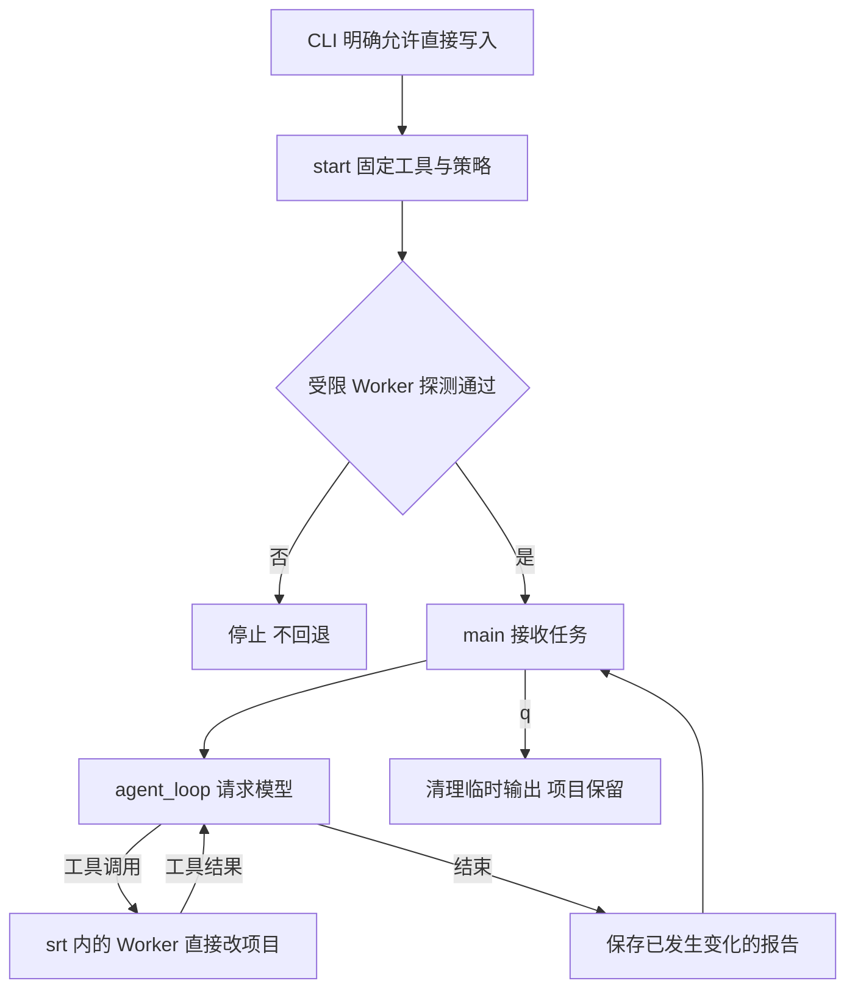
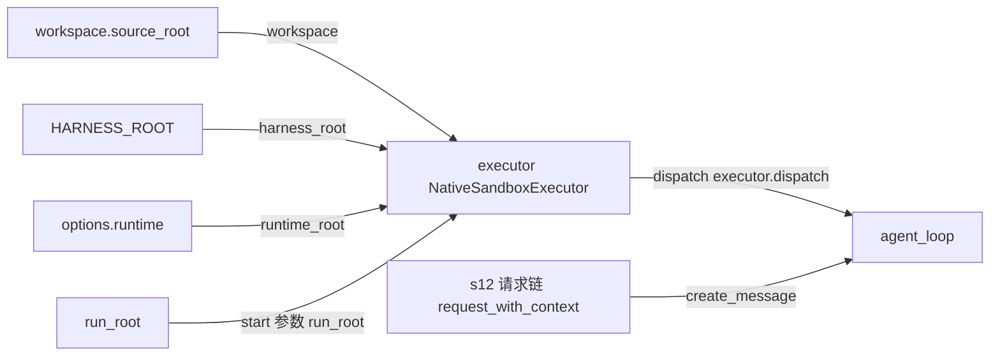

# s13-C：执行沙箱 · 原生受限进程

## 实现原理

宿主 Python 负责对话和模型请求，不创建 Docker 容器。工具调用交给 `sandbox-runtime` 启动的 Worker，六种工具及其 shell 子进程在操作系统限制下执行；策略限制文件读写和网络访问，而不只是切换工作目录。

Worker 直接访问真实项目，不复制源码。与 B 一样，修改立即生效，启动需传 `--allow-write`，不再逐条审批，也不需要 `/apply`；退出不回滚。**隔离依赖平台后端和实际权限状态；版本检查或启动探测失败就停止，不退回无保护执行。**

Harness 仍是 Python，仅执行后端调用用户手动安装的 `@anthropic-ai/sandbox-runtime`，固定版本 **0.0.79**。

观察者故障也会停止入口并清理执行器，但已发生的修改不撤销；历史投影与恢复直接复用 [s11](../s11_runtime_observability/README.md#有效历史与故障边界)，不会自动重放工具。

## 运行与验证

### 环境准备

在 zero2pi 根目录操作。不要为这个入口重新构建 Docker 镜像。

```powershell
# 检查已安装的 Node，需要 >=22.12；本章不会自动安装
node --version

# 首次安装固定版本；已准备好时不用每次运行重复安装
npm install --prefix .sandbox-runtime --save-exact @anthropic-ai/sandbox-runtime@0.0.79
```

runtime 安装在忽略 Git 的 `.sandbox-runtime/`，不是目标项目。版本不匹配、缺少依赖、初始化失败都会停止，不自动下载或换成本地无保护执行。

**Windows：上游支持是 alpha，不当作生产安全承诺。** 还需要由你手动做一次管理员初始化：

```powershell
# 这是已安装的固定版本 CLI；可能弹出一次 UAC，不是每个工具都审批
node ".sandbox-runtime/node_modules/@anthropic-ai/sandbox-runtime/dist/cli.js" windows-install
```

它创建专用沙箱账号和网络过滤，并在运行时为该账号设置、恢复文件权限。程序不会替你执行这条命令。不要并行运行其他向同一沙箱账号授予目录权限的任务；中断可能留下权限记录，需要 runtime 的恢复机制处理。

Linux 使用 bubblewrap，并要求用户手动准备 bubblewrap、socat、ripgrep；macOS 使用 sandbox-exec，并需要 ripgrep。请按对应平台准备，普通用户运行，不以 root 放权。WSL 是 Linux 环境，需要其中的 Python、虚拟环境和 Node，不能直接复用 Windows `.venv`。[固定版本平台与准备说明](https://github.com/anthropics/sandbox-runtime/tree/v0.0.79#platform-support)

### 启动与测试

Harness 的 `.env` 仍需要模型配置与实际 `MODEL_CONTEXT_WINDOW_TOKENS`。在 zero2pi 根目录的 PowerShell 执行：

```powershell
# 首次创建另一个示例目录；已有时检查内容，不清空
New-Item -ItemType Directory -Path ".\example_project\c_demo"

# 使用本地默认 runtime，明确授权该目录的真实写入
python -m s13_c_sandbox_native.code --workspace ".\example_project\c_demo" --allow-write
```

启动会先探测：受保护文件是否不可读、报告目录是否不可写、随机宿主监听端口是否不可连接。探测失败就停止，尚未请求模型；探测通过也不等于不存在其他逃逸途径。

在 `s13-C >>` 输入整行：

```text
只用 Python 标准库，创建 sandbox_demo.py 定义 add(a, b)，创建 test_sandbox_demo.py，用 unittest 测试 2+3=5、-2+1=-1、0+0=0。执行 python -m unittest，修复到三个测试通过。不安装依赖，完成后说明文件和测试结果。
```

正常情况下测试包含 `Ran 3 tests`、`OK`，文件立即出现在电脑的 `c_demo`，不是副本。另开一个 PowerShell 查看：

```powershell
Get-ChildItem -LiteralPath ".\example_project\c_demo" -Force
```

再在 Agent 输入 `/diff` 查看已发生的变化、`q` 退出。无需 `/apply`。这些是操作步骤和预期，不是已运行的模型日志。

### 使用要点

- **后端路径：** `--runtime <包目录>` 可更换安装位置，必须指向可信的固定版本包根目录，包含 `package.json` 和 `dist/cli.js`。
- **记录与恢复：** 配置只加载 zero2pi 的 `.env`；会话、Trace 和报告分别保存在 `.sessions/s13-c/`、`.traces/s13-c/`、`.sandboxes/s13-c/`，按项目 ID 分组。恢复时指定同一 `--workspace`，追加 `--allow-write --session <会话路径>`，保留旁路绑定文件，不混用 A/B 会话。
- **保护范围：** 策略保护已识别的凭证、Git 元数据和运行目录，仍允许解释器及系统必需路径读取，并包含平台默认临时路径规则；不是所有宿主文件的通用读取白名单，不识别源码中的所有秘密。运行期间不要添加凭证、路径别名或同时编辑目标文件。
- **平台限制：** C 没有 B 的 CPU/内存配额，不能认为隔离强度相同。Windows 仍是 alpha，应避免并行原生沙箱；强制中断可能需要 runtime 恢复残留权限。先用独立示例项目验证。
- **报告与冒烟：** `before.tar` 保存启动内容，`changes.diff` 报告已发生变化，也可能包含外部编辑，不提供自动回滚。`--smoke --allow-write` 不请求模型，但会留下 `_sandbox_smoke_*.txt`；长 shell 输出全文随临时目录清理而丢失。

## 核心组件与方法

- `main()`：核对本次授权、绑定项目，显式组装模型/上下文链，处理输入和变化报告。技能路径指向真实工作区，不再写成 `/work`。
- `NativeSandboxExecutor.start(run_root)`：检查版本，把固定工具复制到受保护的 `trusted/`，生成 `settings.json`，通过同一受限 Worker 实测三项限制。
- `dispatch(name, arguments)`：检查工作区和保护清单，使用固定 Node/CLI/Worker 参数启动进程；模型工具名和参数只经 stdin JSON 传递。
- `run_native()`：清除模型密钥、`NODE_OPTIONS` 等环境变量，分别有界收集 stdout/stderr；超时或中断按本次 PID 清理，不按程序名称批量杀进程。**它本身不是沙箱，真正限制来自 srt。**
- `tool_worker.handle_request()`：六种工具都在原生受限进程里执行，bash 子进程继承限制；Windows 使用 cmd.exe，其他平台使用 `/bin/sh`。
- `close()`：撤销入口就绪状态，清理本次独立临时输出；项目、Session、Trace 和报告保留。

对应文件：[code.py](code.py)、[sandbox.py](sandbox.py)、[tool_worker.py](tool_worker.py)。固定工具来自 s02，不从可写目标导入实现。

## 运行流程

流程图展示启动授权、策略准备、隔离探测、工具执行及退出的先后顺序。探测失败时停止；工具执行成功后，真实项目的修改立即生效。



## 组装结构

箭头只表示左侧向右侧提供依赖或数据；名称对应实际构造参数，不表示执行顺序。



`NativeSandboxExecutor(workspace=source_root, harness_root=HARNESS_ROOT, runtime_root=options.runtime)` 接收实际执行依赖；本章完整 `agent_loop()` 只接收 `executor.dispatch`，不承担平台策略、提权初始化或进程参数组装。

## 回归测试

以下命令用于验证 Harness 实现，不是运行示例的必做步骤。

```powershell
# 无原生 runtime、无模型：检查策略、stdin 接线、超时和完整入口
python -m pytest tests/test_s13_c_sandbox_native.py tests/test_s13_direct_runtime.py

# runtime 与平台初始化准备好后，显式验证真实限制
$env:SANDBOX_C_INTEGRATION = "1"
$env:SANDBOX_RUNTIME_ROOT = (Resolve-Path ".sandbox-runtime/node_modules/@anthropic-ai/sandbox-runtime").Path
python -m pytest tests/test_s13_c_sandbox_native.py -k real_native
Remove-Item Env:SANDBOX_C_INTEGRATION
Remove-Item Env:SANDBOX_RUNTIME_ROOT
```

离线测试只证明程序组装和失败路径，不证明 OS 隔离。真实测试会启动你已准备的原生后端，检查即时文件写入、启动三项探测及 shell 不能修改 `.env`；不替你安装、初始化或调用付费模型。

## 参考与差异

- Pi 本地示例注入沙箱 bash 的 operations，以实际工作区完成任务；本章保留执行后端注入，但限制全部六种工具的 Worker，不只限制 bash。本章协议、失败回归和显式原生测试分别验证接线与实际限制。
- Pi 本地示例固定旧 runtime，并在未启用/未初始化时退回普通 bash；本章固定 0.0.79，通过 Python CLI 接入，版本或探测失败立即停止。本章失败测试验证不回退，不把上游 Windows alpha 当作稳定保证。
- 相对 B 换掉 Docker 创建和共享挂载，改用原生策略、固定工具快照和进程清理；模型、会话、压缩、事件的组装保留，本章完整入口测试验证。lcc 的教学分区与独立循环保留，不复制其实现。
