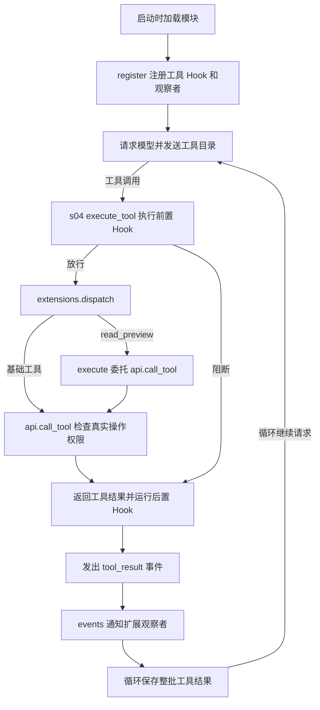
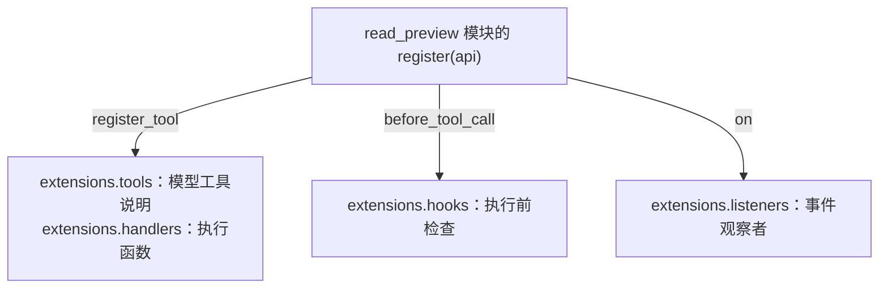
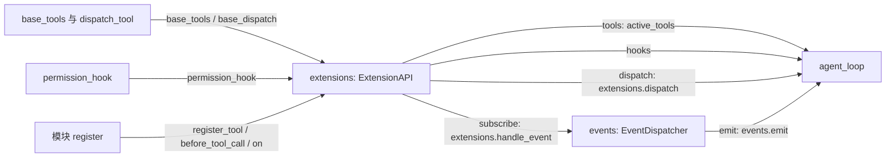

# s14：能力系统 · Extensions

## 实现原理

Skills 提供任务说明，Extension 是新增功能的包，可以提供工具、Hook 或事件观察者中的一种或多种，不必三种都有。Tool 做事，Hook 决定能否执行或处理结果，Event 报告已经发生的事情；扩展订阅已有 Event，并不是每个扩展都要新增事件类型。

启动时加载受信任 Python 模块，调用 `register(api)`，将这些能力接入已有运行时；`agent_loop` 不增加扩展分支。

本章复用 s12 的模型、会话、压缩和技能，用 s13-A 的完整循环保留致命后端失败保护。s13-A/B/C 是执行后端的不同方案，本章不启动沙箱，也不把任意扩展 Python 当成受限进程。

扩展观察者报错会通过 s11 的 `EventDispatchError` 停止入口，不能当普通模型错误继续任务；历史恢复复用 [s11 的有效投影](../s11_runtime_observability/README.md#有效历史与故障边界)，不自动重放缺失结果的调用。

## 运行与验证

在 zero2pi 根目录、已有虚拟环境和模型配置下执行，无新增安装步骤：

```powershell
# 加载自带 read_preview 扩展，基础操作使用只读权限
python -m s14_extensions.code --mode read-only
```

在 `s14 >>` 输入：

```text
用 read_preview 读取 s14_extensions/extensions/read_preview.py 的前 20 行，简要说明它的作用，不执行 shell。
```

预期看到 `read_preview` 调用、读取结果以及“扩展 read_preview 完成”提示。示例工具将读取委托给已有 `read_file`，所以换工具名不会绕过路径和凭证检查。模型是否选择工具仍由模型决定，离线测试验证确定的调用链。

示例的前置 Hook 拒绝超过 80 行的预览；可以输入“调用 read_preview 读取该文件 100 行，若被拒绝只解释原因，不重试”观察阻断。模型可能主动调整为 80 行，需以实际调用参数为准，确定的阻断路径由离线测试验证。80 行仅是演示工具的职责，不改变基础读取工具的预算。

```powershell
# 不请求模型：验证注册、Hook、事件、权限、会话恢复与完整入口
python -m pytest tests/test_s14_extensions.py
# 显式选择可信模块；重复 --extension 可加载多个，替换默认示例
python -m s14_extensions.code --mode read-only --extension s14_extensions.extensions.read_preview
```

使用要点：扩展 Python 在宿主执行，必须信任模块；只读检查约束经 `api.call_tool` 委托的基础操作，不限制模块自行执行的 Python。会话和 Trace 留在 `.sessions/s14/`、`.traces/s14/`；`--session <会话路径>` 恢复消息和用量，扩展按本次启动参数重新注册，不恢复 Python 对象。

## 核心组件与方法

### 示例扩展提供的能力

`read_preview.py` 是扩展模块，`ReadPreviewExtension` 是组织回调的小组件。它提供三项能力：

- 工具 `preview.execute`：完成文件预览，委托已有 `read_file`，不是重新实现文件读取。
- 前置 Hook `preview.check_preview`：检查行数，超过 80 行就阻止读取。
- 事件观察者 `preview.observe_result`：收到 `tool_result` 通知后打印完成或失败，不参与审批。

模块的 `register(api)` 将它们登记到运行时：

```python
api.register_tool(definition, preview.execute)
api.before_tool_call(preview.check_preview)
api.on("tool_result", preview.observe_result)
```

**注册时不执行这些函数，只保存回调。** 这里传的是 `preview.execute`，没有 `()`，不是当场读取文件。工具注册同时保存两份内容：

```python
# 简化说明，省略校验和复制
tools.append(definition)  # 给模型看：名称、说明和参数格式
handlers["read_preview"] = preview.execute  # 给程序用：实际执行的 Python 函数
```

### 注册入口与事件总线

`main()` 中的 `extensions = ExtensionAPI(...)` 是接收注册的地方，不是某个具体扩展。`load_extensions(extensions, ...)` 加载模块并调用 `register(api)`；其中 `api` 就是这个 `extensions` 对象。

`extensions.dispatch()` 按工具名查找 handler；扩展需要基础操作时调用 `api.call_tool()`，先检查真实工具的权限，再调用后端。前后置 Hook 的执行仍复用 s04。

`events = EventDispatcher()` 是 s11 已有的通知分发器。终端、Trace、统计器都接收它的通知；s14 只增加一个接收者：

```python
events.subscribe(extensions.handle_event)
```

事件到来时，`handle_event()` 根据 `extensions.listeners` 筛选订阅者。因此 `tool_result` 通知交给 `preview.observe_result`，其他类型不会交给它。Hook 控制执行，事件观察者只消费运行事实。

阅读顺序：先看示例 [read_preview.py](extensions/read_preview.py) 的 `register()`，再看 [registry.py](registry.py) 的注册与分发，最后看 [code.py](code.py) 的 `main()`。普通扩展工具异常返回错误结果；事件观察者异常沿用 s11 的直接暴露规则，后端致命错误停止并补齐工具结果批次。

## 运行流程

假设模型调用 `read_preview(path="README.md", limit=20)`：先由 Hook 检查，再由 handler 委托读取，最后发出结果事件并通知观察者。以下展示这个调用在循环中的位置：



如果实际调用是 `limit=100`，Hook 就返回拒绝结果，不进入 handler，但仍发出 `tool_result`，观察者打印“失败或被阻断”。基础权限拒绝时也不读取。一次预览在会话和用量中仍是一次模型工具调用，内部委托不重复计数；下一次请求由循环发起，不由观察者触发。

## 组装结构

箭头表示左侧向右侧提供依赖或数据，标注对应变量、参数或注册方式，不表示执行顺序。

### 能力注册

一个扩展将自己的能力提供给三个不同的注册集合：



### 运行时组装

`main()` 再把注册结果提供给已有循环和事件总线：



`main()` 先组装基础权限，再加载扩展；最后把 `extensions.tools`、`extensions.hooks` 和 `extensions.dispatch` 分别传给循环。模型请求链沿用 s12，不与扩展注册混在一起。

## 参考与差异

- Pi 通过模块注册工具与事件，减少能力对核心循环的侵入。本章保留注册入口，改为 Python `register(api)`，只显式加载启动模块；工具、Hook 和 Event 的接入均由本章测试验证。
- Pi 的部分事件能拦截执行。本项目已有 s04 Hooks，因此保留“Hook 控制、Event 观察”的分工，不为扩展重复实现一套拦截链；本章阻断和后置处理测试验证。
- lcc 用逐步展开的工具分发表组织教学。本章保留独立完整循环，但将新增能力放入注册层，不复制其实现。与 s13 的区别是扩展宿主代码不受工具沙箱保护；本章测试只证明委托入口的权限与分发，不证明任意插件安全。[s15](../s15_stateful_extensions/README.md) 已复用注册入口实现 Todo 状态、会话恢复和事件进度提示。
