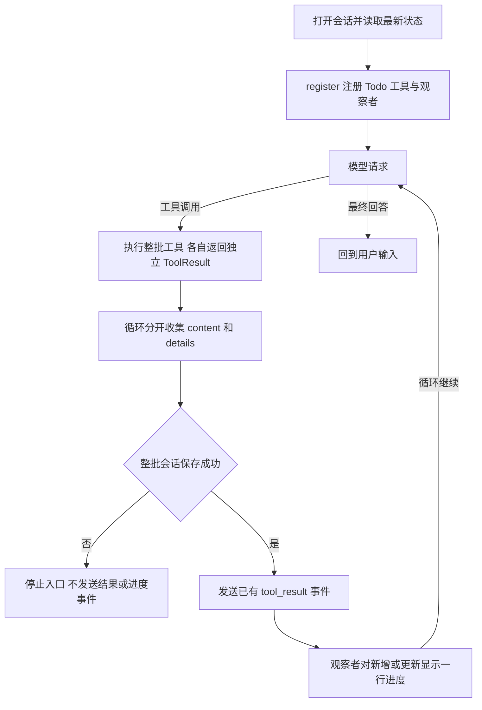
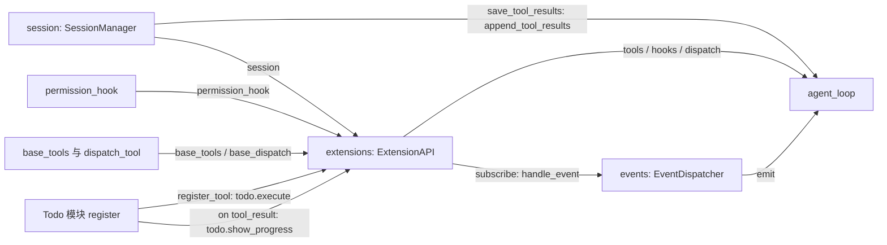

# s15：能力系统 · 有状态扩展（Todo）

## 实现原理

Todo 是一个可选扩展，注册一个工具和一个事件观察者：工具创建、查询、更新清单，观察者显示进度。任务只有完成/未完成两种状态；标记完成不代表代码已经通过测试，也不自动执行清单中的工作。

相对 s14，通用工具结果新增 `details`。正文交给模型，状态快照随工具结果写入会话；保存成功后才发送 `tool_result` 事件。恢复时从完整日志读取最新快照，不从摘要猜进度。循环、会话和注册层都没有 `todo` 专用分支。

## 运行与验证

在 zero2pi 根目录、已有虚拟环境和模型配置下执行，`MODEL_CONTEXT_WINDOW_TOKENS` 仍需填写实际窗口，无新增安装步骤：

```powershell
# 默认加载 Todo 扩展；只读限制基础文件工具，不禁止保存会话清单
python -m s15_stateful_extensions.code --mode read-only
```

在 `s15 >>` **逐条输入**，每条回答结束后再输入下一条：

```text
这是清单演示：添加“阅读入口”“理解状态保存”“运行测试”三个待办，只记录任务，不读取文件或执行命令。
把任务 #1 设为已完成，这是清单标记演示，不要执行其他工作。
查看目前任务清单和进度。
```

预期：添加时分别显示 `进度  0/1`、`0/2`、`0/3 已完成`；更新后显示 `进度  1/3 已完成`。查询调用 `todo(action="list")` 返回完整清单，不再额外打印进度，避免重复。模型调用次序可能不同，这不是已运行的真实模型日志。

输入 `q` 退出，再把启动时打印的会话路径替换到下面的占位处，查询同一清单：

```powershell
# 恢复消息、用量及 Todo 状态，不重新创建清单
python -m s15_stateful_extensions.code --mode read-only --session "<实际会话路径>"
# 离线验证完整入口、压缩后恢复、事件顺序和保存失败处理，不请求模型
python -m pytest tests/test_s15_stateful_extensions.py
```

使用要点：会话和 Trace 分别位于 `.sessions/s15/`、`.traces/s15/`，清单不另写 `.tasks/`；只加载可信宿主 Python 扩展，不是沙箱。`--extension <模块名>` 替换默认扩展，可重复指定；任务最多 100 项，每项文字最多 500 字符。

## 核心组件与方法

- [todo.py](extensions/todo.py) 的 `TodoExtension`：`execute()` 处理 `list/add/set_done`，返回快照；`restore_state()` 校验并恢复状态；`show_progress()` 只读取事件中的快照，不修改清单。
- [result.py](result.py) 的 `ToolResult`：`content` 是正文，`details` 是程序状态；`execute_tool()` 保留 s04 的 Hook 流程，后置 Hook 只处理正文，不丢掉元数据。
- [registry.py](registry.py) 的 `ExtensionAPI`：在 s14 注册入口上接收结构化结果，`get_tool_details()` 把会话中的最新快照提供给 `register(api)`。
- [session.py](session.py) 的 `SessionManager`：`append_tool_results()` 保存整批正文和状态，`latest_tool_details()` 从完整日志反向查找指定工具的最新快照。
- [code.py](code.py) 的 `agent_loop()`：分别收集正文、元数据和事件，调用 `save_tool_results` 保存批次，然后发送事件；保存失败停止整个入口，不带未保存的内存状态继续下一任务。

例如，`set_done` 返回两份不同用途的数据：

```python
ToolResult(
    content="任务 #1 标记为已完成",  # 进入模型上下文与普通工具输出
    details={"action": "set_done", "todos": [...], "next_id": 4},  # 快照随会话保存
)
```

单次调用的状态叫 `ToolResult.details`；循环按调用 ID 收集为 `tool_details`，交给 `append_tool_results()`，最终保存到 `MessageEntry.tool_details[调用ID]`。它不进入模型 `tool_result` 内容块。恢复时先从最新记录查起，同批也先查最后一次调用，找到指定工具的快照后交给扩展恢复。

`build_context()` 仍只投影正文；即使旧正文被压缩，`load_entries()` 仍保留恢复依据。保存失败不自动回滚 JSONL，需检查记录后再恢复，不能将报错视为已经保存成功。

同批可能执行多次 Todo 操作，每次结果都复制自己的快照。观察者读取 `event.data["details"]`，而不是组件的最终 `self.todos`，所以能正确显示 `0/1 → 0/2 → 1/2`，不会把较早事件都显示成最终进度。

观察者报错会停止入口。若整批结果已经保存，Todo 最新快照仍可恢复；若结果尚未保存，不从模型文字补造状态。有效历史与缺失结果处理复用 [s11](../s11_runtime_observability/README.md#有效历史与故障边界)，不会自动重放调用。

## 运行流程



结果事件在整批保存后按调用顺序发送，工具耗时仍按实际执行计算。Event 只观察结果，不决定完成状态、不发起下一次模型请求；查询显示完整列表，更新自动提示数量，不需要 `/todos` 命令。

## 组装结构

箭头统一表示左侧向右侧提供依赖或数据，线上标注实际参数或注册方式，不表示执行先后。



`main()` 先打开会话，再创建注册层并加载扩展，确保 `register()` 可以恢复状态。模型、压缩和统计的组装沿用 s14；本章新增的循环参数只有通用的 `save_tool_results`，而不是 Todo 组件。

## 参考与差异

- Pi 的 Todo 扩展用工具结果 `details` 保存清单，重建时读当前分支。本章保留结果快照，使用现有线性会话的完整日志恢复；不另建任务数据库或分支机制。压缩后恢复及同批快照测试在 s15 验证。
- Pi 使用 `toggle`；本章用明确的 `set_done`，重复请求不会反转状态。Pi 的 `renderResult` 和 `/todos` 用于展示；本章复用 Event 自动显示一行进度，完整查询仍走工具，不增加 TUI 或命令注册。幂等更新、查询及事件顺序测试在 s15 验证。
- lcc 用独立任务文件与依赖关系支持任务系统。本章只演示有状态扩展，省去依赖图和调度；结构化元数据放在消息记录旁，不改变 Provider 协议。s15 测试验证模型请求不携带元数据、原有权限与用量行为保持。
