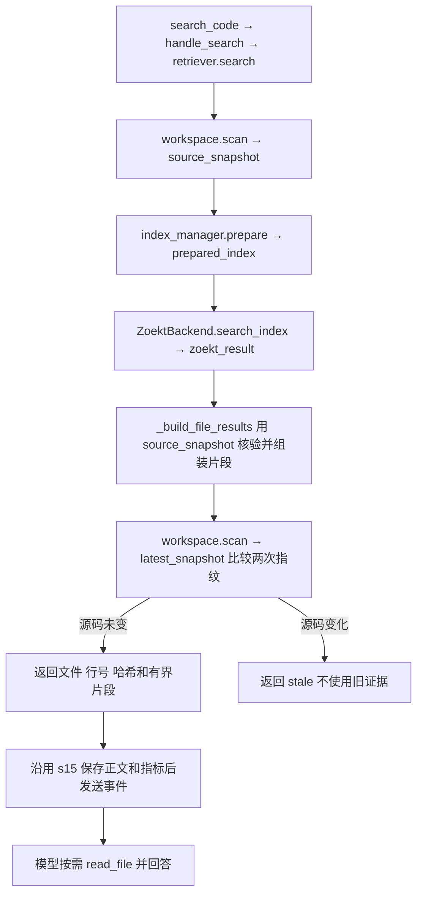
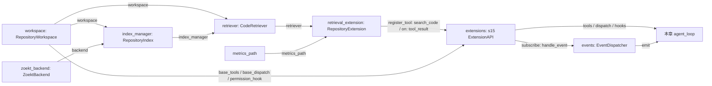

# s16：仓库系统 · Zoekt 文本检索

## 实现原理

Zoekt 把源码建立为带位置的 trigram（三字符）倒排索引，搜索时筛选候选并验证匹配。Python 负责目标范围、缓存更新、结果预算和扩展接入，不重写搜索算法。

相对 s15，新增 `search_code`；与 `glob`、`grep`、`read_file` 共用一个目标项目。检索返回排序文件、行号和 `content_hash`，模型再按需读取源码。完整 `agent_loop` 保留在 [code.py](code.py)，没有检索业务分支。

## 运行与验证

在 zero2pi 根目录、已有虚拟环境下运行。先手动启动 Docker Desktop 的 Linux 服务，再**构建一次**镜像：

```powershell
# 手动下载基础镜像、固定版本 Zoekt 和 Go 构建依赖；只把 search.go 发入构建上下文
docker build -t zero2pi-zoekt:s16 s16_repository_search
# 不调用模型：检索当前项目中 latest_tool_details 的定义或引用
python -X utf8 -m s16_repository_search.code --search latest_tool_details --scope s15_stateful_extensions
# 启动只读 Agent；复用根目录 .env 中的 Provider 与实际上下文窗口配置
python -X utf8 -m s16_repository_search.code
```

在 `s16 >>` 输入：

```text
只读分析：先搜索 latest_tool_details，再读取相关源码，解释 Todo 状态从哪里恢复。给出文件和行号。
```

观察：`search_code` 返回位置和哈希，`read_file` 补读后模型解释；不会请求 bash 审批，因为本章不开放 shell 或写入工具。返回次序由模型和 Zoekt 决定，此处不是实测日志。

默认目标是 zero2pi；其他已有项目使用 `--workspace "D:\dev\my-app"`。`--session "<启动时打印的 JSONL 路径>"` 只恢复同一目标的 s16 会话。无需 `--mode`，本章固定只读。

修改目标源码**不需要重建镜像**：首次检索或允许文件内容变化时重建索引，未变化时复用。只有 Dockerfile、search.go 或固定 Zoekt 版本变化才需重新构建镜像；程序不自动下载、构建或启动 Docker 服务。

```powershell
# 离线回归：使用后端/模型替身，不启动容器、不产生 API 费用
python -m pytest tests/test_s16_repository_search.py
# 镜像手动准备后，显式验证真实 Zoekt 的查询、目录范围、更新、删除与人工标签
$env:ZERO2PI_TEST_ZOEKT = "1"
python -m pytest tests/test_s16_repository_search.py -k real_zoekt
Remove-Item Env:ZERO2PI_TEST_ZOEKT
```

普通回归不证明真实引擎性能；真实测试只验证小样本正确性，不是 SWE-bench 成绩或 Agent Token/工具调用提升。

## 组件与方法

- [workspace.py](workspace.py) `RepositoryWorkspace`：`scan()` 得到合规 UTF-8 快照；`dispatch()` 将基础读取绑定到同一目标；`read_file(expected_hash=...)` 拒绝用旧位置读取新版本。
- [index.py](index.py) `RepositoryIndex.prepare()`：管理索引的复用与重建，返回 `PreparedIndex`。新建时先写过滤副本，再调用 Zoekt 建分片，成功后发布；s16 是整代重建，不是逐文件增量更新。
- [zoekt.py](zoekt.py) `ZoektBackend`：`build_index()` 调用官方索引器，`search_index()` 查询磁盘索引。短容器无网络，只挂载过滤副本/缓存，不挂载原项目或 Docker socket。
- [retrieval.py](retrieval.py) `CodeRetriever.search()`：组织一次完整检索。`_build_file_results()` 用同版源码核验 Zoekt 的位置并组装片段，不重新搜索或排序。
- [extension.py](extension.py) `RepositoryExtension`：`register()` 注册工具与事件；`handle_search()` 接收工具参数并调用检索器。`content` 进入模型，`details` 保存检索指标。

阅读顺序：`main()` 看组件组装 → `CodeRetriever.search()` 看完整流程 → `RepositoryIndex.prepare()` 看缓存复用/构建两条路径；最后再看过滤和容器细节。

## 关键数据

| 名称 | 含义 |
| --- | --- |
| `source_snapshot: SourceSnapshot` | 第一次扫描得到的内存源码。`file_contents` 是路径→完整字节，`file_hashes` 是逐文件哈希，`fingerprint` 是整体指纹，`skipped_counts` 是跳过计数。 |
| `prepared_index: PreparedIndex` | 已准备好的索引信息：`index_dir` 是磁盘分片目录，`generation` 是代次，`rebuilt` 表示本次是否重建；不包含源码，也不是索引本体。 |
| `zoekt_result` | Zoekt 返回的排序文件、匹配行号与完整性标记，还不是模型最终看到的 JSON。 |
| `latest_snapshot` | 查询结束前再次扫描的内存源码，只用整体指纹检查期间是否有变化。 |
| `search_result` / `search_metrics` | 前者组织给模型的结果；后者统计耗时等信息，通过 `ToolResult.details` 保存和记录。 |

`SourceSnapshot` 不是磁盘副本。新建索引时，`prepare()` 才把其中字节写入缓存的 `source/`，供 Zoekt 读取；分片保存在同代次的 `shards/`。命中缓存时不重写副本。两次扫描可能同时占用内存，32 MiB 是单次源码字节上限，不是进程总内存上限。

## 运行流程



例如搜索 `add`：第一次读到 `app.py` 第 1 行是 `def add(...)` → 准备对应索引 → Zoekt 返回 `app.py:1` → 用第一次读到的源码核验并截取片段 → 第二次扫描。源码没变才返回结果；若期间改成 `subtract`，返回 `stale`，而不是用新源码解释旧行号。第二次扫描不负责再建索引或再搜索。

无匹配是 `empty`；搜索不完整是 `partial`；源码变化是 `stale`；扫描、构建或协议错误是 `failed`；参数错误是 `invalid`。`truncated` 表示显示内容有省略，`search_exhaustive` 表示后端是否完成搜索，二者不同。`empty` 仅针对允许索引的范围，跳过计数另列。

## 组装结构

箭头表示左侧向右侧提供依赖或数据；标签对应真实参数/注册方法，不表示执行先后。



运行记录按目标规范路径哈希分组：`.sessions/s16/<项目ID>/`、`.traces/s16/<项目ID>/`、`.indexes/s16/<项目ID>/`。检索指标在 Trace 旁的 `*.retrieval.jsonl`，普通 Trace 不重复保存完整 details。恢复会话不恢复授权或索引状态；旧缓存留作可重建数据，不写回原仓库。

## 范围与参考

本章只搜区分大小写的单行字面文本；`scope` 是相对目录，省略表示整个允许范围。最多 20 个文件、每文件 3 个匹配行、正文 16 KiB；单文件 1 MiB、源码总量 32 MiB、5000 个合规文件/20000 个目录项，超过总容量明确失败。排除常见凭证、依赖、运行记录、路径别名、二进制及非 UTF-8；Git 项目在读正文前应用 Git ignore。任意文件中的秘密无法靠名称识别；这是只读应用策略，不是宿主 OS 沙箱，扫描也不是原子快照。

- [Sourcebot](https://github.com/sourcebot-dev/sourcebot/blob/main/packages/web/src/features/search/zoektSearcher.ts) 用 Zoekt 返回有范围和位置的结果。本章保留这一职责，改为短容器而非常驻 gRPC/Web 服务，降低部署复杂度；更新、范围、结果完整性由 s16 回归验证。
- 复用 [Zoekt](https://github.com/sourcegraph/zoekt/tree/27517a30ae6df16c6e768623847fdab8f6a3bbcf) 固定提交 `27517a30ae6df16c6e768623847fdab8f6a3bbcf` 的索引和搜索 API；Go 文件只构造字面查询、约束范围并导出位置，保留上游 LICENSE。s16 关闭 ctags，s17 再实现 Python 符号边界与文本命中映射。
- Pi 提供扩展注册边界，本章继续用 s15 API，不修改循环。lcc 强调渐进章节；本章只引入文本索引，不提前加入 Potpie 式向量和代码关系数据。语义融合与关系扩展分别由 s18、s19 实现和验证。
