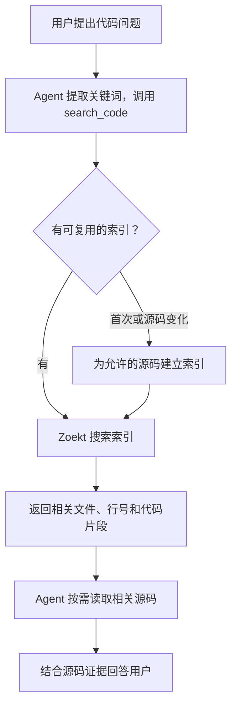
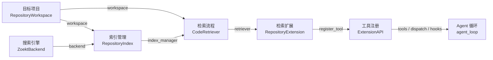

# s16：仓库系统 · Zoekt 文本检索

## 实现原理

Zoekt 把源码建立为带位置的 trigram（三字符）倒排索引，搜索时筛选候选并验证匹配。Python 负责目标范围、缓存更新、结果预算和扩展接入，不重写搜索算法。

Python 在宿主机组织检索，Zoekt 在短容器中建索引和查询。Docker 镜像准备的是 Zoekt 程序，不是目标仓库的源码或索引；模型只提供查询并阅读结果，不参与索引构建。`main()` 启动时验证目标缓存可写、检查后端并组装组件，第一次调用 `retriever.search()` 才构建或复用索引。

相对 s15，新增 `search_code`；与 `glob`、`grep`、`read_file` 共用一个目标项目。检索返回排序文件、行号和 `content_hash`，模型再按需读取源码。完整 `agent_loop` 保留在 [code.py](code.py)，没有检索业务分支。

## 整体工作示意


按①–⑥看一次搜索到源码补读的过程；方框表示运行区域，箭头标明请求或数据去向。虚线只在需要重建时发生。检索模块对应 `RepositoryExtension`、`CodeRetriever`、`RepositoryIndex`；`ZoektBackend` 负责调用容器内的程序。

## 运行与验证

在 zero2pi 根目录、已有虚拟环境下运行。先手动启动 Docker Desktop 的 Linux 服务，再**构建一次**镜像：

```powershell
# 手动下载基础镜像、固定版本 Zoekt 和 Go 构建依赖；只把 search.go 发入构建上下文
docker build -t zero2pi-zoekt:s16 s16_repository_search
# 不调用模型：检索独立示例中 add 的定义或引用
python -X utf8 -m s16_repository_search.code --workspace example_project/retrieval_demo --search add
# 启动只读 Agent；复用根目录 .env 中的 Provider 与实际上下文窗口配置
python -X utf8 -m s16_repository_search.code --workspace example_project/retrieval_demo
```

在 `s16 >>` 输入：

```text
只读分析：搜索 add，补读 math_ops/calc.py、storage.py 和 workflow.py 的相关源码，解释两个同名方法的职责以及直接调用与别名调用的区别。给出文件和行号。
```

观察：`search_code` 返回位置和哈希，`read_file` 补读后模型解释；不会请求 bash 审批，因为本章不开放 shell 或写入工具。返回次序由模型和 Zoekt 决定，此处不是实测日志。

默认目标是 `example_project/retrieval_demo`，即使从其他目录启动也不变；不是 zero2pi 根目录。示例结构、业务运行和观察位置见 [示例说明](../example_project/README.md)。其他示例或已有项目使用 `--workspace "D:\dev\my-app"`。`--session "<启动时打印的 JSONL 路径>"` 只恢复同一目标的 s16 会话。无需 `--mode`，本章固定只读。

索引写入 `<目标项目>/.indexes/s16/`。启动会创建目录并实际写入、删除一个临时验证文件；失败就报出路径并停止，不回退到其他位置。“只读”指业务源码和模型工具，Harness 仍需写专用缓存。`.indexes/` 强制排除，不参与检索，也不向模型开放读取；外部 Git 项目请将它加入自己的 `.gitignore`。

修改目标源码**不需要重建镜像**：首次检索或允许文件内容变化时重建索引，未变化时复用。只有 Dockerfile、search.go 或固定 Zoekt 版本变化才需重新构建镜像；程序不自动下载、构建或启动 Docker 服务。

```powershell
# 离线回归：使用后端/模型替身，不启动容器、不产生 API 费用
python -m pytest tests/test_s16_repository_search.py
# 镜像手动准备后，显式验证真实 Zoekt 的查询、目录范围、更新、删除与人工标签
$env:ZERO2PI_TEST_ZOEKT = "1"
python -m pytest tests/test_s16_repository_search.py -k real_zoekt
Remove-Item Env:ZERO2PI_TEST_ZOEKT
```

普通回归不证明真实引擎性能；真实测试只验证小样本正确性，不是 SWE-bench 成绩或 Agent Token/工具调用提升。

## 组件与方法

- [workspace.py](workspace.py) `RepositoryWorkspace`：`prepare_index_directory()` 在启动时验证目标缓存可写；`scan()` 得到合规 UTF-8 快照；`dispatch()` 将基础读取绑定到同一目标；`permission_hook()` 只做轻量前置检查；`read_file()` 自动检查搜索指纹，也支持显式 `expected_hash`。
- [index.py](index.py) `RepositoryIndex.prepare()`：管理索引的复用与重建，返回 `PreparedIndex`。新建时先写过滤副本，再调用 Zoekt 建分片，成功后发布；s16 是整代重建，不是逐文件增量更新。
- [zoekt.py](zoekt.py) `ZoektBackend`：`build_index()` 调用官方索引器，`search_index()` 查询磁盘索引。短容器无网络，只挂载过滤副本/缓存，不挂载原项目或 Docker socket。
- [retrieval.py](retrieval.py) `CodeRetriever.search()`：组织一次完整检索。`_build_file_results()` 用同版源码核验 Zoekt 的位置并组装片段，不重新搜索或排序。
- [extension.py](extension.py) `RepositoryExtension`：`register()` 注册工具与事件；`handle_search()` 接收工具参数并调用检索器。`content` 进入模型，`details` 保存检索指标。

阅读顺序：`main()` 看组件组装 → `CodeRetriever.search()` 看完整流程 → `RepositoryIndex.prepare()` 看缓存复用/构建两条路径；最后再看过滤和容器细节。

## 数据与存放位置

| 数据 | 存放位置 | 用途 |
| --- | --- | --- |
| 目标原始源码 | `--workspace` 指定的宿主机目录，默认 `example_project/retrieval_demo` | 被检索的独立项目，`scan()` 和 `read_file()` 从这里读取；不是 Harness 源码目录。 |
| `source_snapshot: SourceSnapshot` | Python 内存 | 第一次扫描的合规源码；`file_contents` 保存完整字节，`file_hashes` 保存逐文件哈希，`fingerprint` 是整体指纹，`skipped_counts` 是跳过计数。不是磁盘副本。 |
| 过滤后的源码副本 | 缓存的 `source/` 目录，宿主机硬盘 | 将快照字节写成文件，供 Zoekt 索引程序读取；不是完整 Git 克隆。 |
| Zoekt 索引分片 | 缓存的 `shards/` 目录，宿主机硬盘 | Zoekt 生成的真正检索数据，不是 Python 字典或源码路径清单。 |
| `prepared_index: PreparedIndex` | Python 内存 | 只保存分片路径 `index_dir`、代次 `generation` 和本次是否重建 `rebuilt`；不保存源码或索引本体。 |
| `zoekt_result` | Python 内存 | 后端返回的位置与完整性标记，用于组织结果，不直接整份保存到会话。 |
| `search_result` / `search_metrics` | Python 内存；通过返回值交给会话/事件层 | 前者序列化为给模型的正文；后者通过 `ToolResult.details` 传递耗时等指标。 |
| `latest_snapshot` | Python 内存 | 查询结束前再次扫描的源码，只用整体指纹检查查询期间是否有变化。 |
| `workspace.search_hashes` | 当前 Python 进程的内存 | 只登记成功返回过的“文件路径 → 指纹”，用于补读时自动检查；不保存源码、不当作权限清单，也不从历史会话恢复。 |

磁盘缓存跟随实际目标项目。默认在 `example_project/retrieval_demo/.indexes/s16/`；指定 `--workspace "D:\dev\my-app"` 后，构建成功时是：

```text
D:\dev\my-app\.indexes\s16\<索引代次>\
├─ source\          # 过滤后的源码副本，保留相对目录结构
├─ shards\          # Zoekt 索引文件（.zoekt）
└─ manifest.json    # 对应的源码哈希、目标身份和后端版本
```

项目由各自的目录隔离，章节由 `s16/` 隔离；索引代次根据目标身份、源码及后端版本等计算，用于复用同一版数据。构建时先写临时 `.build-*` 目录，成功后再改名发布，避免把半成品当作有效索引。原先 zero2pi 根目录下的缓存不会自动迁移、复用或删除。

容器不挂载目标原项目：建索引时把临时源码副本只读挂为 `/source`，索引输出目录可写挂为 `/index`；查询时只把已发布的 `shards/` 只读挂为 `/index`。这些是宿主机目录的挂载，不会打进镜像，容器退出后已发布缓存仍保留。

## 运行流程

本章的工作流程是：Agent 先搜索定位，再按需读取源码，最后根据证据回答。箭头表示执行先后，只画正常工作主线。



建索引覆盖整个允许范围；`scope` 只限制查询，换关键词不会重建索引。完整源码不会因此全部发送给模型，模型只得到搜索片段，再按需补读。

这条检索流程由 `CodeRetriever.search()` 组织。命令行 `--search` 可直接验证它，打印结果后退出，不经过 Agent，也不创建会话。源码副本与索引的位置见上面的“数据与存放位置”；版本校验、输出预算和指标记录不在流程图中展开。

例如默认示例中 `math_ops/calc.py` 第 8 行是运算方法定义。首次搜索 `add` 时：完整文件字节进入内存快照 → 写入目标项目 `.indexes/s16/<索引代次>/source/math_ops/calc.py` → Zoekt 建索引并找到第 8 行等位置 → Python 从首次快照取出匹配行并附哈希 → 再扫描确认未变后返回。若期间修改文件，则返回 `stale`，不提供旧证据。此例是流程示意，不是运行日志。

若文件在搜索返回后才被修改，`read_file` 即使没带指纹也会发现版本变化，拒绝返回新版正文；重新搜索该文件后才更新自动校验依据。未搜索过的文件仍可直接读取。指纹只说明“上次搜到的内容是什么”，不能让已被忽略或禁止的文件获得读取权限。

基础读取的错误也分开处理：`grep(path="src", ...)` 是把目录当文件，返回 `Error` 并提示使用 `search_code(query=..., scope="src")`，不再说成权限不足，也不自动替模型执行搜索；越界、保护路径和不在允许清单中的文件仍然拒绝。注册层和分发层只做轻量路径检查，真正读取前才枚举一次当前文件清单；下次调用仍重新检查 `.gitignore`，打开文件时的链接、类型和大小检查也保留。

随后搜索 `return`，只要允许文件的路径/内容、后端版本等没变，就复用同一版索引，不重写副本；索引不是专门为 `add` 建立的。当前实现每次正常检索前后仍会完整读取允许范围内的源码，索引没有省掉版本检查所需的扫描。两份快照可能同时占用内存，32 MiB 是单次源码字节上限，不是进程总内存上限。

无匹配是 `empty`；搜索不完整是 `partial`；源码变化是 `stale`；扫描、构建或协议错误是 `failed`；参数错误是 `invalid`。`truncated` 表示显示内容有省略，`search_exhaustive` 表示后端是否完成搜索，二者不同。`empty` 仅针对允许索引的范围，跳过计数另列。

## 组装结构

只看工作流程时无需展开；对照代码时再看主要组件。箭头表示提供依赖或注册能力，不表示执行先后。

<details>
<summary>主要组件的组装关系</summary>



`main()` 先组装索引和检索器，再通过扩展注册 `search_code`，循环本身不增加检索业务分支。基础读取同样绑定 `workspace`，指标观察仍沿用已有事件机制，图中不展开。

</details>

Session、Trace 仍留在 **zero2pi 根目录**，按目标规范路径哈希分组：`.sessions/s16/<项目ID>/`、`.traces/s16/<项目ID>/`。检索指标在 Trace 旁的 `*.retrieval.jsonl`，普通 Trace 不重复保存完整 details。恢复会话不恢复授权或索引状态；旧索引代次保留为目标内的可重建缓存，不改写业务源码。

## 范围与参考

本章只搜区分大小写的单行字面文本；`scope` 是相对目录，省略表示整个允许范围。最多 20 个文件、每文件 3 个匹配行、正文 16 KiB；单文件 1 MiB、源码总量 32 MiB、5000 个合规文件/20000 个目录项，超过总容量明确失败。排除常见凭证、依赖、运行记录、路径别名、二进制及非 UTF-8；Git 项目在读正文前应用 Git ignore。任意文件中的秘密无法靠名称识别；这是只读应用策略，不是宿主 OS 沙箱，扫描也不是原子快照。

- [Sourcebot](https://github.com/sourcebot-dev/sourcebot/blob/main/packages/web/src/features/search/zoektSearcher.ts) 用 Zoekt 返回有范围和位置的结果。本章保留这一职责，改为短容器而非常驻 gRPC/Web 服务，降低部署复杂度；更新、范围、结果完整性由 s16 回归验证。
- 复用 [Zoekt](https://github.com/sourcegraph/zoekt/tree/27517a30ae6df16c6e768623847fdab8f6a3bbcf) 固定提交 `27517a30ae6df16c6e768623847fdab8f6a3bbcf` 的索引和搜索 API；Go 文件只构造字面查询、约束范围并导出位置，保留上游 LICENSE。s16 关闭 ctags，s17 再实现 Python 符号边界与文本命中映射。
- Pi 提供扩展注册边界，本章继续用 s15 API，不修改循环。lcc 强调渐进章节；本章只引入文本索引，不提前加入 Potpie 式向量和代码关系数据。语义融合与关系扩展分别由 s18、s19 实现和验证。
