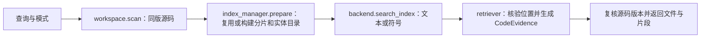
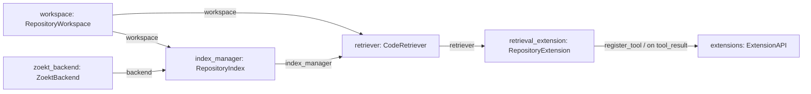

# s16：仓库检索 · 文本与符号

用同一份 Zoekt 索引搜索源码正文和符号定义：text 找“哪里出现这个词”，symbol 找“哪里定义这个名称”。Universal Ctags 在建索引时提供符号位置；Python AST 额外提供类、函数的完整范围，方便补读。两者不是两套独立的搜索引擎。

## 运行与验证

在 Harness 根目录运行。先手动构建一次包含 Zoekt 与 ctags 的镜像；Dockerfile、search.go 或固定版本改变时才需要重建。旧版不含 ctags 的 s16 镜像需要重新构建，程序不会自行下载或构建。

```powershell
# 构建搜索镜像：首次会下载基础镜像、Zoekt 与 ctags
docker build -f s16_repository_search/Dockerfile -t zero2pi-zoekt:s16 s16_repository_search
# 搜正文：包含 add 的定义、调用和注释都可能命中，不调用模型
python -X utf8 -m s16_repository_search.code --search add
# 搜符号：只找名称包含 add 的定义，仍查询同一份索引
python -X utf8 -m s16_repository_search.code --search add --search-mode symbol
# 启动只读 Agent；聊天模型配置沿用根目录 .env
python -X utf8 -m s16_repository_search.code
```

默认目标是 `example_project/retrieval_demo`；其他已有项目用 `--workspace "D:\dev\my-app"`。可以输入：“找到 Calculator.add 的定义，读取完整函数并说明逻辑。”

示例中，text 可以找到 workflow.py 中的调用；symbol 应找到 Calculator.add 和 Store.add 的定义。观察 `entity.qualified_name`、完整范围与文件哈希；随后 read_file 自动校验该文件是否变化，不靠模型记住哈希。

## 原理与存放位置

一次查询先读取目标允许范围，形成内存中的 `SourceSnapshot`；首次或源码变化时，`RepositoryIndex.prepare` 将过滤源码副本交给 Zoekt 整体建索引。未变化时复用已有代次，不重复生成副本或分片，但仍扫描源码并在返回前复核版本。

```text
目标项目/
└─ .indexes/s16/<代次>/
   ├─ source/          允许索引的源码副本，不是目标仓库的完整复制
   ├─ shards/          Zoekt 文本与 ctags 符号的同一组分片
   ├─ entities.sqlite  Python 实体身份、范围与解析错误；不存另一份正文
   └─ manifest.json    源码指纹、解析版本与实际镜像身份
```

`CodeEvidence` 是最小证据约定：路径、命中范围、显示片段、文件哈希、来源、可选实体。命中范围与函数完整范围不同；同名函数也有不同实体 ID。会话和 Trace 在 Harness 的 `.sessions/s16/<项目ID>/`、`.traces/s16/<项目ID>/`，不写到目标业务目录。

[整体工作示意图](architecture.svg)展示 Agent、目标源码、引擎与缓存的位置；下面的流程图只说明执行顺序。

## 运行流程



## 组装结构

箭头统一表示左侧向右侧提供依赖或数据，不表示调用先后。



在 code.py 的 main 中按图组装；index.py 管缓存发布，retrieval.py 管一次查询，extension.py 只适配工具与指标。agent_loop 完整保留在本章，不包含索引分支。

## 参考与差异

- Sourcebot/Zoekt：复用 trigram 与 ctags 搜索；用受限短容器替代常驻搜索服务，便于逐步阅读与运行。Python 实体边界是本项目额外补充，s18 用它关联关系，s19 用它聚合多路证据。
- Pi/lcc：沿用扩展注册与显式循环；检索独立成组件，避免改变 Agent loop。s19 在此证据约定上实现融合，不在本章预建向量或关系索引。

源码读取只限允许清单；缓存、敏感文件和链接被排除。ctags/AST 不是完整编译器，解析错误与截断分别披露。每次最多 20 文件、每文件 3 个命中行、正文 16 KiB。

旧代次可用 `python -m s16_repository_search.code --clean-indexes` 预览并确认清理；只处理本目标可识别的完整 s16 代次。删除不进回收站，未知或旧格式缓存保持不动；不要与索引进程并行运行。

```powershell
# 离线回归：使用引擎和模型替身，不启动容器或调用 API
python -m pytest tests/test_s16_repository_search.py tests/test_s16_repository_symbols.py
```
