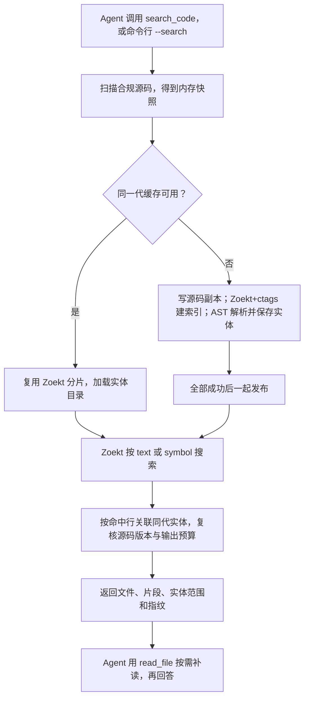
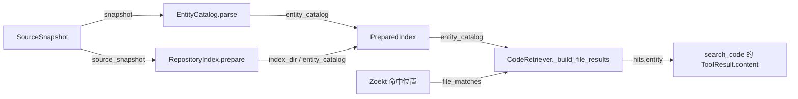

# s17：仓库系统 · 符号索引与代码实体

## 实现原理

s16 回答“哪些文件、哪些行出现了这个词”；s17 进一步回答“它是不是定义、属于哪个类或函数、完整代码从哪行到哪行”。仍是同一个 `search_code` 工具，默认 `mode="text"` 搜正文和引用，`mode="symbol"` 搜符号定义。

两部分各司其职：**Zoekt + ctags 负责查定义，Python AST 负责补代码边界**。ctags 的符号位置随 trigram 文本索引一起写入 Zoekt 分片；查询用 `Symbol(Substring)`，不是 Python 遍历名称来冒充符号索引。AST 只解析合规快照中的 `.py/.pyi`，提取类、函数、异步函数和限定名，不 import 或执行项目代码。

`EntityCatalog` 将 AST 结果保存为 `entities.sqlite`，和源码副本、Zoekt 分片按同一代发布。查询得到文件和行号后，再按行关联实体；命中嵌套函数体时取最内层实体。变量符号、非 Python 文件、模块级文本或解析失败的文件可能没有 AST 实体，结果明确为 `null`，不会编造边界。Python 解析错误另列，文本搜索仍可用。

## 整体工作示意


沿①–⑥查看“搜索 → 返回位置和实体 → 按需补读”的主线。虚线表示新建或重建时的写入；s17 新增内容在原有区域内标出，不增加另一套 Agent 循环或搜索服务。

## 运行与验证

在 zero2pi 根目录、已有虚拟环境下运行，先手动启动 Docker Desktop 的 Linux 服务。s16 镜像关闭了 ctags，**s17 需要单独构建一次**：

```powershell
# 手动下载构建依赖，编译固定 Zoekt 与 Universal Ctags 6.1.0；不包含目标项目
docker build -t zero2pi-zoekt:s17 s17_repository_symbols
# 不调用模型：查 Todo 状态恢复方法的定义，不查对它的调用
python -X utf8 -m s17_repository_symbols.code --search restore_state --search-mode symbol --scope s15_stateful_extensions
# 对照文本模式：定义和引用都可能命中；两种模式复用同一代索引
python -X utf8 -m s17_repository_symbols.code --search restore_state --scope s15_stateful_extensions
# 启动只读 Agent；复用根目录 .env 的 Provider 和上下文预算
python -X utf8 -m s17_repository_symbols.code
```

在 `s17 >>` 输入：

```text
只读分析：用符号模式查 s15_stateful_extensions 中的 restore_state 定义，按返回的实体范围补读，解释 Todo 状态恢复的过程。给出限定名、文件和行号。
```

观察 `search_code` 的 `entity.qualified_name/start_line/end_line`，以及随后 `read_file` 的补读范围。这里没有 bash 或写入工具，不需要逐条批准 shell。运行结果由当前源码和模型决定，上述任务不是实测日志。

目标默认是 zero2pi；其他已有项目加 `--workspace "D:\dev\my-app"`。`--session "<启动打印的 JSONL 路径>"` 只恢复同一目标的 s17 会话。修改目标源码不用重建镜像；修改 Dockerfile、search.go 或固定后端版本才需要重新构建。

```powershell
# 离线回归：后端和模型使用替身，不下载、不启动容器、不产生 API 费用
python -m pytest tests/test_s17_repository_symbols.py
# 镜像准备完成后，显式验证真实 ctags/Zoekt 的定义与引用区别，以及更新后的实体
$env:ZERO2PI_TEST_ZOEKT_S17 = "1"
python -m pytest tests/test_s17_repository_symbols.py -k real_zoekt
Remove-Item Env:ZERO2PI_TEST_ZOEKT_S17
```

离线测试验证编排和边界，不证明真实搜索引擎或 Agent 的定位性能。

## 组件与流程

| 组件 / 方法 | 本章职责 | 与 s16 的关系 |
| --- | --- | --- |
| `RepositoryWorkspace.scan/read_file/dispatch` | 扫描、过滤、补读与搜索指纹校验 | 复用 s16；构造时将记录目录隔离到 s17 |
| `ZoektBackend.build_index/search_index` | 开启 ctags；把 `mode` 传给薄 Go 适配器 | 修改：同一索引支持文本和符号查询 |
| `CodeEntity` | 一个类或函数的名称、完整范围、文件版本与 ID | 新增：元数据，不保存源码 |
| `EntityCatalog.parse/save/load/entity_at_line` | 解析定义、保存/恢复目录、按命中行找实体 | 新增：只做结构解析与关联，不重做关键词搜索 |
| `RepositoryIndex.prepare` | 分片和实体目录一起复用或发布 | 修改：返回的 `PreparedIndex` 增加 `entity_catalog` |
| `CodeRetriever.search/_build_file_results` | 扫描、准备索引、查位置、关联实体、复核版本、限制输出 | 修改：显式传递模式，并在命中中加入实体 |
| `RepositoryExtension.register/handle_search` | 注册同一个工具并接收 `mode` | 修改工具参数；指标事件与保存方式保持 |

先看 [code.py](code.py) 的 `main()` 组装 → [retrieval.py](retrieval.py) 的 `search()` 查询主线 → [index.py](index.py) 的 `prepare()` 缓存两条路径 → [entities.py](entities.py) 的解析与关联。完整 `agent_loop` 保留在本章，流程与 s16 相同。



### 查询示例

假设 `app.py` 是下面的代码，左侧数字只是说明行号：

```text
1  class Store:
2      @decorator
3      async def restore_state(self):
4          return 'restored'
5
6  def caller():
7      return Store().restore_state()
```

搜索 `restore_state`：文本模式可能返回第 3、7 行；符号模式返回定义所在的第 3 行，不返回调用行。第 3 行关联到 `Store.restore_state`，实体范围是 **2–4 行**（包括装饰器）；文本模式中的第 7 行关联到 `caller`，表示“这条匹配在 caller 内”，不表示已解析出调用关系。

相应命中的关键字段如下，省略了 ID 和哈希的实际值：

```json
{
  "start_line": 3,
  "end_line": 3,
  "reason": "符号定义匹配",
  "entity": {
    "path": "app.py",
    "name": "restore_state",
    "qualified_name": "Store.restore_state",
    "kind": "async_function",
    "start_line": 2,
    "definition_line": 3,
    "end_line": 4
  }
}
```

外层行号是**命中位置**，`entity` 内是**完整定义范围**。补读时调用 `read_file(path="app.py", start_line=2, limit=3)`；程序自动对照搜索指纹，文件已变化就拒绝沿用旧位置。符号查询是区分大小写的名称片段，例如 `restore_state`，不是 `Store.restore_state` 这种限定名表达式；限定名由结果提供，用于区分同名定义。

## 数据与组装结构

所有持久化数据仍在 zero2pi 内，目标项目只读：

```text
.indexes/s17/<项目ID>/<索引代次>/
├─ source/          # 过滤后的源码副本，给 Zoekt 索引器读取
├─ shards/          # Zoekt 文本+符号分片，不是两份独立索引
├─ entities.sqlite  # Python 定义的身份、范围和解析错误；不保存源码正文
└─ manifest.json    # 源码指纹、目标、实际镜像 ID、AST/数据格式版本
```

`source_snapshot` 在内存保存本次合规文件的完整字节；磁盘 `source/` 是建索引的过滤副本，不是完整 Git 克隆。`entity_catalog` 在内存只保存元数据，SQLite 是它的持久化形式，不是另一份代码副本，也不负责向量搜索。

首次查询覆盖整个允许范围建立索引和实体目录；`scope` 只限制查询。未变化时复用，不因换词或换模式重建；源码变化时整代重建，不是逐文件增量。先在 `.build-*` 临时目录完成全部内容再改名，任何一步失败都不发布半成品或退回旧版本。查询前后仍扫描源码，开销边界沿用 s16。

`entity_id` 由项目、路径、限定名、定义行和文件哈希生成，所以同名定义不冲突，源码变化后 ID 也变化。数据库只存本章实际使用的实体和解析错误，没有提前加入向量或调用关系。

下面只画本章新增实体目录及直接关联；箭头统一表示提供依赖或数据，标签对应真实参数/字段，不表示执行顺序：



`main()` 的组装层次不变：`workspace + zoekt_backend → index_manager`，再将 `workspace + index_manager → retriever → retrieval_extension → extensions → agent_loop`。`EntityCatalog` 由管理器准备并放在 `PreparedIndex.entity_catalog` 中，不额外塞进循环。会话、Trace 和检索指标分别位于 `.sessions/s17/<项目ID>/`、`.traces/s17/<项目ID>/`，不与 s16 共用会话文件或索引缓存。

## 范围与参考

最多 20 文件、每文件 3 个命中行、正文 16 KiB；扫描、路径保护和基础读取预算沿用 s16，AST 元数据另外限制 50000 个实体 / 64 MiB 数据库。超出容量明确失败；Python 语法错误有单独说明，其他语言可能有 Zoekt 符号结果但没有 AST 完整范围。ctags 不是完整编译器，不能保证识别所有语言或定义；`-require_ctags` 保证解析器可用及非超时解析故障不被静默忽略，但 Zoekt 的单文件解析超时仍可能跳过，`search_exhaustive` 不是符号覆盖率保证。

- [Sourcebot 的 Zoekt 搜索入口](https://github.com/sourcebot-dev/sourcebot/blob/main/packages/web/src/features/search/zoektSearcher.ts)利用同一引擎提供文本和符号定位；本章保留这一分工，不另写一套符号倒排搜索。固定 [Zoekt 提交](https://github.com/sourcegraph/zoekt/tree/27517a30ae6df16c6e768623847fdab8f6a3bbcf)，镜像加入 [Universal Ctags v6.1.0](https://github.com/universal-ctags/ctags/tree/v6.1.0)，保留相应许可证；s17 真实引擎测试验证定义与引用区别。
- ctags 位置不足以表达完整 Python 函数范围，所以本章加 AST 实体目录，并从同一快照整体发布；没有把它误称为调用图或向量库。s18 用这些实体组织语义候选与混合检索，s19 再实现有证据的关系扩展。
- Pi 的扩展边界与 lcc 的渐进表达保持：工具接入不改循环，新增机制只在本章落地；s17 回归验证指标事件、只读补读及与 s16 相同的本地完整循环。
