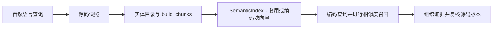
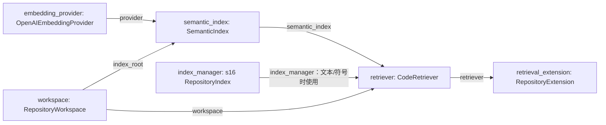

# s17：仓库检索 · 语义召回

把“负数如何归零”这样的自然语言转成向量，寻找含义相近的源码块。Python AST 负责识别实体边界，embedding 模型负责语义表示，SemanticIndex 负责缓存和相似度排序；它们解决的是三个不同问题。

## 运行与验证

在 Harness 的 `.env` 中填写已验证可用的独立向量服务配置，不修改目标项目的配置：

```dotenv
EMBEDDING_BASE_URL=服务的OpenAI兼容接口地址
EMBEDDING_MODEL=实际向量模型名称
EMBEDDING_API_KEY=你的密钥
EMBEDDING_DIMENSIONS=
EMBEDDING_REVISION=1
```

DIMENSIONS 留空表示不发送该参数；模型或输入表示需要主动换代时修改 REVISION。聊天模型与 embedding 模型不能混用。

```powershell
# 直接测试语义召回：允许发送过滤后的源码块和查询，可能计费；不需要 Docker 或聊天模型
python -X utf8 -m s17_semantic_retrieval.code --scope math_ops --search "负数如何归零" --search-mode semantic --allow-remote-embedding
# 启动同时支持 text/symbol/semantic 单路查询的 Agent；需要先按 s16 准备镜像
python -X utf8 -m s17_semantic_retrieval.code --allow-remote-embedding
```

默认搜索独立的 retrieval_demo；自然语言查询应帮助定位 math_ops/calc.py 中的 normalize。结果具体名次由配置的模型决定，不保证每种模型完全一致。再次查询时观察：`embedding.index.requests` 应减少，查询向量仍会产生 `embedding.query.requests`。

## 原理与存放位置

1. `workspace.scan()` 读取本次源码快照。
2. `EntityCatalog.parse()` 从同版源码提取 Python 类/函数；其他文本仍可按窗口切块。
3. `build_chunks()` 按最内层实体分组，再限制每块大小。长函数有多个块，嵌套函数有自己的实体。
4. `SemanticIndex.search()` 编码缺失块，编码查询，在当前块集合中计算余弦相似度。
5. `CodeRetriever.search()` 组织文件与片段，复核源码版本，再返回结果。

编码批次在 SemanticIndex 的 batch_size 参数配置，默认 10；应不超过实际服务上限。

embedding 输入是“文件路径＋限定名称＋块正文”，不是整仓库一次发送。块正文保留在本次内存快照；`<目标>/.indexes/s17/emb-<模型配置身份>/vectors.sqlite` 只持久化输入哈希与向量。旧向量可复用，但删除的源码块不会因缓存存在而再次被召回。

这里使用 SQLite 缓存和精确余弦基线，不等于部署了独立向量数据库服务。返回结果附行号、文件哈希、实体和 similarity；text/symbol 继续使用 s16 的同一 Zoekt 搜索组件。

[整体工作示意图](architecture.svg)展示 Agent、目标源码、引擎与缓存的位置；下面的流程图只说明执行顺序。

## 运行流程



## 组装结构

箭头统一表示左侧向右侧提供依赖或数据。



chunks.py 定义切块；embeddings.py 适配服务并校验返回；semantic.py 管缓存和匹配；retrieval.py 表达一次单路查询。main 显式组装这些组件，授权只对当前进程有效。

## 参考与差异

- 参考 Potpie 历史代码解析与向量索引的分工；保留路径和实体上下文，先用普通 dense 向量与精确余弦形成可验证基线，不宣称复用了 ColBERT/Qdrant。
- 结构数据沿用 s16，s18 在相同实体身份上建立关系；跨路排名由 s19 单独实现。本章每次选择一种模式，便于分清语义召回本身的效果。
- 沿用 Pi 扩展注册与 lcc 的显式流程，embedding 用量独立于聊天用量，失败和未知用量不会伪装成零。

```powershell
# 离线验证切块、缓存、授权、失败用量与单路入口，不产生 API 费用
python -m pytest tests/test_s17_semantic_retrieval.py
```
