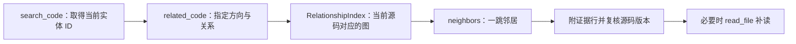
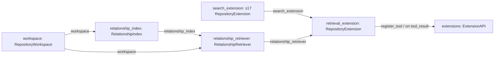

# s18：仓库检索 · 代码关系

已经找到一个函数后，再查询谁调用它、它调用谁，以及导入或继承关系。实体目录继续使用 s16 的 Python AST 结果；本章增加关系分析和单跳导航，不执行目标项目代码。

## 运行与验证

先按 s16 准备同一搜索镜像，在 Harness 根目录启动：

```powershell
# 默认读取独立 retrieval_demo；关系分析本身不调用 embedding
python -X utf8 -m s18_relationship_navigation.code
```

输入：“找到 Calculator.add，再查找它的调用者，按源码行号说明。”

观察工具过程：search_code 的 symbol 模式返回 Calculator.add 的当前 entity_id；related_code 用该 ID 查询 incoming/calls；需要更多上下文时 read_file 补读。示例应关联 workflow.py 中 checkout 的第 13 行和 preview 的第 25 行，不应混入 Store.add。

也可独立查询，不创建模型或会话：

```powershell
# 第一步取得当前 entity_id；它是结果中的 64 位 ID，不是函数名
python -X utf8 -m s18_relationship_navigation.code --search add --search-mode symbol
# 第二步把下方占位内容替换为 Calculator.add 的 ID；此命令不需要 Docker
python -X utf8 -m s18_relationship_navigation.code --related "复制的64位entity_id" --direction incoming --kind calls
```

## 如何建立、保存和使用关系

`RelationshipGraph.build(snapshot, catalog)` 先建立模块、定义和名称绑定，再提取 calls/imports/inherits。这样才能区分同名函数，并解析明确的导入别名和简单函数别名。

例如，Calculator.add 和 Store.add 是两个节点；checkout 调用 Calculator.add，是一条有 workflow.py:13 作为证据的边。未知对象的方法、动态绑定等不能确定时，target_id 为 null，不能靠名称相同就补连线。

`RelationshipIndex.prepare()` 将节点和边保存在 `<目标>/.indexes/s18/rel-<源码与解析版本身份>/relations.sqlite`；不再保存第二份源码副本。缓存命中后加载关系；源码变化使用新代次，旧实体 ID 失效。

`RelationshipRetriever.related()` 负责“扫描 → 取得当前图 → 找单跳邻居 → 附源码行和双方实体 → 复核版本”。图负责关系，检索器负责一次请求，扩展只负责工具接入。每次最多 20 条 / 16 KiB；关系按位置稳定排列，不是与自然语言问题的相关度分数。

[整体工作示意图](architecture.svg)展示 Agent、目标源码、引擎与缓存的位置；下面的流程图只说明执行顺序。

## 运行流程



## 组装结构

箭头统一表示左侧向右侧提供依赖或数据；搜索和关系是两个明确的操作入口。



## 参考与差异

- 参考 Potpie 的“实体＋有来源的关系”思路，用本地 AST 和 SQLite 实现最小静态代码图，不把它称为完整知识图谱或运行时调用图。
- 复用 s16 的实体身份，与 s17 的向量召回共享结构基础，但不互相嵌套。s19 将两种操作归入统一仓库检索服务，并实现受控关系补充。
- 沿用 Pi 的注册方式；与让模型遍历所有文件相比，related_code 提供明确的实体导航入口，但是否调用仍由任务和模型决定。

```powershell
# 离线验证同名区分、别名解析、未知绑定、缓存版本与工具组装
python -m pytest tests/test_s18_relationship_navigation.py
```
