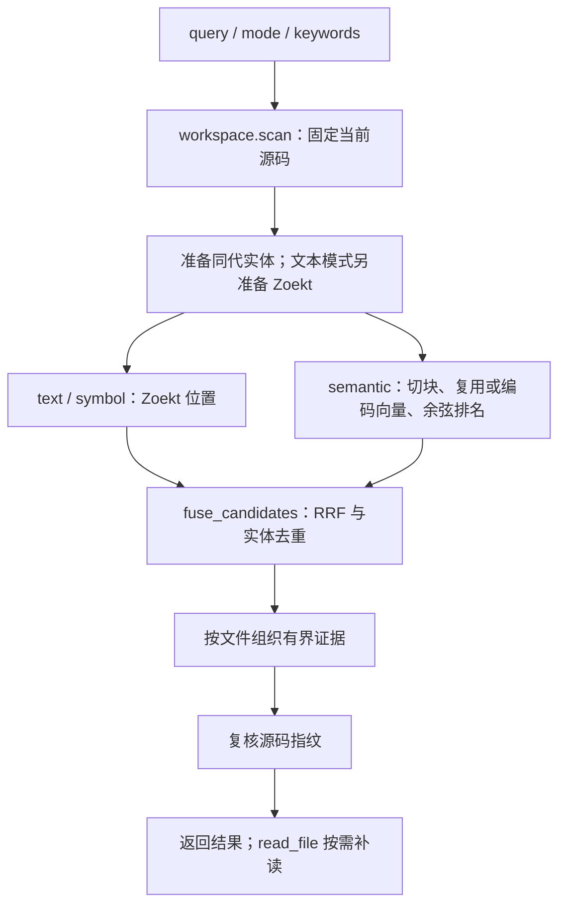
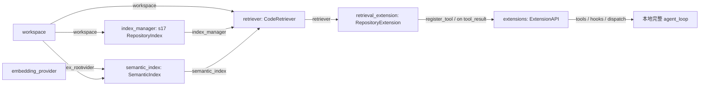

# s18：仓库系统 · 语义与混合检索

s17 按代码里出现的词找位置；s18 增加“按含义找代码”。例如不知道 `normalize` 这个名字时，也能用“负数如何归零”召回候选，再用源码确认。**语义相似不等于答案正确。**

## 原理


同一次扫描产生内存快照。Python AST 提供所属实体；源码按实体边界和 4000 字符窗口切块，将“路径＋限定名＋源码”交给独立 embedding 服务。查询也转成向量，在当前源码块中计算精确余弦相似度。这里只用标准库 SQLite 和精确扫描，没有部署向量数据库。

四种模式：`text` 搜正文，`symbol` 搜定义，`semantic` 搜含义，`hybrid` 融合三路。混合查询将自然语言 `query` 与代码 `keywords` 分开，不额外调用聊天模型猜关键词。

融合采用 RRF：每路第 r 名贡献 `1/(60+r)`；同一实体在一路只计一次，跨路贡献相加。比如 `normalize` 在语义路第 2、符号路第 1、文本路第 3，得分为 `1/62 + 1/61 + 1/63`。**这不是相似度或正确率**，只是融合排序分数。每文件最多三段，最终按文件去重。

## 运行与验证

先在 Harness 的 `.env` 填独立配置；原来的 DeepSeek/Anthropic **聊天配置不改**。请使用你实际拥有且支持 `/embeddings` 的服务，不要把聊天模型名直接填作 embedding 模型。

```dotenv
EMBEDDING_BASE_URL=https://你的服务地址/v1
EMBEDDING_MODEL=服务支持的向量模型名
EMBEDDING_API_KEY=你的密钥
# 仅服务支持指定维度时填写，否则留空。
EMBEDDING_DIMENSIONS=
EMBEDDING_REVISION=1
```

以下命令由你手动执行。首次查询会为当前范围的全部合规代码块编码，不是只编码最后返回的几段；远程服务会收到源码和查询，可能计费。过滤凭证文件不等于自动清除了普通源码里的秘密，发送前仍需自己确认目标。

```powershell
# 只验证语义检索：无需 Docker、聊天模型，不创建 Session/Trace。
python -X utf8 -m s18_semantic_retrieval.code --search "负数如何归零" --search-mode semantic --allow-remote-embedding

# 三路融合：需已经按 s17 教程准备好 Zoekt+ctags 镜像，无需重新构建新镜像。
python -X utf8 -m s18_semantic_retrieval.code --search "负数如何归零" --search-mode hybrid --keyword normalize --allow-remote-embedding

# 只读 Agent；自然语言让模型选择模式。此入口同时提供 text/symbol，因此需要 s17 镜像。
python -X utf8 -m s18_semantic_retrieval.code --allow-remote-embedding

# 离线回归：替身验证机制，不联网、不产生模型费用。
python -m pytest tests/test_s18_semantic_retrieval.py
```

默认目标仍为 `example_project/retrieval_demo`；用 `--workspace "D:\dev\my-app"` 切换已有项目。可加 `--scope math_ops` 限定语义编码范围。不加授权标志时，交互工具目录只有 text/symbol；即使工具请求 semantic，运行时也明确拒绝。授权不随会话恢复。

观察两次相同查询的 stderr 指标：第一次 `embedding.encoded_chunks > 0`，第二次为 0、`cache_hits > 0`；查询本身仍需一次编码。`embedding.index` 和 `embedding.query` 分别记录已知 Token 与未知用量请求；失败可能仍计费，不以失败推断零用量。聊天用量统计不包含 embedding，也不报告未经定价核验的金额。

## 运行流程



各通道只在请求对应模式时运行。hybrid 中任一路失败，整次请求明确失败，不冒充三路成功；源码变化返回 stale。

## 组件与组装结构



箭头统一表示提供依赖/数据，不表示调用先后。`main()` 先组装组件，再注册工具和既有运行时；`SemanticIndex` 只做编码/缓存/召回，`CodeRetriever.search()` 才负责整个查询，扩展只适配参数与保存后的指标。

阅读顺序：`code.py: main()` → `retrieval.py: search()` → `chunks.py: build_chunks()` → `semantic.py: search()`。`EmbeddingProvider` 是协议，`OpenAIEmbeddingProvider` 按兼容协议实现编码，不继承聊天 Provider。

## 数据放在哪里

内存仍只有一次查询用的源码快照与块；结束复核只留哈希，不积攒第二份源码。磁盘均在**目标**的 `.indexes/s18/`：

- `<文本代次>/source、shards、entities.sqlite`：复用 s17 的过滤副本、分片与实体；纯 semantic 不建立这些文件。
- `emb-<模型配置身份>/vectors.sqlite`：仅存实际输入哈希和向量。模型、端点、维度、修订号或输入格式变化时隔离缓存；源码改动只重新编码变动块。服务在同名模型下换权重时，手动增加 `EMBEDDING_REVISION`。

查询候选始终从当前源码重建，已删除块的旧缓存不会被召回。缓存不自动清理，不提供 s16/s17 的清理入口；不要并行构建/清理。单行超过 4000 字符、块超过 20000 或向量缓存超过 128 MiB 时明确失败，当前版本不做大仓库 ANN。结果上限 20 文件 / 16 KiB，裁剪会标记 truncated。

交互记录在 Harness 的 `.sessions/s18/<项目ID>/`、`.traces/s18/<项目ID>/`；指标保存为 `.retrieval.jsonl`，不重复保存全部向量或候选正文。

## 参考与差异

- [Sourcebot 的 Zoekt 路径](https://github.com/sourcebot-dev/sourcebot/blob/main/packages/web/src/features/search/zoektSearcher.ts)解决确定性定位；s18 保留 s17 的真实引擎，不把 Zoekt 叫作向量检索。
- Potpie 的[历史发布记录](https://github.com/potpie-ai/potpie/releases)提供混合检索参考；其[当前 Context Graph 文档](https://github.com/potpie-ai/potpie/blob/main/docs/context-graph/querying.md)强调带来源的证据。s18 自行实现普通 dense embedding＋精确余弦＋[RRF](https://cormack.uwaterloo.ca/cormacksigir09-rrf.pdf)，不是复制其 Qdrant/ColBERT 或当前知识图谱排名算法；为的是先获得能单独验证的基线。s19 用候选实体 ID 验证关系导航，性能消融在 s22。
- Pi 的注册工具/事件解决能力接入；s18 复用既有 ExtensionAPI，不改核心循环。lcc 提供渐进章节表达方式；本章按独立职责拆文件，保留显式上层流程。
- 编码请求遵循[官方 embedding 接口](https://developers.openai.com/api/reference/python/resources/embeddings/methods/create)，兼容服务仍需自行验证。离线替身只证明机制，不证明真实模型召回质量。

两轮检查分别优化了组件职责/连接关闭，以及嵌套实体切块、scope、损坏缓存、每批容量限制与失败用量保留；新章及长路径定向组 72 项通过，真实服务质量另验。
