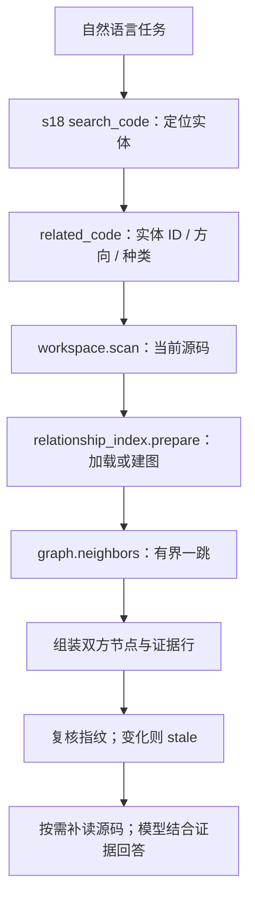
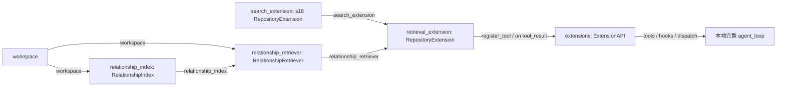

# s19：仓库系统 · 关系导航

s18 找“可能相关的代码”；s19 从已经找到的实体出发，回答“谁调用它、它调用谁、导入或继承了谁”。先定位，再查一跳关系，最后按证据补读，不自动遍历全仓库。

## 原理


Python AST 提供导入、调用和继承表达式。分析器先建立模块/定义表，再分析局部绑定；关系和实体使用同一源码指纹。只解析源码，不 import 或执行目标项目。图用 SQLite 关系表保存，不需要 Neo4j。

示例中的两个 `add` 不能混为一谈：

```text
workflow.checkout 第 13 行：Calculator.add(2, 3)
  → 导入 math_ops.calc.Calculator → Calculator.add
workflow.checkout 第 14 行：Store().add(total)
  → 导入 storage.Store → Store.add
workflow.preview 第 24 行：operation = Calculator.add
workflow.preview 第 25 行：operation(4, 5)
  → 唯一局部别名 → Calculator.add
```

`related_code(entity_id=Calculator.add 的当前 ID, direction="incoming", kind="calls")` 因而返回 checkout 和 preview 的调用证据，不会误收 Store.add。ID 不是名称字符串，而是 `search_code` 返回、带文件版本的实体身份。

## 运行与验证

复用 s17 已准备的镜像及现有聊天配置。**关系分析本身不需要 embedding，也不产生模型调用。** 以下命令由你手动执行：

```powershell
# 只读 Agent：默认 text/symbol 搜索＋关系导航，不启用 embedding。
python -X utf8 -m s19_relationship_navigation.code

# 可选：同时启用 s18 的语义/混合检索，需要独立配置与源码发送授权。
python -X utf8 -m s19_relationship_navigation.code --allow-remote-embedding

# 离线回归：复制示例到临时目录，不改示例原件，不启动 Docker/模型。
python -m pytest tests/test_s19_relationship_navigation.py
```

输入示例任务：

> 找到 Calculator.add 的定义，再查询谁调用了它。区分直接调用和局部别名调用，给出路径与行号；不要把 Store.add 混进来。

观察工具顺序：`search_code(mode="symbol", query="add")` → 取得 Calculator.add 的 ID → `related_code` → 必要时 `read_file` → 回答。顺序由模型根据任务选择，运行时不保证模型一次就选对。

不经过聊天模型也可以分两步手动验证：

```powershell
# 先获取当前实体 ID；只请求 Zoekt，不创建会话。
python -X utf8 -m s19_relationship_navigation.code --search add --search-mode symbol

# 从上一条 JSON 复制 Calculator.add 的 entity_id；本条无需 Zoekt 或 embedding。
python -X utf8 -m s19_relationship_navigation.code --related "复制的64位entity_id" --direction incoming --kind calls
```

默认目标为 `example_project/retrieval_demo`；切换项目时，两条命令均加同一 `--workspace "D:\dev\my-app"`。源码修改后要重新获取 ID，不可沿用旧会话里的 ID。

## 运行流程



这不是将图分数偷偷加进 RRF。s18 排名解决“先找谁”，s19 导航解决“再看谁”；两步共享实体身份，分别留下真实工具调用与指标，便于观察收益和消融。

## 组件与组装结构



箭头统一表示提供依赖/数据。`main()` 将搜索和关系两个组件**并列组装**，再交给扩展注册，不把图分析加入 agent_loop。

阅读顺序：`code.py: main()` 看组装 → `retrieval.py: related()` 看一次查询 → `index.py: prepare()` 看持久化 → `relations.py: build()` 看建图。底层 `_FileAnalyzer.analyze_scope()` 按“收集写入与遮蔽 → 绑定确定名称 → 绑定简单别名 → 提取边与进入子作用域”排列。下划线表示内部实现，不是另一种 Python 方法类型。

## 关系边界与存放位置

支持仓库内直接导入、明确继承、直接函数/类成员调用、单次赋值的实例/函数别名。只做静态绑定分析，不证明运行时一定执行。参数类型、动态返回值、反射、条件别名、重绑定、匿名作用域和外部包等无法确定时，`target_id=null` 并说明 unresolved；它表示“不知道连向谁”，不是“没有调用”。不推断继承方法分派、重导出、namespace package 链或 `src/` 源码根配置，不冒充完整 Python 调用图。

一跳最多 20 条 / 16 KiB；循环调用不会递归扩散。incoming 只能找已解析终点的调用者；outgoing 可以看到未解析表达式。返回双方实体、关系类型、证据行及哈希；补读自动校验已登记文件版本。源码复核并非文件系统锁，稳定验证请冻结工作树。

目标项目 `.indexes/s19/rel-<源码与解析版本身份>/relations.sqlite` 保存节点和关系，**不另存源码副本**；s18 的文本/向量缓存也隔离在 `.indexes/s19/` 中。原源码只读，索引缓存强制排除出扫描和模型工具。图数据库先关闭连接，再整体发布目录；损坏缓存明确失败，不返回空关系假装成功。旧缓存不自动删除，不与构建/清理并行运行。

会话和 Trace 在 Harness 的 `.sessions/s19/<项目ID>/`、`.traces/s19/<项目ID>/`；搜索和关系指标写入同一个 `.retrieval.jsonl`，用真实 `tool_name` 与 `mode` 区分，不混成一次请求。

## 参考与差异

- Potpie 的[当前 Context Graph](https://github.com/potpie-ai/potpie/blob/main/docs/context-graph/querying.md)将证据检索与 Agent 推理分开；s19 保留这一边界，但自己实现针对 Python 的静态关系表，不复制其完整知识图谱、语义排名或数据库体系。用一跳控制规模和可解释性；关系增益由 s22 消融验证。
- s17 复用 Sourcebot/Zoekt 思路定位定义，AST 补完整边界；s19 在同一实体 ID 上增加调用/导入/继承，不把 ctags 定义查询说成完整调用图。
- Pi 的工具注册使能力可以组合；s19 通过现有 ExtensionAPI/Event 接入，不新增循环参数。lcc 的渐进表达方式保留为独立完整循环和就近差异注释。s20 再引入 Git 任务信息，s19 不提前添加空接口。

两轮检查分别验证了组件职责/资源释放，以及作用域误连/损坏缓存/预算与指纹。离线替身不证明真实模型工具选择或检索质量，未提前填写性能提升结论。
