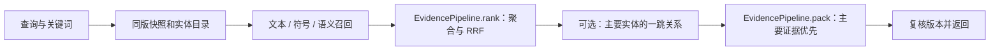
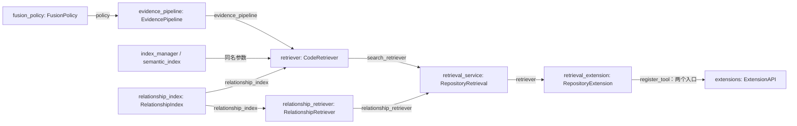

# s19：仓库检索 · 多路融合与证据组装

把文本、符号和语义召回放到同一次查询中：合并相同实体的排名，同时保留不同命中片段；按需补充调用者，再把证据裁剪到模型可消费的预算内。召回、关系分析、排名和显示组装各有明确职责。

## 运行与验证

先按 s16 准备搜索镜像，按 s17 配置 embedding；在 Harness 根目录运行：

```powershell
# 一次混合检索：自然语言描述意图，keyword 提供代码字面词；允许远程 embedding，可能计费
python -X utf8 -m s19_retrieval_fusion.code --search "负数归零后在哪里使用" --search-mode hybrid --keyword normalize --allow-remote-embedding --include-related
# 启动 Agent；同时开放 search_code 与 related_code
python -X utf8 -m s19_retrieval_fusion.code --allow-remote-embedding
```

默认目标仍是 retrieval_demo；其他项目用 --workspace。观察结果：

- files：主要命中的文件和代码片段；channel_ranks/rrf_score 解释实体排名，sources 说明片段来源。
- related_context：主要实体的直接调用者，附关系与证据位置；不是第四路 RRF 排名。
- coverage：各路是完整搜索、有界 Top-K，还是部分结果；omissions：因文件、片段、字符或总字节预算省略的内容。

不需要语义时可直接用 text/symbol，不授权也不会请求 embedding。include_related 默认关闭；启用时最多从前三个实体各补充五条同范围内的一跳调用关系。已知实体时仍可直接使用 related_code，不必先进行向量检索。

## 一次查询的设计

1. CodeRetriever.search 校验参数，只扫描一次源码；所有召回与关系补充共享该版本和实体目录。
2. Zoekt 搜文本/符号；SemanticIndex 搜向量。每路先得到自己的候选顺序，不直接相加两种引擎分数。
3. EvidencePipeline.rank 按实体聚合并计算 RRF。一路内同一实体只投一次票，但该实体的不同命中片段全部保留。
4. 需要关系时复用 s18 的 RelationshipIndex，从主要实体补一跳调用证据。
5. EvidencePipeline.pack 先组织主要文件，再用剩余空间添加关系，总结果不超过 16 KiB。
6. 最后复核源码版本；发生变化就丢弃本次证据，不登记旧指纹。

数据层次：CodeEvidence 是一处源码命中，Candidate 给它附上可选相似度，RankedCandidate 聚合一个实体的各处命中与通道名次。最后的 files/hits 是按显示预算挑选的结果，不是另外一份索引。

例如，假设一个长函数的定义在第 10 行，文本命中第 30 行，语义命中第 65～75 行：这是一个函数候选、三处证据。不能为了实体去重只剩第一个片段；显示预算不足时才省略，并记录原因。

默认 RRF 为 `sum(weight / (60 + rank))`。FusionPolicy 可配置 rrf_k、三个通道权重、每文件片段数和显示长度；main 中的 fusion_policy 是实际生效位置。权重不是可信概率；文本与符号共用引擎，默认等权只是待评测基线。

[整体工作示意图](architecture.svg)展示 Agent、目标源码、引擎与缓存的位置；下面的流程图只说明执行顺序。

## 运行流程



## 组装结构

箭头统一表示左侧向右侧提供依赖或数据，不表示调用先后。名称对应 code.py 的 main。



service.py 是工具之下的统一仓库服务：search 交给搜索检索器，related 交给关系检索器。关系属于仓库检索能力的一层，但不是 Zoekt 的子功能。evidence.py 不扫描、不调用模型；extension.py 不实现检索算法；agent_loop 保持完整且不增加检索分支。

## 参考与差异

- 参考 Sourcebot 的搜索结果适配和 Potpie 的 reader/排序/结果组装分工；本项目用少量实际组件保持组装可见，不照搬其平台和知识存储。
- 延续 s16 的 CodeEvidence，使用 RRF 规避引擎分数不可比；关系独立标注，避免把位置顺序误当相关性。s22 对检索策略做组件消融，不预先宣称收益。
- 沿用 Pi 扩展 API 与 lcc 渐进章节；s20/s21 复用本章统一服务，分别接入任务上下文和隔离修复，不改变搜索算法。

索引仍按目标与章节隔离：Zoekt 为 .indexes/s19/<代次>/，向量为 emb-<身份>/vectors.sqlite，关系为 rel-<身份>/relations.sqlite；Session/Trace 留在 Harness。旧目录、旧缓存和历史会话不会自动迁移或删除。

```powershell
# 离线验证融合、证据保留、版本一致性、关系补充和工具服务，不调用 Docker/API
python -m pytest tests/test_s19_retrieval_fusion.py tests/test_s19_evidence_pipeline.py
```
