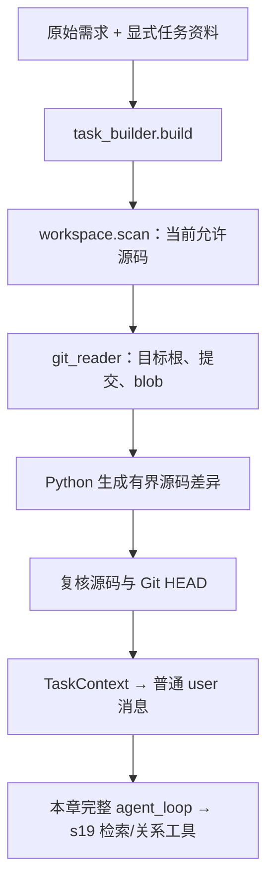
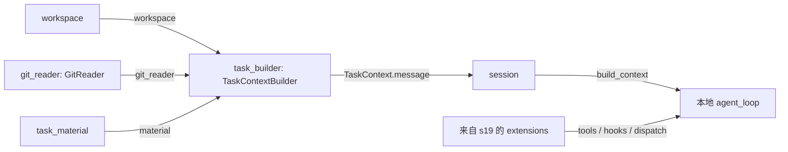

# s20：任务系统 · Git 上下文

s18 帮模型定位代码；s20 在任务开始时，把原始需求、用户提供的 Issue/Comment 和本地 Git 证据组织在一起。它不自动抓远程 Issue，不提交代码，仍然只读。

## 原理


`TaskContextBuilder.build()` 先扫描允许源码，再由 `GitReader` 读取当前目标的提交与 blob，最后在 Python 中生成差异。得到的 `TaskContext` 保存成普通 user 消息，交给原有循环；历史讨论是资料，不是执行授权。

例如 HEAD 中是 `return a + b`，当前源码是 `return a - b`，任务输入会同时包含“分析本次修改”、HEAD/base、近期提交摘要和这段有界差异。模型再用 s19 的检索服务核实，不必先用 shell 调查项目状态。

## 运行与验证

在 Harness 根目录手动运行：

```powershell
# 默认独立示例没有自己的 Git；只显示任务结构，不读取父 Harness 的提交。
python -X utf8 -m s20_git_task_context.code --show-context --task "说明两个 add 的区别"

# 查看一个已有 Git 仓库的任务输入；不调用模型/Zoekt，不创建会话。
python -X utf8 -m s20_git_task_context.code --workspace "D:\dev\my-app" --show-context --task "分析当前修改"

# 可选：基于一个已有本地标签/分支比较；不存在就报错，不自动 fetch。
python -X utf8 -m s20_git_task_context.code --workspace "D:\dev\my-app" --base main --show-context --task "定位这次变更的影响"

# 只读 Agent：复用已经手动准备的 s16 镜像与聊天配置。
python -X utf8 -m s20_git_task_context.code --workspace "D:\dev\my-app"

# 离线回归只在临时仓库创建测试提交，不修改本项目 Git 状态。
python -m pytest tests/test_s20_git_task_context.py
```

可用 `--task-file "D:\tasks\issue.json"` 显式提供资料，文件最多 64 KiB，只接受：

```json
{"title":"加法结果不对","body":"调用后结果与预期不符","comments":["请检查计算入口"]}
```

不会从目标自动发现这个文件。默认目标仍为 `example_project/retrieval_demo`；外部目标必须是已有目录。目标不在 Git 根目录时不会向上取父项目历史；Git 元数据损坏与没有仓库是不同错误。

## 运行流程



## 组件与组装结构



箭头统一表示提供依赖/数据，不表示调用先后。先读 `code.py: main()` 的组装，再读 `context.py: build()`；`git_reader.py` 只负责受限 Git I/O，不负责理解任务。

## 边界与存放

上下文最多 16 KiB；最多五份文件差异、每份 2000 字符，差异输入超过 128 KiB 只给定位信息。缺少的路径标成 `missing_from_source`：可能删除、忽略或不是允许文本，不靠宿主存在与否猜测容器状态，不读取这些旧文件正文。

这里只比较 **base 的 blob 与当前允许源码**，不区分 staged/unstaged，也不冒充 `git status`。不用工作树 diff/status，是为了不触发仓库 clean filter、textconv 或 fsmonitor；同时关闭日志签名程序和隐式对象下载，部分克隆缺少本地对象就报错。Git 子进程有时间/输出预算，错误明确停止。并发修改时不是事务快照，请冻结工作树验证。

原始需求不因裁剪消失；资料和差异省略会标记。索引位于目标 `.indexes/s20/`，Session/Trace 位于 Harness 的 `.sessions/s20/<项目ID>/`、`.traces/s20/<项目ID>/`；恢复历史不恢复 Git 状态或授权。

## 参考与差异

- Pi 通过工具/上下文组装接入能力；s20 保留既有循环和注册表，把任务资料构建作为独立组件，不让模型控制 Git argv。
- lcc 的增量章节用于表达方式；本章没有复制其代码。新增内容仅为任务入口和上下文，检索沿用 s19。
- [Git 对象/引用解析](https://git-scm.com/docs/git-rev-parse)与[差异行为](https://git-scm.com/docs/git-diff)用于核对读取边界；为避免外部辅助程序，本项目自行比较受限 blob/源码。s21 将同一组件接到容器源码视图，s22 单列实际会话成本，不宣称上下文必然降低 Token。
- 隐式对象下载与签名配置依据 [Git 环境变量](https://git-scm.com/docs/git#Documentation/git.txt-GITNOLAZYFETCH)及 [log.showSignature](https://git-scm.com/docs/git-config#Documentation/git-config.txt-logshowSignature)关闭；只读命令也不应默认为完全没有副作用。
