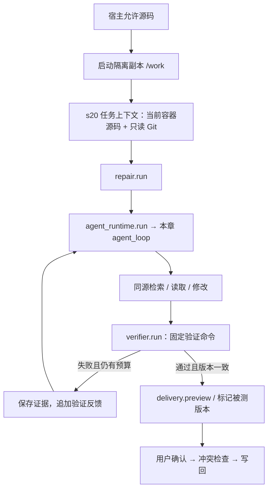
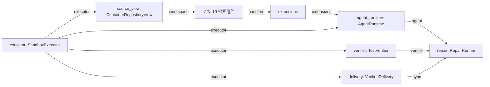

# s21：维护系统 · 隔离修复闭环

把前面的能力接起来：在 **A 版本隔离副本** 中定位、修改，Harness 运行固定测试；失败就把反馈交给模型修复，次数到限则报告未完成。原仓库不会自动变化。

## 原理


`RepairRunner` 管尝试次数，`AgentRuntime` 调用本章完整循环，`TestVerifier` 管固定验证命令，`VerifiedDelivery` 管验证后的确认交付。它们不是一个不断嵌套的请求函数。

检索、补读、修改都面向**同一容器**：`ContainerRepositoryView.scan()` 导出当前允许源码，再交给 s17/s19 检索。改完后重新查询，会使用新指纹/新索引，不能拿宿主旧源码解释副本。

## 运行与验证

需要已经手动准备好 s13-A、s16 镜像。以下构建只需首次或 Worker/Dockerfile 改动后执行；会下载容器 Git 软件包，不在运行时安装：

```powershell
# 构建本章镜像；基础镜像复用本地 zero2pi-sandbox:s13-a。
docker build -f s21_sandbox_repair/Dockerfile -t zero2pi-sandbox:s21 .

# 先验证容器和测试链路，不用模型/Zoekt；示例含故意保留的计算错误，预期退出码非 0。
python -X utf8 -m s21_sandbox_repair.code --verify-only

# 启动维护 Agent；默认目标 example_project/repair_demo，复用现有聊天配置。
python -X utf8 -m s21_sandbox_repair.code

# 指定其他已有 Python 项目及固定验收配置；命令只在容器执行，不经 shell。
python -X utf8 -m s21_sandbox_repair.code --workspace "D:\dev\my-app" --test-command "python -B -m pytest -q -p no:cacheprovider" --test-root tests

# 离线回归：容器/模型替身，不启动 Docker、不计 API 费用。
python -m pytest tests/test_s21_sandbox_repair.py
```

运行案例输入：

> 修复 total 的加法结果。先定位实现与调用关系，只修改业务代码，不修改现有测试；完成后说明改了什么。

默认最多三次修复，每次最多十二轮模型请求，可用 `--max-attempts`、`--max-rounds` 调整。达到预算是停止，不代表任务成功。观察 `task-001.json` 中各次 `exit_code`、被测指纹和 `status`。

看到 `tests_passed` 后输入 `/diff`，再输入 `/apply` 并确认 `y` 才会写回原仓库；容器继续保留。一次性 `--task "需求"` 只保存报告/Diff 后退出，不自动应用。`q` 关闭容器，未交付修改只能从报告人工审查，不声称下次自动恢复。

## 运行流程



模型/API/隔离错误停止任务，不伪装成测试失败反复重试。模型返回 error/aborted 同样停止，不进入验收。

## 组件与组装结构



箭头表示依赖/数据。`AgentRuntime` 只是一次任务的调用边界；完整循环仍写在 `code.py`。先读 `main()` 组装，再看 `workflow.py: RepairRunner.run()` 的“运行 → 验证 → 反馈”，最后看视图和 Worker 协议。

## 验收与记录边界

- 默认只复制允许的 UTF-8 项目源码，最多 4000 文件 / 12 MiB；不复制依赖、凭证、`.git` 或索引。因此需要二进制资源/未安装依赖的项目不能直接照搬示例，依赖应由用户提前准备在镜像中。
- 固定测试目录和测试选择配置不能被修改/删除/新增后拿来验收；验证期间源码变化、没有执行测试、被测版本与预览不一致，均不能交付。需要改测试的任务暂不在此闭环内。
- 验证退出码 0 只说明**所选命令成功**，不证明业务需求完整、测试足够或代码无恶意；未把该状态叫作“任务已解决”。不要用 `echo` 之类的命令当验收。
- **交付快照**不跟随 `.gitignore` 隐藏文件；**检索视图**用容器 Git 执行当前 ignore 语义。前者防误删除，后者控制检索范围；链接/特殊业务文件会拒绝导出。容器源码导出是 IPC，复核会短暂产生第二批字节，不声称已有大仓库内存优化。
- 索引在实际目标 `.indexes/s21/`；Session/Trace 在 Harness 按 s21/项目ID 分组；输入 tar、Diff、逐任务 JSON 和确认回写备份在 `.sandboxes/s21/<项目ID>/<容器名>/`。报告不作为模型可写配置，不自动提交。

## 参考与差异

Pi 的可组合工具/运行时用于保持循环稳定；本项目加上的验收/确认是 Harness 策略，不塞进系统提示词代替执行保证。lcc 的渐进表达保留为具体章节注释和显式流程。隔离、快照与冲突检查复用 s13-A，不同时改 B/C；s21 的新 Worker 仅增加当前源码与固定验证协议。s22 分开报告组件指标和会话成本，不把通过公开测试当 SWE-bench 成绩。
