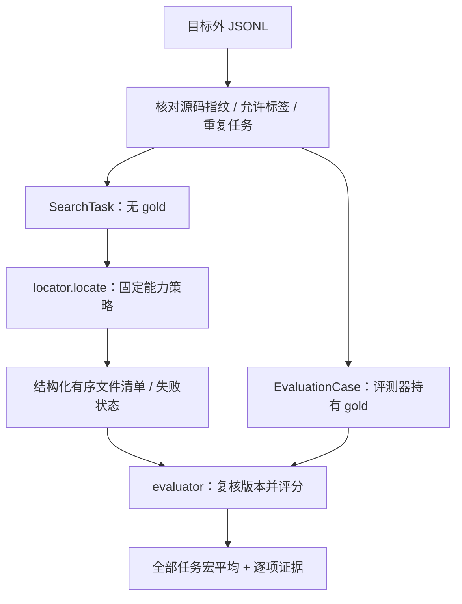
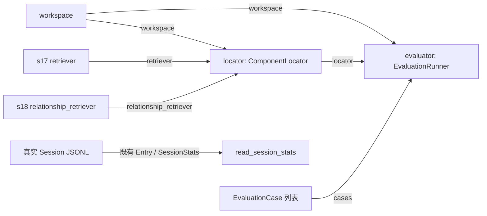

# s22：评测系统 · 定位消融

用固定任务和标签比较检索能力，回答“找到了哪些文件、排名如何、花了多少组件调用”；另外只读汇总真实会话的模型/工具成本。**组件评测不等于 Agent 实测，更不等于修复成功率。**

## 原理


`load_cases()` 将输入拆成不含答案的 `SearchTask` 与评测器持有的 gold。定位器只拿任务，评分器最后才比较文件；空结果和失败都保留在事先选定的分母中。

例如 gold 有 A、B 两个文件，候选只找到 A：File Recall@10 是 1/2，Hit@10 是 1。失败是 0 分，不丢掉失败任务重新平均；重复文件不重复得分。

## 运行与验证

```powershell
# 固定三条教学任务，只用 glob/grep/read 的脚本化基线；不用模型/Docker/API。
python -X utf8 -m s22_retrieval_evaluation.code --mode basic

# 已准备 s16 镜像后，对同一任务分别比较文本、文本＋符号。
python -X utf8 -m s22_retrieval_evaluation.code --mode text
python -X utf8 -m s22_retrieval_evaluation.code --mode text-symbol

# 可选：按 s17 配置独立 embedding；会发送源码/查询，可能计费。
python -X utf8 -m s22_retrieval_evaluation.code --mode hybrid --allow-remote-embedding
python -X utf8 -m s22_retrieval_evaluation.code --mode hybrid-relations --allow-remote-embedding

# 实际 Agent 用 s20/s21 运行；此命令只读统计你明确选择的一份会话。
python -X utf8 -m s22_retrieval_evaluation.code --session-stats "实际会话.jsonl"

# 离线回归：引擎/embedding 替身，不证明真实服务召回效果。
python -m pytest tests/test_s22_retrieval_evaluation.py
```

默认目标仍为 `example_project/retrieval_demo`，结果在 Harness `.evals/s22/<运行ID>.json`。`--output` 可选目标外的新文件，禁止覆盖旧报告；路径与标签先检查，再启动可能计费的服务。固定标签在章节 `tasks/retrieval_demo.jsonl`，不进入目标。

`basic` 是固定 glob→逐文件 grep→命中窗口 read 的**脚本化组件对照**，不是 LLM 的智能基础工具基线。`logical_tool_calls` 只数这个策略实际调用的工具/组件入口；内部扫描、编码与缓存另看 `retrieval_metrics`。不能据此声称 Agent 工具调用或 Token 减少了多少。

## 运行流程



## 组件与组装结构



箭头表示依赖/数据，不表示先后。先读 `code.py: main()` → `evaluation.py: run()` → `strategies.py: locate()`；数据拆分在 `dataset.py`。本章是评测程序，不新增 Agent 版本，因此不复制一个运行时根本不会调用的 `agent_loop`。

## 样本、指标和结论边界

- JSONL 每行需要 `id/query/keywords/symbol_query/source_fingerprint/gold_files`；可选 seed 只含用户已知的 `query/qualified_name`，不得塞答案文件路径。三个样本只是教学回归，不是代表性评测集。
- 指纹对应实际源码字节；文件/换行变化都会要求人工核对版本，不能自动改标签掩盖变化。标签非空且属于当前允许源码，新建目标、空标签、未知文件明确拒绝，不算满分。换目标时同时提供匹配的 `--dataset`。
- File Recall@10、Hit@10、MRR@10 按最终去重文件计数，并保留失败分母、耗时和真实组件调用数；关系只从任务明确给出的起点扩展一跳，不拿 gold 挑实体。
- Embedding 索引/查询、已知 Token/未知用量在原组件指标中保留；首次与复用缓存不能混称同一种成本。组件不调用聊天模型，不能从字符估算聊天 Token。
- `--session-stats` 复用 s11/s15 的持久化 Entry 和用量规则，包含摘要与失败；范围是**整份会话**，不会推断定位阶段或从助手自由文本猜最终候选。正式 Agent 对比需独立任务、固定模型/预算、结构化提交清单和重复实验，尚未自动执行。

## 参考与差异

s19 的统一检索与证据接口解决定位，不让评分器改算法；s22 单独控制标签/版本与分母。复用 Pi 风格的组件边界和既有事件/用量记录，不新增一套 Token 统计。lcc 的章节表达用于保持机制独立。SWE-bench Verified 数据获取、固定版本、许可、人工标签与真实 API 预算仍需另行确认；本章不自动下载、不伪造简历中的提升数字，后续扩展编号待定。
