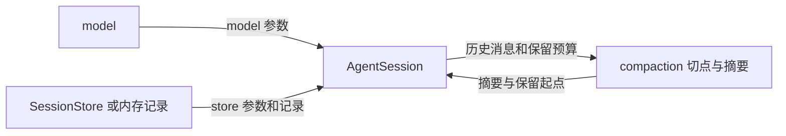

# s07：上下文压缩

对话越来越长时，一直把全部历史发给模型会占用上下文窗口。本章先实现手动压缩：保存完整记录，同时让之后的请求使用“摘要 + 最近消息”。自动压缩和溢出恢复将在本章第二阶段加入。

## 怎么运行

```powershell
python -m tutorials.s07_compaction.code --demo --no-session --workspace example_project/mini_app --keep-recent-tokens 4
```

输入两条问题后，再输入 `/compact`；也可以输入 `/compact 请保留任务目标`。继续输入问题，就会使用压缩后的上下文。`--keep-recent-tokens 4` 是为了方便演示，默认值为 20000；默认预算较大时，短对话可能提示没有足够内容可压缩。`--demo` 的摘要是固定文本，只用于验证流程，真实摘要需要配置模型并去掉 `--demo`。

测试时使用新的临时目录名：

```powershell
python -m pytest tests/test_s07_compaction.py --basetemp .sessions/s07-一个未使用的目录名 -p no:cacheprovider
```

## 代码怎么走




- [session.py](session.py) 的 `compact()` 负责协调：有回合在运行时先取消并等待收口，然后计算切点、请求摘要，最后保存。成功前不改变模型使用的上下文。`session.messages` 和 `prompt()` 仍返回完整历史。
- [compaction.py](compaction.py) 的 `find_cut_point()` 从最近消息向前估算，不让工具结果成为保留段开头；切开一个超长回合时，对回合前缀单独生成摘要。`summarize()` 请求当前模型，工具列表为空。参考 Pi，摘要请求中省去推理签名和脱敏数据，单条工具结果最多带入 2000 个字符。
- 下一次请求由 `_request_context()` 取最近一次摘要和保留的消息；摘要在内部是 `CompactionSummary`，发给供应商前转成文本。摘要本身不是用户实际输入。
- 文件会话仍保留原消息。第一次压缩时，v1 文件先备份为同目录的 `文件名.v1.bak`，再迁移到 v2 并追加压缩记录；普通续聊不迁移。旧章节程序不能读取 v2 文件，备份不会包含迁移后的新消息。`--no-session` 使用内存记录。
- 摘要请求失败、取消、返回空文本或被截断时不保存压缩记录。已有运行中的处理函数不能等待自身空闲；同时压缩会被拒绝。文件存储按单写入者使用，不能作为多进程并发写入保证。

SDK 直接调用 `await session.compact(instructions=None)`，返回摘要、保留起点和可选摘要用量；构造 `AgentSession` 时可设置 `keep_recent_tokens`。开始和成功分别发出 `compaction_start`、`compaction_end` 事件。

## 参考与差异

参考 Pi `e4c75a732` 的 `packages/coding-agent/src/core/compaction/compaction.ts` 和 `agent-session.ts`：Pi 保留原记录、按近期预算选切点并在必要时拆分回合，本章保留这些目的和顺序。Python 使用自己的线性 JSONL v2，不能直接读取 Pi 会话文件；会话树待后续专题实现，编号待定。

已对齐：手动入口、完整历史与请求上下文分离、工具结果边界、摘要失败不发布。暂缓：自动阈值、上下文占用和溢出恢复在 s07 第二阶段；压缩前/成功/失败的扩展 Hook 在 s09。
