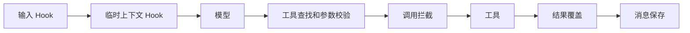
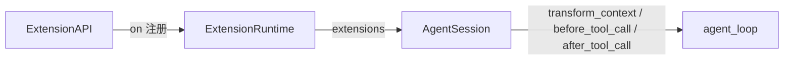

# s08：Hook 拦截

本章让扩展在输入、模型请求和工具执行的边界参与决策。工具是否真的执行，由校验之后的 tool_call 决定。

## Pi 怎么做

参考 Pi `e4c75a732`：`coding-agent/src/core/extensions/runner.ts` 的 emitInput、emitContext、emitToolCall、emitToolResult，以及 `agent/src/agent-loop.ts` 的 prepareToolCall/finalizeToolCall。先串联输入，再为每次模型请求生成临时上下文；工具先查找、校验，再拦截，最后覆盖结果。普通 Hook 失败记录诊断；tool_call 失败会阻止工具执行。

## 调用方式

```python
def setup(api):
    api.on(
        "input", lambda event, ctx: {"action": "transform", "text": event["text"] + " 请简短回答"}
    )
    api.on(
        "tool_call",
        lambda event, ctx: {"block": True, "reason": "当前只允许对话", "terminate": True},
    )
```

input 返回 continue、transform 或 handled；handled 不保存用户输入、不请求模型。context 返回 messages，仅影响当前请求，不改会话历史。tool_result 可分别改 content、is_error、terminate。Hook 可同步或异步。ctx.session 提供当前会话，ctx.cwd 是业务工作区。生命周期 Hook 只观察；返回值不修改已保存消息。





执行顺序在 code.py，策略分发在 extensions.py，参数校验与执行在 tools.py，组装在 session.py。ToolResult.terminate 是执行策略，不进入持久化消息。整批工具都 terminate 才停止自动续轮；仍保存全部结果。

## 测试

```powershell
python -m pytest tests/test_s08_hooks.py --basetemp .sessions/s08-your-random-id -p no:cacheprovider
python -m tutorials.s08_hooks.code --demo --no-session --no-extensions --workspace example_project/mini_app --prompt "读取 README.md"
```

## 参考与差异

- 已对齐：串联顺序、校验后拦截、Hook 异常分流、上下文临时修改、工具结果覆盖、整批终止选择。
- 调整：Python 使用字典事件和内部消息类型；结果正文暂限文本。为了防止不完整数据污染上下文，context 用同一消息编解码器校验。扩展不是权限沙箱。
- 暂缓：命令与状态在 s09，运行期间投递在 s10，重载和 session_start/shutdown 在 s12。多模态、before_provider_request 等供应商专属 Hook 编号待定，不声称完整 Pi Hook 集已实现。
