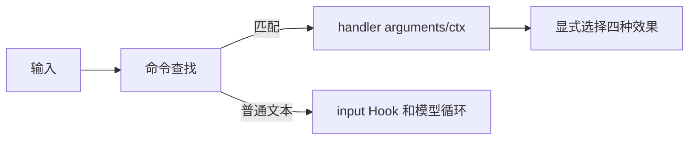
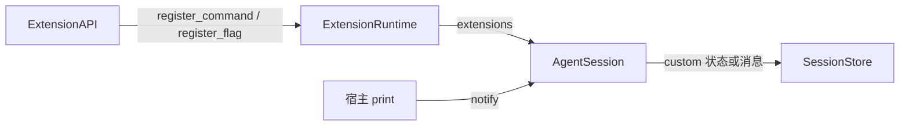

# s10：命令与参数

本章解决“执行了命令，大模型是不是一定知道”的问题。答案取决于命令选择的效果。

## Pi 的设计

参考 Pi `e4c75a732` 的 extensions/loader.ts（registerCommand/registerFlag）、agent-session.ts（sendCustomMessage）和 session-manager.ts（appendCustomEntry）。命令先于 input Hook 分发。命令处理函数返回不自动触发模型。状态 custom 条目用于扩展恢复，不进入模型；custom 消息经 convertToLlm 转换后进入模型。display 只控制显示，trigger_turn 只控制是否启动回合。

## 使用

```python
def setup(api):
    api.register_flag("label", type="string", default="笔记")

    async def note(arguments, ctx):
        ctx.ui.notify("已记录")  # 只有界面效果
        ctx.append_entry("note", {"text": arguments})  # 保存状态，不进入模型
        await ctx.send_message(
            arguments, display=False, trigger_turn=False
        )  # 模型以后可见，不立即运行

    api.register_command("note", note, description="记录笔记")
```

ctx.entries 返回恢复后的条目副本。ctx.send_message(..., trigger_turn=True) 明确启动一次模型回合。/help 列出当前命令，未知 /命令在 CLI 报错；SDK 的 run_command 返回是否匹配，宿主自行决定后续处理。参数在扩展工厂加载完成后解析，处理函数中 get_flag 读取最终值。支持 --flag、--no-flag、--flag=true、--name=value 和 --name value。





## 验证

```powershell
python -m tutorials.s10_commands.code --demo --no-session --no-extensions -e tutorials/s10_commands/example_extension.py --label=记录 --prompt "/note 今天学命令"
python -m pytest tests/test_s10_commands.py --basetemp .sessions/s10-your-random-id -p no:cacheprovider
```

## 参考与差异

- 已对齐：命令和工具独立注册、同扩展最后注册、原始参数文本、独立旗标、UI/状态/模型消息/触发回合分离。
- 待修订：当前跨扩展同名命令仅保留第一个；Pi 同版本会生成 `name:1`、`name:2`，让两个命令都能调用。普通命令异常也缺少 Pi 的错误分发。详见 [复核记录 A04/A05](../../docs/pi-alignment-review.md)，本次仅更正声明，代码尚未修复。
- 调整：Python async send_message 允许调用者等待结果；只支持文本消息，JSONL 自定义条目保持 Python 线性格式。UI 由 notify 注入，没有界面时不打印。
- 暂缓：忙时消息投递与命令上下文等待空闲在 s11，资源命令在 s12，动态注册和 /reload 在 s13；完整 TUI 补全和消息渲染器编号待定。
