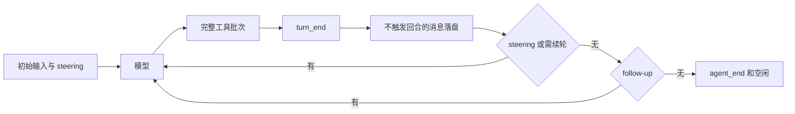
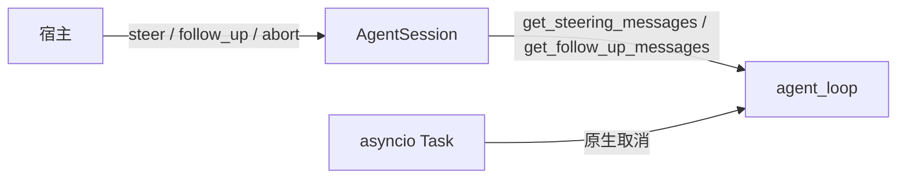

# s10：取消与消息队列

模型运行时仍会收到新输入。本章把这些输入排队，在安全边界进入同一个循环；取消等待当前任务收口。

## Pi 的执行过程

参考 Pi `e4c75a732`：agent.ts 的 PendingMessageQueue、steer/followUp/abort/waitForIdle，agent-loop.ts 的 runLoop；测试 agent.test.ts 与 agent-loop.test.ts。开始前先取 steering，完成整批工具后再取一次；模型准备停止时才取 follow-up。默认 one-at-a-time，一轮只取一条，也可各自设为 all。不会为了响应 steering 跳过同批尚未执行的工具。

## SDK

```python
session.steer("先检查测试")
session.follow_up("完成后再总结")
await session.send_message("供模型以后参考", display=False, trigger_turn=False)
await session.send_message("调整方向", trigger_turn=True, deliver_as="steer")
await session.send_message("下次输入时再用", deliver_as="next_turn")
session.abort()
await session.wait_for_idle()
```

prompt 仍拒绝并发。运行中 trigger_turn=False 的 custom 消息等完整回合结束再保存，不让它插入工具请求和结果之间；它不会单独触发下一轮。next_turn 总是等下一次 prompt/continue_。continue_ 不新增用户文本。取消使用原生任务取消，供应商流先关闭，未完成工具补错误结果，异常仍传播；未投递 steering/follow-up 保留，可用 clear_queues 清除。

wait_for_idle 要等 agent_end 订阅器和持久化都完成；活跃处理函数不能等待自己，避免死锁。CLI 的 Ctrl+C 使用同一取消路径并返回 130；交互终端暂不接入并发键盘读取，SDK 可以在运行时投递。





## 验证

```powershell
python -m pytest tests/test_s10_queues.py --basetemp .sessions/s10-your-random-id -p no:cacheprovider
python -m tutorials.s10_queues.code --demo --no-session --no-extensions --workspace example_project/mini_app --prompt "读取 README.md"
```

## 参考与差异

- 已对齐：双队列时机、默认一轮一条/全部模式、工具批次边界、忙时投递三种选择、末事件空闲屏障。
- 调整：Python 直接取消活跃 asyncio 任务；同步阻塞插件必须自行改为异步，无法强制中止 Python 同步函数。队列为运行期内存，不声称重启恢复。
- 暂缓：资源加载在 s11，重载生命周期在 s12。Pi 的并行工具调度和完整 TUI 交互编号待定。

修订 V2-B014：轮数保护前已出队的输入保存为历史，等待 continue_ 处理；input Hook 接管时显式投递的消息也会保存，不触发模型。仅回补边界 Bug，未加入后章机制。
