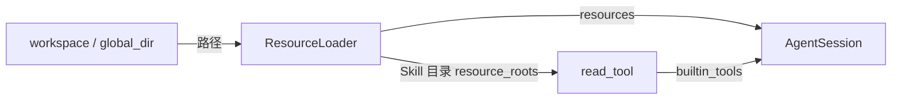

# s11：资源加载

上下文文件提供项目约定，Skill 提供按需流程，模板把常用提示变成 /命令。本章只读取这些资源，不安装或执行 Markdown。

## Pi 怎么运行

参考 Pi `e4c75a732` 的 resource-loader.ts::loadProjectContextFiles、skills.ts、prompt-templates.ts::parseCommandArgs/substituteArgs，以及 agent-session.ts::_expandSkillCommand。扩展命令先匹配；普通输入经过 input Hook，再展开 Skill 和模板，最后进入模型。上下文进入 system；Skill 列表只带元数据，正文按需读取。

## 目录与调用

业务目录内使用 AGENTS.md、.pi-code-agent/skills/<名称>/SKILL.md、.pi-code-agent/prompts/<名称>.md。全局目录为 PI_CODE_AGENT_HOME，结构相同。每层上下文按 AGENTS.override.md、AGENTS.md、CLAUDE.md 等候选顺序只取第一份；同名 Skill/模板先发现的来源优先（全局、项目、显式路径）。

```python
from pi_code_agent import AgentSession, ResourceLoader

resources = ResourceLoader(workspace, global_dir=agent_home).load()
session = AgentSession(model=model, resources=resources)
await session.prompt("/skill:review 检查工具边界")
await session.prompt('/review "src/main.py" tests')
```

Skill 头信息示例：

```yaml
---
name: review
description: 检查工具边界
---
```

disable-model-invocation: true 只隐藏模型列表，用户仍能显式 /skill:review。Skill 正文使用时重新读取；相对引用以 Skill 目录为基准。CLI 把已发现的 Skill 目录注入 read_tool(resource_roots=...)，只放行这些资源和引用，避免为了读取全局 Skill 放开整个用户目录。

模板支持 $1、$2、$@、$ARGUMENTS、${2:-默认值}、${@:2} 和 ${@:2:3}；一次替换，参数里的占位符不二次求值。引号解析对齐 Pi，不执行 shell。YAML 用 PyYAML safe_load，当前环境已有 6.0.3，本轮没有安装依赖。




## 验证

```powershell
python -m pytest tests/test_s11_resources.py --basetemp .sessions/s11-your-random-id -p no:cacheprovider
python -m tutorials.s11_resources.code --demo --no-session --no-extensions --workspace example_project/mini_app --prompt "读取 README.md"
```

CLI 支持 --skill 路径、--prompt-template 路径、--no-resources。后者关闭默认发现，显式路径仍可用。SDK 不隐式扫描；先 load，再注入 session。

## 参考与差异

- 已对齐：上下文候选优先级和层次、元数据渐进加载、禁用模型隐式调用、Skill 显式展开、模板占位符与非递归替换、输入 Hook 在展开前执行。
- 调整：默认 context_root 等于业务 workspace，避免把 Harness 根目录约定混入示例项目；需要祖先继承时显式给 context_root。上下文不递归扫描子目录。Python 资源目录额外受 read 的敏感路径规则约束。坏 Skill 文件记录诊断，显式使用已失效文件则报错，不隐藏读取失败。
- 暂缓：s12 重载资源；完整 gitignore/fdignore、Pi 包管理资源、worktree 主仓库上下文遮蔽编号待定。只遍历资源根，不索引业务源码；名称不合规范但描述有效的 Skill 按 Pi 警告后保留。

修订 V2-B014：轮数保护前已出队的输入保存为历史，等待 continue_ 处理；input Hook 接管时显式投递的消息也会保存，不触发模型。仅回补边界 Bug，未加入后章机制。
