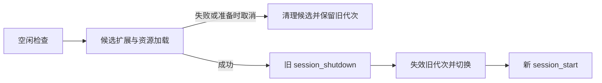
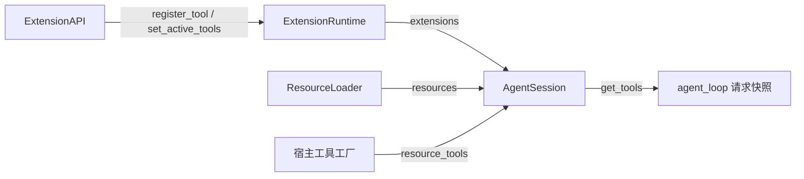

# s12：动态工具与重载

本章让扩展在运行期间注册/切换工具，并让修改后的扩展和资源真正生效。重载失败保留当前可用版本。

## Pi 的过程

参考 Pi `e4c75a732` 的 agent-session.ts::setActiveToolsByName/_refreshToolRegistry/reload、extensions/loader.ts 和 runner.ts；重点回归 `6162-extension-active-tools-next-turn.test.ts`。工具切换在下一次模型请求生效，同一回答已经请求的整批工具使用固定目录。重载通知 session_shutdown(reason=reload)，失效旧 API，再启动新代次。

## SDK 与扩展示例

```python
def setup(api):
    async def switch(arguments):
        api.set_active_tools(["read"])
        return api.ToolResult("下一轮只启用 read")

    api.register_tool(api.Tool("switch", "切换工具", switch))
    api.on("session_start", lambda event, ctx: ctx.ui.notify("扩展启动：" + event["reason"]))


session.set_active_tools(["switch", "read"])
await session.prompt("先切换工具")
await session.reload()  # 空闲时调用；CLI 使用 /reload
await session.aclose()  # 关闭扩展，借用的模型客户端仍由宿主管理
```

动态注册、命令、Hook、参数只允许 loading/active 的 API 使用；关闭和失败代次不能继续注册。get_active_tools 返回启用名称；未知名称忽略，重复去重。默认工具集包含已注册目录；显式选择后新工具要显式启用。

核心每次请求前调用 get_tools，固定工具定义和执行目录，因此某工具切换 active 集合不会让同批另一个工具突然消失。SDK 显式工具覆盖仍最高。重载保留消息、存储、队列、参数值和显式启用集合；变化的参数类型拒绝迁移。

## 重载与失败

先重新发现文件/重跑工厂、加载候选资源并检查，再通知旧代次关闭，随后无等待切换引用，发新 session_start。候选失败或准备期间取消会清理候选模块，保留旧代次。生命周期普通异常进入 diagnostics；切换后的通知失败不承诺撤销已经发生的外部副作用。

文件扩展拥有唯一包名；自有子模块使用 FreshSourceLoader 读取源码，避免“同一秒、同样长度”的 helper.py 修改被旧 pyc 掩盖。不更改 sys.path，不清理其他应用模块。Python 仅支持 UTF-8 源码扩展。

Hook/命令上下文是带代次检查的 ExtensionContext，ctx.session 返回同一视图。重载后不要用捕获的旧 ctx、方法或 ui.notify；在新事件中重新获取。上下文属性实时读取会话，不保存旧的消息列表。

ResourceLoader 重载后，CLI 的 resource_tools 工厂重建 read_tool 的 Skill 资源根；SDK 可注入同名工厂重建自己的资源依赖。没有这个工厂时宿主工具按调用者原样保留。





## 验证

```powershell
python -m pytest tests/test_s12_reload.py --basetemp .sessions/s12-your-random-id -p no:cacheprovider
python -m tutorials.s12_reload.code --demo --no-session --no-extensions --prompt /reload
```

## 参考与差异

- 已对齐：动态注册、下一请求工具切换、同批快照、启停 reason、旧代次失效、资源重新发现、旗标值延续。
- 优化：Pi 当前先停旧运行时再重建；这里先验证候选，使加载失败时仍能用旧工具。实际回归覆盖坏工厂、坏 YAML、同秒同长度 helper 修改和旧上下文调用。
- 调整：忙时重载拒绝；宿主可从另一任务 await wait_for_idle 后调用。不能撤销工厂自行执行的外部副作用，原生同步阻塞代码无法强制取消。动态供应商注册、热换模型客户端和跨进程扩展隔离编号待定；当前自定义模型沿用 Model/StreamingModel 注入。
- 暂缓专题：会话树/分支、压缩恢复、完整 TUI 编号待定。本轮扩展基座到此形成闭环，后续功能应优先通过已有扩展接口实现。
