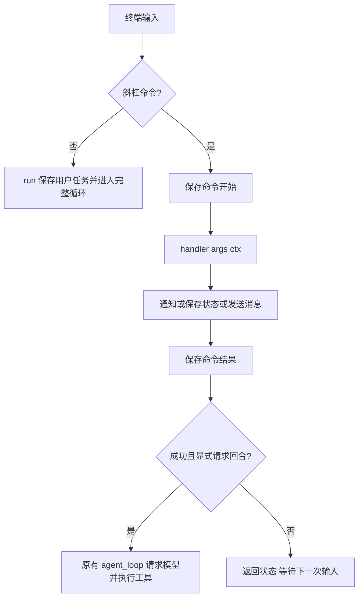
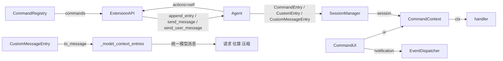

# s18：命令注册与结果去向

s17 统一配置，本章对齐 Pi 的命令机制：handler 显式选择界面通知、扩展状态、模型消息和回合触发。命令日志保存审计事实，模型只接收明确发送的消息。

## 问题与 Pi 的执行过程

同一个 `/status` 可能只显示状态，也可能保存笔记、通知模型或请求模型继续。四件事分别控制，才能适应 CLI 和 SDK。不能因为需要审计历史，就把所有操作强制变成模型上下文。

本地参考 Pi `e4c75a732`，包版本 `0.85.1`：

1. `core/extensions/loader.ts` 的 `registerCommand` 把名称与 handler 放入 Map。
2. `core/agent-session.ts` 的 `_tryExecuteExtensionCommand` 解析名称与参数，调用 `handler(args, ctx)`。
3. handler 使用 `ctx.ui.notify`、`appendEntry`、`sendMessage`、`sendUserMessage` 选择效果。
4. `sendCustomMessage` 决定保存、投递或启动模型，`messages.ts` 的 `convertToLlm` 只把模型可见消息转换成 user 消息。

本章采用 Python 同步移植，来源与 MIT 声明见 [第三方归属](../../docs/third-party-notices.md)。`code.py` 保留 s17 完整核心循环，基础组件由正式包提供。

## 组件与实际接口

| 接口或记录 | 用途 | 模型可见 |
|---|---|---|
| `handler(args, ctx)` | args 是命令后原样参数文字；ctx 提供 ui 和 session | 由 handler 决定 |
| `ctx.ui.notify(text, level)` | 发送界面通知，CLI 打印，SDK 消费事件 | 否 |
| `api.append_entry(custom_type, data)` | 保存独立 JSON 状态 CustomEntry | 否 |
| `api.send_message(content, display=True, trigger_turn=False, ...)` | 保存 CustomMessageEntry；details 是独立 JSON 元数据 | 只有 content |
| `api.send_user_message(content)` | 保存真正的用户文本，并请求模型回合 | 是 |
| `CommandEntry` | 开始、成功或失败的命令审计 | 否 |

`display` 只控制展示；`trigger_turn` 控制是否请求模型继续。`display=False` 的消息仍然进入模型上下文。明确发送的正文会占用后续模型 Token；通知和私有状态不进入 Token 估算、摘要或请求。

`CommandRegistry` 校验名称、拒绝重名并生成真实帮助。`Agent.execute_command` 执行 handler，返回 `CommandResult(is_error, error)`。handler 自身通过效果 API 输出并返回 None，不再强制返回两份文字。

内置 `/help`、`/stats` 和 Todo 扩展 `/todos` 默认只通知用户。三个命令不接受参数，但扩展 handler 可以自行解析 args。名称区分大小写，不带斜杠注册；未知命令返回失败，不调用模型。

## 阅读与教学顺序

先读 `commands.py` 的注册与上下文，再读 `Agent.execute_command` 追踪效果和触发时序，接着读 `extension_entries.py`、`_model_context_entries` 理解日志与模型协议边界，最后核对 `TodoExtension.show_todos`、main 和测试。

一次 `/todos`：保存 started → handler 读取同一份 Todo → notification 显示清单 → 保存 succeeded → 返回。没有模型消息或新工具调用。Todo 重启恢复仍依赖工具结果 details，不从通知或摘要恢复。

这里的模型回合指运行一次 Agent 循环，可能包含多次模型请求和工具调用。一次会触发模型的扩展命令：handler 保存消息并标记触发意图 → handler 返回 → 保存命令结束 → 调用同一个 agent_loop。命令期间不重入 run；多次触发意图合并为随后的一次回合，已保存消息按顺序一起进入上下文。

## SDK 与扩展示例

以下函数可放入可信扩展模块，使用既有 `agent.register_extension(register)` 加载：

```python
def register(api):
    def note(args, ctx):
        if not args:
            raise ValueError("用法：/note <内容>")
        api.append_entry("note", {"text": args})
        ctx.ui.notify("笔记已保存")

    def tell(args, ctx):
        api.send_message(args, custom_type="status", display=False)
        ctx.ui.notify("已保存给模型的消息，等待下一次任务")

    def ask(args, ctx):
        api.send_user_message(args)

    api.register_command("note", note, description="保存私有笔记")
    api.register_command("tell", tell, description="发送下一次模型可见的消息")
    api.register_command("ask", ask, description="向模型发送任务并继续")
```

这里的嵌套函数是独立的扩展回调，捕获当前 api，不是为减少几行代码增加的运行流程包装。JSON 状态从 `api.session.load_entries()` 中的 CustomEntry 恢复，日志中的历史记录不会自动执行 handler。

宿主已经创建 agent 时，也可直接调用 `agent.send_message("事实", display=False, trigger_turn=True)`；空闲时立即请求模型。`send_user_message` 始终请求一轮，SDK 的 `run` 仍不会自动解释斜杠输入。

## 失败与边界

- 普通 handler 异常记录 failed 并发送错误通知，不兑现该 handler 请求的模型回合；已保存的消息和状态保留，不承诺事务回滚。
- 保存开始失败不执行；保存结果、状态或消息失败关闭入口并抛 SessionPersistenceError。先保存消息，再展示，避免公布未保存事实。
- 中断或致命观察者错误可能只留 started，表示完成情况未知；恢复只读取，不自动重放。审计本身不会污染模型上下文。
- 命令成功后模型回合仍可能失败；命令状态与模型任务结果分别判断，模型异常向 SDK 调用方传播。
- 命令与任务共享单任务检查，模型运行期间拒绝插入消息，避免打断 tool_use/tool_result 配对；不参与协议的私有状态仍可独立追加。队列章节（编号待定）再实现忙时投递。
- 当前正文沿用文本 SDK，未实现多模态消息；多模态章节编号待定。UI 目前只有通知，完整 TUI 与自定义渲染编号待定。

## 运行流程



## 组装结构

箭头表示左侧提供依赖或数据，不表示执行顺序。



## 运行与验证

本章不新增依赖。配置仍由启动目录 .env 和进程环境提供。

```powershell
python -m tutorials.s18_commands.code --help
# 填好现有模型配置后运行；教程默认加载 Todo 扩展
python -m tutorials.s18_commands.code --workspace .
python -m pi_code_agent --workspace . --extension pi_code_agent.extensions.todo
```

依次输入 `/help`、`/stats`、`/todos` 可查看结果；输入 q 退出。构造 CLI 仍要求合法模型配置，三个查询命令本身不请求模型。

```powershell
$testTemp = Join-Path ([System.IO.Path]::GetTempPath()) ("p18-" + [guid]::NewGuid().ToString("N").Substring(0, 8))
if (Test-Path -LiteralPath $testTemp) { throw "测试目录已存在" }
python -m pytest tests/test_s18_commands.py --basetemp $testTemp -p no:cacheprovider
python -m ruff check --no-cache src tests tutorials examples
```

离线测试覆盖四种 display/trigger 组合、真实 CLI 路由、参数、状态复制和恢复、主动回合、错误不自动触发、Token 估算和压缩、工具配对、存储与观察者故障、关闭和中断。不是对真实模型或 Docker 的验证。

## 已对齐、暂缓与扩展

- 已对齐：Pi 注册命令、args/ctx、通知、独立状态、显式模型消息、display、triggerTurn、用户消息。它们解决结果去向混淆；s18 在正式实现和教学快照共同验证。
- 扩展或优化：保留命令审计，未知命令和重名明确拒绝；同步 handler 完成及审计后再兑现触发意图。Pi 可在异步 handler 内投递，本项目采用上述时序以保持同步单任务边界，由回合顺序与失败测试验证。
- 暂缓：Pi 的 Steer/Follow-up、会话切换、异步 handler、TUI 渲染和多模态。各能力在对应后续章节落实，编号待定；不提前接受无作用的参数。未知斜杠向模板或 Skill 回退随 s21/s22 资源接线验证。
- lcc 的显式 REPL 分支解决人工命令先于模型处理的问题。本章保留清晰分支，实际效果由共享 SDK 入口处理；s18 入口测试验证。

下一章 s19 实现扩展启动参数，区分启动时配置与运行时命令。
