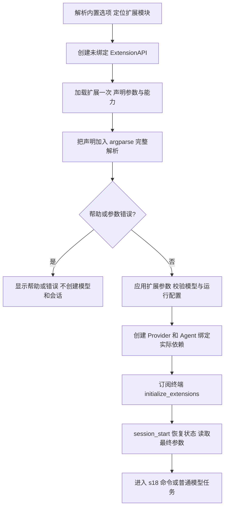
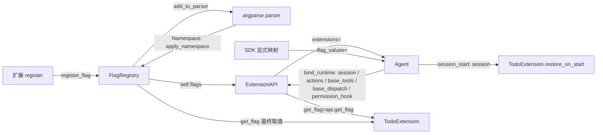

# s19：扩展启动参数

s18 让 handler 选择执行效果；s19 解决启动时如何配置扩展。运行时命令的 args 与程序启动参数是两个入口：`/todos` 是命令，`--todo-heading 学习清单` 是配置。

## 问题与 Pi 的执行过程

扩展提供自己的参数，主程序事先不知道完整清单。如果先完整解析 CLI，就会把合法扩展选项当成未知参数；如果为了解析再加载一次扩展，会重复注册 handler 和事件。

本地 Pi 参考提交 `e4c75a732`、包版本 `0.85.1`：`core/extensions/loader.ts` 的 registerFlag 收集类型和默认值，getFlag 从运行时读取值；`cli/args.ts` 收集未知参数；`core/agent-session-services.ts` 的 applyExtensionFlagValues 在加载声明后校验应用；扩展在 session_start 或执行时读取最终值。`examples/extensions/plan-mode/index.ts` 在 session_start 读取 plan 参数，是这个时序的实际例子。

本章沿用“声明 → 应用值 → 运行”的机制，使用 argparse 两次解析，但**扩展 register 只调用一次**。许可与来源见 [第三方归属](../../docs/third-party-notices.md)。

## 本章实现与阅读顺序

1. `flags.py`：ExtensionFlag、FlagRegistry 的声明、类型、默认值、覆盖与帮助。
2. `registry.py`：ExtensionAPI 可以先用于声明，再通过 bind_runtime 注入真实工具、权限和 Session。
3. `main()`：第一遍定位扩展，加载并注册选项，第二遍完整解析；之后才读取模型配置和创建资源。
4. `Agent.initialize_extensions()`：最终校验并固定参数，发送一次 session_start，完成状态恢复。
5. `extensions/todo.py`：参数实际改变标题与进度展示，不只是声明一个无作用的开关。

`code.py` 保留 s18 的完整循环与本章 Agent；共享组件来自正式包，正式包不导入教程。本章新增机制是扩展启动参数，声明/绑定分离及一次启动事件为该机制服务，不增加取消、重载或队列空接口。

## 参数接口与规则

```python
api.register_flag("label", type="string", default="默认标签", description="展示标签")
api.register_flag("enabled", type="boolean", default=True, description="是否启用展示")
# handler 或 session_start 中读取；声明期间尚未应用 CLI 覆盖
label = api.get_flag("label")
```

- 支持 boolean、string；默认值与显式值按声明类型校验。未声明名称返回 None，对应 Pi 的 undefined。
- CLI 显式值优先于声明默认值；SDK 使用 flag_values 映射。未设置默认值时为 None。
- boolean 使用 `--enabled` 与 `--no-enabled`，省略时保留默认值；string 支持 `--label value` 与 `--label=value`，允许显式空字符串。相同参数重复出现时 argparse 使用最后一次。
- 名称不带 `--`，使用小写字母开头、最长 64 字符的标识符。重名、内置选项冲突及 boolean 自动反向选项冲突都明确拒绝。
- 未知参数和缺失值在 CLI 创建模型/会话之前失败；帮助包含实际选中扩展的参数，不要求模型配置。
- SDK 可以在注册前提供 flag_values，注册后首次初始化校验未知名称。默认构造 Agent 已经创建空会话，因此 SDK 未知参数保证的是首条任务保存前拒绝；预加载声明注入可在创建会话前完成校验。
- 参数在一次初始化后固定；新增参数、改变覆盖值需要创建新实例。运行时热重载属于生命周期章节，编号待定。

扩展是可信宿主 Python 模块。`--help --extension MODULE` 也需要导入模块并执行一次声明函数，但本项目不会为帮助创建 Provider 或 Session；不能把加载可信代码描述成 OS 隔离。

## Todo 的实际行为

| 参数 | 默认值 | 实际消费位置 |
|---|---|---|
| `--todo-heading VALUE` | 任务 | TodoExtension.show_todos 通过 get_flag 查询，改变人工查看标题 |
| `--todo-progress / --no-todo-progress` | True | TodoExtension.show_progress 通过 get_flag 查询，控制已保存进度通知 |

参数不改变模型 todo 工具的状态、权限或调用计数。数据恢复仍使用工具 details；展示配置不从旧会话恢复，重启时使用本次显式参数或默认值。

声明时没有会话，不能调用 api.session、get_tool_details、基础工具或消息动作。Todo 在 session_start 读取事件提供的真实 Session 并恢复。旧教学入口已经绑定会话时继续支持注册时恢复，保留早期章节可运行性。

## SDK 的两种组装方式

以下为接线片段，Provider 与已有 workspace 由宿主提供。

```python
from pi_code_agent import create_agent
from pi_code_agent.extensions.todo import register

agent = create_agent(
    provider=provider,
    workspace=workspace,
    flag_values={"todo-heading": "学习清单", "todo-progress": False},
)
agent.register_extension(register)
agent.initialize_extensions()
agent.execute_command("/todos")
```

CLI 使用预加载声明方式，避免二次执行扩展：

```python
from pi_code_agent import ExtensionAPI, create_agent
from pi_code_agent.registry import load_extensions

extensions = ExtensionAPI()
load_extensions(extensions, ["pi_code_agent.extensions.todo"])
agent = create_agent(
    provider=provider,
    workspace=workspace,
    extensions=extensions,
    flag_values={"todo-heading": "学习清单"},
)
agent.initialize_extensions()
```

同一容器只能绑定一个 Agent。main 在绑定后先订阅终端，再初始化，所以扩展可被观察。SDK 忘记显式初始化时，首次 run、execute_command 或主动消息回合会自动初始化；无模型触发的状态保存和消息保存仍可独立使用。

session_start 只发送一次。启动回调可恢复状态、保存私有数据和显式发送消息；trigger_turn 或用户消息请求的回合在全部启动观察者完成后统一执行。回调期间仍禁止重入 run。初始化异常或中断会关闭实例并抛出，不能以部分初始化状态继续；已完成初始化后的模型回合失败按任务错误传播。实现与回归见 B039。

## 运行流程



## 组装结构

箭头表示左侧向右侧提供依赖或数据，不表示执行顺序；名称对应真实字段或参数。



## 运行与验证

本章不增加依赖。以下两条帮助命令不需要模型配置：

```powershell
python -m tutorials.s19_extension_flags.code --help
python -m pi_code_agent --extension pi_code_agent.extensions.todo --help
# 配好原有模型配置后运行；输入 /todos 查看标题，q 退出
python -m tutorials.s19_extension_flags.code --workspace . --todo-heading 学习清单 --no-todo-progress
python -m pi_code_agent --workspace . --extension pi_code_agent.extensions.todo --todo-heading 学习清单 --no-todo-progress
```

```powershell
$testTemp = Join-Path ([System.IO.Path]::GetTempPath()) ("p19-" + [guid]::NewGuid().ToString("N").Substring(0, 8))
if (Test-Path -LiteralPath $testTemp) { throw "测试目录已存在" }
python -m pytest tests/test_s19_extension_flags.py tests/test_s18_commands.py --basetemp $testTemp -p no:cacheprovider
python -m ruff check --no-cache src tests tutorials examples
```

测试使用真实入口、工具/会话组件和离线 Provider：验证帮助、覆盖、boolean 关闭、string 标题、只加载一次、错误早拒绝、SDK 未知字段、容器单次绑定、状态恢复、基础权限与启动中断。不代表真实模型、Docker 或网络验证。

## 已对齐、暂缓与扩展

- 已对齐：Pi 的 registerFlag/getFlag、boolean/string 类型、默认值、显式覆盖、先收集声明后应用值、初始化阶段读取配置。它们解决未知扩展参数与声明阶段缓存旧值的问题；s19 的 CLI/SDK 和 Todo 行为测试共同验证。
- 扩展或优化：Python argparse 两遍解析但只执行一次 register；参数帮助无需模型配置和会话；boolean 增加明确的反向开关；冲突报错，区别于本地 Pi 对跨扩展同名参数保留首个。当前共享容器统一命名，不提供每扩展私有参数视图；以重名测试验证边界。
- 暂缓：参数热重载、异步启动回调、运行期间会话替换，留到生命周期/会话章节，编号待定；没有预置空方法或假投递选项。
- lcc 的显式组装用于保持 main 可读，本章仍按声明和配置、功能组件、运行时绑定、交互入口展开，完整循环保持 s18。

下一章 s20 接入根 AGENTS.md，随后 s21 统一 Skills 来源、s22 接入提示词模板。生命周期、取消和消息队列按后续教学推进，编号待定。
